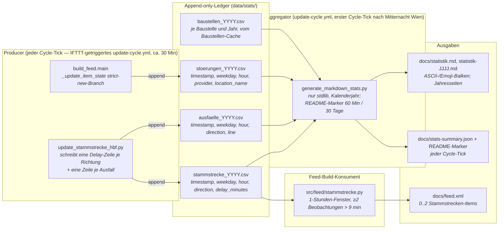

[Architektur-Karte — Wien ÖPNV Feed](architecture.md), Teil 10.

## 6. Statistik- und Dashboard-Pipeline

Drei Append-only-CSV-Ledger unter `data/stats/` fangen jede relevante
Beobachtung ein, sobald sie auftritt. Sie bedienen **zwei Konsumenten**
mit unterschiedlichen Fenstern: das tägliche Markdown-Dashboard
(`docs/statistik.md`, Kalenderjahr) plus die vier README-STATS-Marker
(`STATS:STAMMSTRECKE[_LIVE]` und `STATS:AUSFAELLE[_LIVE]`, 60-Min- und
30-Tage-Snapshots), sowie den RSS-Feed selbst (Stammstrecken-Sektion,
1-Stunden-Fenster — siehe
[`docs/reference/stammstrecke_provider_logic.md`](reference/stammstrecke_provider_logic.md)).
Der Hot-Path-Build blockiert nie auf Observability-I/O — beide
Konsumenten tolerieren fehlende oder fehlerhafte Zeilen kulant. Jedes
abgeschlossene Jahr mit Zeilen in diesen drei Ledgern hat eine Seite
`docs/statistik-<Jahr>.md`, die jeder Dashboard-Lauf mit ihren Ledgern abgleicht,
mit Jahresüberblick und den Baustellen aus einem vierten Ledger,
`baustellen_<Jahr>.csv` (mit dem Baustellen-Cache geschrieben), samt einem
geprüften Rückblick von Gemini ([Teil 15, §12](architecture-teil-15.md#12-die-jahresseite-der-statistik-überblick-baustellen-rückblick-seit-2026-11-10)).

### Architektur-Ziele

| Ziel | Verwirklicht durch |
| --- | --- |
| **CI/CD-Entkoppelung** — `docs/statistik.md` wird nur auf den Cycle-Ticks zwischen 00:00 und 00:29 Wiener Zeit neu gerendert (in der Regel einer am Tag), gegated durch einen `TZ=Europe/Vienna date +%H%M`-Check in `scripts/cycle/refresh_stats.sh` (bis 2026-11-14 inline in `update-cycle.yml`); die README-STATS-Marker und `docs/stats-summary.json` werden bei jedem ca. 30-Min-Cycle-Tick aktualisiert (`--skip-dashboard`); der Lauf nach Mitternacht schreibt auch die Jahresseiten und fragt zuletzt Gemini nach einem fehlenden Rückblick (Teil 15, §12) | `.github/workflows/update-cycle.yml`, Step „Refresh statistics dashboard and README snapshot" mit `scripts/cycle/refresh_stats.sh` (der separate `generate-stats.yml`-Workflow wurde zusammen mit den per-Provider-Escapes entfernt; Ad-hoc-Regenerationen laufen jetzt über `manual-full-refresh.yml`) |
| **Strikt null Data-Science-Abhängigkeiten** — kein `numpy`, `pandas`, `matplotlib`; die CI-Installation bleibt sub-sekundär | `scripts/generate_markdown_stats.py` kommt ohne externe Data-Science-Pakete aus — nur Python-Standardbibliothek (u. a. `csv`, `datetime`, `statistics`, `zoneinfo`) und projekteigene `src.*`-Module |
| **Append-only, lock-freie Producer** — Einzelzeilen-Writes sind unter POSIX bis `PIPE_BUF` (4 KiB) atomar, parallele Cycle-Ticks können also nicht mitten in einer Zeile Bytes verschachteln | `src/utils/stats.py:_append_row` (Modus `"a"`, kein `flock`) |
| **Eine Zeile je Auftreten** — eine langlebige Meldung wird einmal aufgezeichnet, nicht einmal pro Build; eine wiederkehrende WL-Meldung (gleiche guid, neues Auftreten) zählt bei jedem Auftreten neu | `src/feed_build/item_meta.py:_update_item_state` schreibt beim State-Cache-Miss (weder `_identity` noch `guid` hatten einen Vorgängereintrag) und bei einem Eintrag, den `_restart_recurring_occurrences` als neues Auftreten markiert hat (`new_occurrence`), jeweils beim ersten Erscheinen im Feed |
| **Idempotente, byte-stabile Ausgabe** — ein erneuter Aggregator-Lauf auf identischer Eingabe erzeugt byte-identisches Markdown, damit der Commit-Schritt der Workflows (`scripts/publish_to_main.sh`) zum No-op wird, wenn sich nichts geändert hat | Stabiler Sekundär-Sort (alphabetische Tie-Breaks, z. B. `key=lambda pair: (-pair[1], pair[0])` in `_format_providers_section`, `_format_ausfall_directions_section`, `_format_ausfall_lines_section`) in jeder Rangliste; der Renderer liest `now()` nur für den Zeitstempel im Header |
| **Per-Jahr-Datei-Rotation** — die einzelne Ledger-Größe bleibt auch über Mehrjahres-Betrieb beschränkt | Dateiname wird aus dem Wien-lokalen `timestamp.year` der Zeile abgeleitet, nicht aus der Prozess-Uhr |

### Resilienz-Schichten

Die Producer sind Observability, keine Kern-Funktionalität, deshalb
ist jeder Fehlerpfad **best-effort, no-throw**: ein `OSError` aus dem
Writer wird auf WARNING geloggt und verschluckt. Produktions-Pipelines
crashen nie, weil die Platte vollgelaufen ist.

Der Aggregator hingegen ist der Engpass, der *nicht vertrauenswürdige*
Bytes von der Platte lesen muss (eine im CI-Runner manipulierte
riesige CSV ist das kanonische Threat-Modell). Drei gestaffelte
Verteidigungslinien decken ihn ab:

1. **Begrenzte Reads** — jede CSV wird über `read_capped_text` geladen
   (`open` + `fstat` auf den offenen Filedescriptor + gedeckeltes
   `read(MAX_CSV_BYTES + 1)`) und über `csv.reader` über einem
   In-Memory-`io.StringIO` geparst. Das „kein bares
   `csv.reader(handle)` in `src/` oder `scripts/`"-Invariant ist über
   `tests/test_sentinel_csv_size_bomb.py` durchgesetzt.
2. **Toleranz gegenüber fehlerhaften Zeilen** —
   `_parse_stammstrecke_rows` / `_parse_stoerung_rows` /
   `_parse_ausfall_rows` überspringen einzelne Zeilen, die
   `fromisoformat` oder `float()` werfen. Ein fehlerhaft editierter
   Eintrag legt nicht das ganze Dashboard lahm.
3. **Atomarer Dashboard-Write** — das gerenderte Markdown landet via
   `src.utils.files.atomic_write` auf der Platte. Ein Kill-Signal
   mitten im Render-Vorgang kann das vorhandene Dashboard nicht durch
   eine halbgeschriebene Datei ersetzen.

### Test-Isolation

Die Produktion-Writer defaulten via `src.utils.stats.DEFAULT_STATS_DIR`
auf `<repo>/data/stats/`. Eine autouse-Fixture `isolate_stats_writes`
in `tests/conftest.py` monkey-patcht diese Konstante für **jeden** Test
auf einen per-Test-`tmp_path`, sodass jeder Test, der transitiv einen
Hot-Path triggert, der Statistik schreibt (der
`_update_item_state`-strict-new-Branch, die
Stammstrecken-Processing-Schleife) den committeten CSV-Ledger nicht
verunreinigen kann. Tests, die explizit ein anderes `stats_dir` ansetzen
(die dedizierten Unit-Tests in `tests/test_utils_stats/`), bleiben
unberührt, weil das explizite Keyword innerhalb von `stats_path` immer
gewinnt.

### Woher das Live-Dashboard seine Zahlen nimmt

`docs/site.html` las die drei Jahres-Ledger bis 2026-09-14 direkt von
`raw.githubusercontent.com` und verdichtete sie im Browser — rund
**705 KB pro Seitenaufruf** (und über das Jahr wachsend), um ein paar
KPI-Kacheln und Balken zu zeichnen. Seit Audit-Befund **E.3** schreibt
`scripts/generate_markdown_stats.py` bei jedem Tick zusätzlich
`docs/stats-summary.json` (~3 KB, feste Dimensionen: 7 Wochentage,
24 Stunden, eine Handvoll Provider, Linien und Richtungen) und die Seite
rendert ausschließlich daraus. Zwei Konsequenzen über die Bytes hinaus:

* **Gleiche Origin.** `raw.githubusercontent.com` ist kein
  Auslieferungs-CDN, hat eigene Rate-Limits und liegt außerhalb der
  Pages-Zusage. Der Host steht deshalb nicht mehr im `connect-src` der
  Seite.
* **Eine Rechenstelle.** Kennzahlen wie „kritische Verspätungen"
  (`delay_minutes > DELAY_THRESHOLD_MINUTES`) werden nur noch in Python
  gebildet; die frühere JS-Zweitimplementierung — die Quelle einer
  echten Drift (`>=` auf der Website, `>` im Backend) — ist entfallen.

Die Roh-Ledger bleiben unverändert unter `data/stats/` und sind auf der
Seite weiterhin verlinkt. `SUMMARY_SCHEMA_VERSION` versioniert das
Format; die Seite verweigert ein unbekanntes, statt eine halbe
Auswertung zu rendern. `archive_years` (seit 2026-11-10, Jahre mit Seite)
kam ohne neue Version dazu; fehlt es, bleibt die Jahreswahl verborgen.

**Leeres Live-Fenster: „Keine Fahrten“ oder „N/A“ (Entscheidung Michael,
2026-10-30).** Die Live-Kachel „Ø Verspätung Stammstrecke“ und der
README-Block `STATS:STAMMSTRECKE_LIVE` zeigen den Mittelwert der letzten
60 Minuten. Liegt darin keine Beobachtung, zeigen beide „Keine Fahrten“
(EN „No trains“), wenn der letzte erfolgreiche Abruf des Monitors
(`coverage.poll.last_success`) im selben 60-Minuten-Fenster liegt: Der
Abruf lief, gefahren ist kein Zug (Nachtpause oder alle Züge der Stunde
ausgefallen, so am 30.10. 15:00–16:00 bei einem Gleisschaden zwischen
Meidling und Liesing). Ohne einen solchen Abruf wurde nichts gemessen, und
die Anzeige bleibt „N/A“. Die Grenze ist das Live-Fenster, nicht die drei
Stunden des Health Checks. Python (`_live_fetch_covers`) und Seite
(`renderStammstreckeLiveTile`) prüfen dieselbe Regel; die Seite misst gegen
die Uhr des Browsers, damit ein liegengebliebener Stand nicht weiter
„Keine Fahrten“ behauptet.

### Was das Dashboard beantwortet

| Frage | Sektion in `docs/statistik.md` |
|---|---|
| **Wann** treten Stammstrecken-Verspätungen auf? | „Stammstrecke" — Wochentag- und Stunden-Verteilung sowohl der Beobachtungszahl als auch der mittleren Verspätung |
| **Wie häufig** fallen auf der Stammstrecke Züge aus? | „Ausfälle" — per-Richtung- und per-Linien-Tabellen plus Wochentag- und Stunden-Verteilung |
| **Wann** bündeln sich Disruption-Events? | „Störungen" — per-Provider-Tabelle plus Wochentag- und Stunden-Verteilung |

`extract_location_name` ist weiterhin Teil der Producer-Pipeline (siehe
`src/utils/stats.py` und `src/feed_build/item_meta.py`) und persistiert die
abgeleitete Location pro Disruption-Zeile in
`data/stats/stoerungen_<YYYY>.csv`. Die aktuelle Dashboard-Renderung
aggregiert die Daten allerdings nur nach `provider`, `weekday` und
`hour` (siehe `aggregate_stoerungen` in
`scripts/generate_markdown_stats.py`) — eine frühere „Top-5
Hotspots mit Stundenprofil"-Sektion wurde entfernt, die Roh-Daten in
der CSV bleiben aber für Ad-hoc-Analysen erhalten. Die Heuristik selbst
ist katalog-zentriert: Ein Kandidat wird nur zurückgegeben, wenn er
über die kuratierte Verzeichnisdatei `data/stations.json` (`station_info`)
auflösbar ist. In dieser Reihenfolge versucht sie — (1)
`| Haltestelle:` (WL-`relatedStops`, erster Eintrag, verbatim
akzeptiert), (2) `| Station:` / `| Location:` (WL-Extras), (3)
`in Richtung X` (Stammstrecke-Renderer), (4) `zwischen X und Y`
(ÖBB-Phrasierung, Capture Group 1), (5) `Wien <Stadtteil>`, (6) einen
Sliding-Window-Verzeichnis-Scan über Titel + Beschreibung; der Scan
nimmt nur einen Stationsnamen, keinen Code und keine ID
(`station_named_in_text`, seit 2026-10-05, vorher stand etwa „am
Olympiaplatz“ unter der WL-Haltestelle „Am Bahnhof“). Einziger
Fallback ist `"unbekannt"`; einen Freitext-/Token-Fallback samt
Stoppwortliste gibt es bewusst **nicht** mehr (die Freitext-Regex-
Matches wurden 2026-05-09 entfernt, weil deutsche Substantive durchweg
großgeschrieben sind und Störungstypen wie `Demonstration Linie`
fälschlich als Haltestellen akzeptiert wurden). So rendert das Dashboard
auch bei adversarial Provider-Input noch.

### Gestaltung des Live-Dashboards (Kacheln, 2026-10-17)

Michael am 17.10.2026 zu `site.html`: „Der Aufbau selbst ist gut. Ich mag
auch die Farben. Der kleine Zug ist ein Hingucker und die Fußzeile ist, mit
dem Hintergrund, auch in Ordnung. Die Kacheln selbst sehen aber ziemlich
generisch aus.“ Daraus folgt, was bleibt und was neu ist:

* **Bleibt, auf seinen Wunsch:** Aufbau und Reihenfolge der Sektionen,
  Farbpalette (alle Tokens in `:root`), der fahrende Zug, Kopfzeile und die
  Fußzeile mit Foto-Hintergrund. HTML und JavaScript sind unverändert; die
  Änderung steckt allein im Stylesheet (seit 2026-11-02 die Teile in
  `docs/assets/site-css/`) und dem daraus erzeugten `site.min.css`.
* **Neu: Jede Kachel trägt die Farbe dessen, wofür sie steht.** Eine Meldung
  hat die Farbe ihrer Quelle als `--src` (Randstreifen links, ein Hauch der
  Farbe hinter dem Etikett, das Etikett selbst in der Quellfarbe; ein
  farbiger Punkt steht im passenden Filter-Chip). Das Etikett trägt seit
  dem 30.10.2026 keinen Punkt mehr (Michael: „Bitte entferne den Punkt aus
  den 'Pillen'“), nur noch den Namen der Quelle; der Punkt im Filter-Chip
  bleibt. Im Dunkelmodus sind das die dunkleren
  Markenrot-Varianten, die schon vorher für die weiße Etikettschrift galten
  (Kontrast ≥ 6:1).
* **Neu: Jede Statistik-Sektion hat einen Ton** (`--tone`): Störungen Blau,
  Stammstrecken-Verspätungen Orange, Ausfälle Rot, also die Farbe ihrer
  Balken. Der Ton färbt das Quadrat vor der Überschrift, den Schimmer und das
  Quadrat der Kennzahl-Kacheln, den Strich unter jedem Diagrammtitel und das
  Hover-Band einer Balkenzeile. Die Live-Kachel „Ø Verspätung Stammstrecke“
  nimmt den Ton der Sektion, auf die sie verlinkt, und trägt einen
  pulsierenden Live-Punkt.
* **Neu: Beginn, Bis und Erstmals** stehen als kleine Kapseln unter dem
  Meldungstext statt als lose Textzeile.
* **Bewegung:** Kacheln blenden beim Rendern kurz nacheinander ein, Meldungen
  heben sich bei Hover an (nur mit Maus). Alles nur über `opacity` und
  `transform`, also ohne Layout-Verschiebung; bei
  `prefers-reduced-motion: reduce` ist beides aus.
* **Behoben dabei:** Der aktive Filter-Chip nutzte `--c-brand` als
  Hintergrund, das im Dunkelmodus die Seitenfarbe ist; „Alle“ war dort nicht
  als aktiv erkennbar. Er nutzt jetzt die Textfarbe als Hintergrund.

Geprüft vor dem Merge in Chromium (Desktop 1366 px hell/dunkel, Handy
375 px und 320 px, DE und EN): keine axe-Verstöße, kein waagrechter
Überlauf, ein `<h1>`, Feed-Autodiscovery DE/EN und beide Open-Meteo-Links
vorhanden, keine Konsolenfehler unter der strengen CSP. Wächter:
`tests/test_site_css_tiles.py`. Wie das Ergebnis auf seinem eigenen Gerät
wirkt (Bildschirm, Schrift, Bewegung), beurteilt Michael selbst.

### Was eine Meldungskachel zeigt (2026-10-25)

Die Kachel einer Meldung auf `site.html` sagt dasselbe wie ihr Text am TV:

* **Quelle:** Etikett, Farbe und Filter-Chip folgen dem RSS-`<source>` der
  Meldung (`_ITEM_SOURCES` in `src/feed_build/item_meta.py`, deutsche und englische
  Namen). Link und Titel entscheiden nur noch bei einer Meldung ohne
  bekannten Tag. Vorher entschied der Link: Baustellen der Stadt Wien
  verlinken seit 17.10.2026 auf `wien.gv.at/verkehr/baustellen` und wären
  unter „Andere“ gelandet, die Stammstrecken-Meldung (Link zur
  ÖBB-Streckeninformation, Tag „VOR/VAO“) unter „ÖBB“.
* **Beginn** ist `ext:starts_at`, wie in der Zeitzeile; ein früheres
  `pubDate` desselben Wiener Tages, das nicht auf einer vollen Stunde liegt,
  ist die Minute, in der WL die Störung eingetragen hat, und gilt dann
  (`_incident_since`). `pubDate` allein ist kein Beginn: WL veröffentlicht
  geplante Ereignisse Tage vorher („1/2/71/D: Nationalfeiertag“, Beginn
  bisher 16.10., Text „[Am Mo 26.10.]“), ÖBB rückt es bei jeder
  Aktualisierung weiter. Ein Beginn um 00:00 Uhr steht als Datum da.
* **Bis** ist ein Datum ohne Uhrzeit, wie am TV: Die Uhrzeit eines Endes ist
  ein Puffer (23:59, 01:00, 04:00) oder WLs Standardwert, keine Ankündigung.
  `ext:ends_at` trägt das Ende, das die Zeitzeile nennt (`_shown_end`);
  WLs 11:11-Ablaufdatum ohne Ende im Text fehlt dort wie in der Zeitzeile
  („48A: Neubaugasse, Neustiftgasse“: TV „[Seit 19.10.]“, Website bisher
  „Bis: 08.10.2027, 11:11“). Im Cache bleibt es das Ablaufdatum der Meldung.
* **Datenstand** im Kopf ist das `lastBuildDate` des Feeds, also der Stand
  der Daten. Bisher stand dort die Uhrzeit, zu der der Browser geladen
  hatte; ein Feed, der nicht mehr aktualisiert wurde, sah dadurch aktuell
  aus.

Der Abdeckungshinweis der Stammstrecke beurteilt die Kennzahlen an den
Zeilen, aus denen sie bestehen: im README am 30-Tage-Fenster, auf der Website
und in `docs/statistik.md` am ganzen Jahr. Die Jahreszahlen enthalten
Praterstern bis 14.08.2026 (3.831 Beobachtungen); der Hinweis sagt deshalb
„Die Jahreszahlen unten enthalten Richtung Praterstern daher nur bis dahin.“
statt „decken nur Richtung Meidling ab“, was die Tabelle direkt darunter
widerlegte (`render_direction_coverage_note(..., yearly=True)`,
`renderCoverageNotice` in `site.js`). Die Jahresseite sagt es in der
Vergangenheit; eine Richtung, die zuletzt im Vorjahr fuhr, sucht der Lauf in
früheren Jahresdateien (`earlier_rows_until_every_direction`).

Replay vor dem Merge: 109 Feed-Stände seit 04.10. auf der alten und der
neuen Seite (Chromium, Uhr auf den Stand eingefroren): 37 Kacheln, deren
Beginn oder Bis der Zeitzeile widersprach, und 314 mit einer Uhrzeit beim
Ende vorher, 0 nachher. 61 echte Stände durch `build_feed.main()`: Titel und
Texte gleich, es fehlen nur die `ext:ends_at`-Zeilen mit 11:11-Ablaufdatum. Tests:
`tests/test_site_feed_tiles.py`, `tests/test_stammstrecke_direction_health/`.

### Bilder ohne Marken, Hinweis „inoffiziell“ (2026-10-17)

Beide Bilder der Seite (`docs/assets/train.png`, der fahrende Zug, und
`docs/assets/footer-bg.jpg`, der Hintergrund der Fußzeile) sind laut Michael
KI-generiert. Sie zeigten aber ÖBB-Marken: das ÖBB-Logo und den Schriftzug
„cityjet“ am Zug, ÖBB-Logos auf Sitzen, Liniennetzplan und Fahrschein im
Hintergrund. Die Nutzungsbedingungen von oebb.at (Punkt 3) verlangen auch für
Markennamen eine vorherige schriftliche Genehmigung. Michael hat am 17.10.2026
entschieden, nur Inhalte mit geklärten Nutzungsrechten zu zeigen. Deshalb sind die Marken
aus beiden Bildern entfernt (übermalt aus der umgebenden Fläche); Motiv,
Farben, Größe und Aufbau bleiben, die WebP-Fassungen sind aus den neuen
Bildern erzeugt. Aus demselben Grund steht am Anfang des `<copyright>` beider
Feeds, in der Fußzeile (DE/EN) und im README der Satz „Inoffizielles Projekt
ohne Verbindung zu Wiener Linien, ÖBB, Stadt Wien und VOR/VAO; maßgeblich sind
die verlinkten Originalmeldungen.“ (`_UNOFFICIAL_DE`/`_EN` in
`src/feed_build/rss.py`, Test `tests/test_channel_copyright.py`). Titel und Texte
der Meldungen ändern sich dadurch nicht. Ein neues Bild für die Seite trägt
keine Marke eines Verkehrsunternehmens.

---

Weiter in [Teil 11](architecture-teil-11.md).
