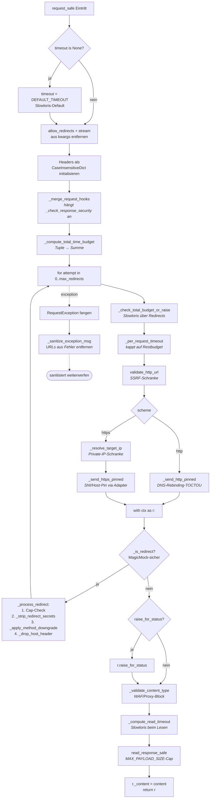
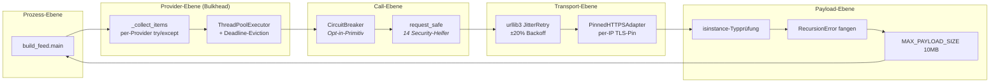

[Architektur-Karte — Wien ÖPNV Feed](architecture.md), Teil 3.

* **Folgejahre, Jahreswechsel, Schaltjahre (geprüft 2026-10-03 bis 2040).**
  Dieselbe echte Septembernacht auf jede Umstellung bis 2040 verschoben (letzter
  Sonntag im Oktober und März, darunter Jahre mit dem 25. und dem 31.), dazu
  echte Nächte gleichen Wochentags auf jeden Silvester 2026 bis 2040, eine
  echte Woche über den Jahreswechsel 2026/27 und über den 29.02.2028 sowie die
  Schalttage 2032, 2036 und 2040: 49 Szenarien, 1 854 Feed-Läufe, deutscher
  und englischer Feed. Verschoben wird nach der Wiener Uhrzeit (Datum plus N
  Tage), ein Lauf in der doppelten Stunde läuft zweimal. Bis auf die
  verschobenen Daten stimmten alle Läufe mit dem Original überein: Jahr in der
  Zeitzeile nur außerhalb des laufenden Jahres („[Bis 08.01.2027]“ am 31.12.,
  „[Bis 08.01.]“ ab 01.01.), Wochentag nur bis sechs Tage voraus und richtig,
  „[Seit 31.12.2026]“ für eine Störung von Silvester nach Mitternacht.
  Gefunden und behoben:
  - **WL-Ende ohne Jahr:** WL schreibt das Jahr oft nur beim Beginn („Ab
    24. August 2026, etwa 06:00 Uhr, bis 07. September“). Das Ende wurde
    unabhängig davon auf das nächstgelegene Datum gelegt; „Ab 01. Mai 2026
    bis Ende Dezember“ las sich als Dezember 2025, und das Ende ging verloren.
    Ein Ende ohne Jahr ist jetzt der erste solche Tag ab dem Beginn im Text
    (`_end_day`), auch über den Jahreswechsel („Ab 28. Dezember 2026 bis
    06. Jänner“). In den 228 Texten mit Ende seit Juli änderte sich nichts.
  - **Statistik-Jahr:** `scripts/generate_markdown_stats.py` las das Jahr beim
    Einlesen der Argumente von der Uhr der Maschine; ein Lauf mit `--now-iso`
    in einem anderen Jahr wertete das falsche Jahr aus. Es folgt jetzt der
    Laufzeit.
  - **Statistik-Seite am Jahreswechsel:** `docs/statistik.md` wird nur beim
    Lauf zwischen 00:00 und 00:29 neu geschrieben und zeigt das Kalenderjahr.
    Ihr letzter Stand eines Jahres entstand am 31.12. gegen 00:15, ohne
    Silvester, und am 01.01. ersetzte sie ein fast leeres neues Jahr. Jetzt
    schreibt der erste Dashboard-Lauf eines neuen Jahres zusätzlich das ganze
    Vorjahr samt 31.12. nach `docs/statistik-<Vorjahr>.md` (Michaels Wahl
    „Jahresarchiv“, 2026-10-03). Die Seite wird danach nie mehr angefasst;
    fällt der Lauf am 01.01. aus, schreibt sie der nächste.
  Tests: `tests/test_calendar_years.py`.

### Zeitraum einer WL-Meldung: Plausibilitätsprüfung (seit 2026-10-02)

Wiener Linien nennen den Zeitraum einer Meldung bis zu dreimal: in
`time.start`/`time.end`, als „ab“/„am“-Datum im Titel und im Abschnitt
„Zeitraum:“ der Beschreibung. Ein Tippfehler steht meist nur an einer
Stelle. Anlass: „47B: Laufveranstaltung am 04.10.2027“ (Text und `time.end`:
04.10.2026) schob den Beginn ein Jahr hinter das Ende, der deutsche Feed
zeigte „[Ab 04.10.2027]“ für einen Lauf am selben Sonntag.

`src/providers/wl_plausibility.py` wägt die Angaben gegeneinander ab, in
dieser Reihenfolge:

1. **Mehrheit bei Widerspruch.** Titel- und Textdatum mit gleichem Tag und
   Monat, aber anderem Jahr: Es gilt das Jahr näher an der Veröffentlichung
   (`year_conflict`).
2. **Harte Grenzen.** Ein Beginn nach dem Ende wird vom Ende überstimmt
   (`begin_after_end`). Ein Beginn mehr als 365 Tage nach der
   Veröffentlichung zählt nur, wenn eine zweite Angabe ihn bestätigt
   (`unconfirmed_lead`). Längster echter Vorlauf im Cache vom 02.10.: 88
   Tage (Stammstrecke Phase 2).
3. **Im Zweifel konservativ.** Was offen bleibt, fällt auf `time.start`
   zurück. Eine Meldung wird wegen eines Widerspruchs nie versteckt; ein
   `time.start` nach `time.end` wird nur gemeldet
   (`source_start_after_end`).
4. **Jede Korrektur wird gesammelt.** Sie steht als Warnung im Log, und
   `scripts/update_wl_cache.py` führt sie in
   `data/wl_plausibility_anomalies.json` (gleiches Format wie
   `data/feed_line_anomalies.json`: `kind`, `title`, `detail`,
   `first_seen`, `last_seen`, `days_seen`). Die Datei entsteht erst mit der
   ersten Korrektur.

Die bisherigen Regeln gelten unverändert und zählen nicht als Korrektur:
Ein 11:11-Ende weicht dem Ende aus „Zeitraum:“, ein Beginndatum verschiebt
den Start nur nach hinten, und ein Textdatum hinter dem Ende ist das Datum
einer späteren Phase. Was die Prüfung nicht sehen kann: eine Angabe, die an
allen Stellen gleich falsch ist.

Ein Ende ohne Jahr („Ab 24. August 2026 … bis 07. September“) ist der erste
solche Tag ab dem Beginn im Text, auch über den Jahreswechsel; ohne Beginn
im Text das Datum, das der Veröffentlichung am nächsten liegt (seit
2026-10-03).

Nennt „Zeitraum:“ kein Ende, sondern eine Dauer („auf Dauer von etwa sechs
Wochen“, seit 2026-10-02), gilt statt eines 11:11-Endes der Start aus dem
Text plus Dauer plus Puffer, auf 23:59 des Tags. Der Puffer ist die halbe
Dauer, mindestens eine Woche (`MIN_DURATION_BUFFER`): WL schreibt „etwa“,
und eine Baustelle, die länger dauert, soll nicht aus dem Feed fallen,
solange WL sie noch ausliefert. Die Rechnung verkürzt ein 11:11-Ende nur,
sie verlängert es nie. Anlass: „65A/66A“ (ab 12.08., „etwa zwei Wochen“)
stand am 02.10. noch mit Ende 31.08.2027 im Cache; 29B/N25 endet jetzt am
07.12. statt 31.12., 36A/36B am 12.11. statt 16.09.2027, 63A behält sein
11.11.

Eine Haltestellenverlegung oder -auflassung nennt ihren Zeitraum unter
„Dauer:“ statt „Zeitraum:“ („Dauer: Ab 05. Oktober 2026, etwa 07:00 Uhr für
etwa zwei Wochen“); alle 37 solchen Meldungen der Rohdaten vom 2026-10-04
tun das, keine hat „Zeitraum:“. Seit 2026-10-04 gilt „Dauer:“ dort als
Überschrift des Zeitraums (`_period_text`), mit denselben Regeln. Anlass:
„26E/N20: Fultonstraße“, am 28.09. für den 05.10. veröffentlicht, stand mit
„[Bis 28.09.2027]“ (11:11-Ende) im Feed-Nachbau; jetzt „[Ab Mo 05.10. bis
26.10.]“. 27 der 37 Meldungen beginnen dadurch später (der Tag aus dem Text
statt der Veröffentlichung), sechs enden früher (27A, 60A und 76A Ende
Oktober 2026 statt im Herbst 2027). Nur dort: Vier WL-Störungen schreiben „Dauer:“ vor
eine Uhrzeit oder „Bis 30.10.2026 Betriebsschluss“, das die Beginnregel für
einen Beginn am 30.10. hielte.

Eine Dauer in Jahren („für etwa ein Jahr“, „für ca. 1 Jahr“, „für etwa
1,5 Jahre“, „eineinhalb“) zählt seit 2026-10-08 wie Wochen und Monate
(365 Tage je Jahr). Anlass: 1A Habsburgergasse, 57A Haus des Meeres und
26A/N20 Siebeckstraße standen mit ihrem 11:11-Ende zwei und drei Jahre
nach der Veröffentlichung im Feed; jetzt enden sie am 20.07.2027,
31.08.2027 und 24.09.2028 (Start plus Dauer plus halbe Dauer).

**Ein 11:11-Ende ohne Ende und Dauer im Text erscheint nicht in der
Zeitzeile** (seit 2026-10-08, Betreiberentscheidung „Kein Ende“,
`wl_plausibility.end_unknown`). Das 11:11-Ende ist bei WL ein von Hand
gesetztes Ablaufdatum, meist ein Jahr nach der Veröffentlichung, kein
erwartetes Ende: Von den 124 Hinweisen mit 11:11-Ende, die WL zwischen dem
21.02. und dem 08.10.2026 beendete, verschwanden 122 vor diesem Datum, im
Median 336 Tage davor. Die Zeitzeile liest sich deshalb wie bei jeder
Meldung ohne Ende: „[Seit 08.10.]“, angekündigt „[Ab Mo 19.10.]“ statt
„[Bis 08.10.2027]“ (72A Haidestraße S) oder „[Bis 31.12.2027]“ (38A, „auf
derzeit unbekannte Zeit“). Am 08.10. betraf das 25 der 49 WL-Hinweise mit
11:11-Ende. Nennt der Text ein Ende oder eine Dauer, bleibt alles wie oben,
auch ein 11:11-Ende, das eine längere Dauer nicht verkürzt (63A). Ein
vages Ende („bis voraussichtlich Mitte August 2026“, „bis etwa Frühjahr
2027“) nennt keinen Tag und zählt als keines; als Monatsletzter gelesen
hätte es Meldungen beendet, die WL noch auslieferte (85A, „Mitte Mai“, bis
02.08.2026 gelistet). Eine Dauer-Spanne („für etwa zwei bis drei Wochen“,
„2–3 Monate“) zählt ebenso als keine Dauer (Betreiberentscheidung
2026-10-15, „So lassen“): Die Meldung zeigt kein Ende und bleibt, solange
WL sie ausliefert; falsch ist dabei nichts. In den 9.741 verschiedenen
Texten aller Anbieter seit 01.07.2026 kam keine Spanne vor, alle 103
Dauerangaben waren einfache Zahlen. Das 11:11-Datum bleibt das Ablaufdatum der Meldung
(`ends_at`, Altersfilter); geändert ist nur die Zeitzeile, im englischen
Feed ebenso.

**Ein Ende um 23:59 genau ein Jahr nach der Veröffentlichung zählt wie das
11:11-Ende** (seit 2026-11-06, Betreiberentscheidung „Ja, bitte“,
`wl_plausibility.placeholder_end`). Anlass: „5B: Bauarbeiten“, am 06.11.2026
um 14:11 veröffentlicht mit „Ab Montag, den 9. November 2026, etwa 07:00 Uhr
für ca. drei Wochen“, hatte `time.end` 06.11.2027 23:59 und stand ab 14:31
mit „[Ab Mo 09.11. bis 06.11.2027]“ im Feed; von den elf WL-Hinweisen mit
einem 23:59-Ende im Cache dieses Tages war es der einzige mit dem Jahrestag
der Veröffentlichung, die anderen endeten binnen Tagen. Für so ein Ende
gelten dieselben Regeln wie für 11:11: das Ende aus dem Text, sonst Start
plus Dauer plus Puffer (5B: 09.11. + 21 Tage + 10,5 Tage, „bis 10.12.“),
sonst kein Ende in der Zeitzeile. Die Zeitzeile braucht dazu die
Veröffentlichung der Meldung (`pubDate`, `_shown_end` in
`src/feed_build/item_meta.py`); ein 23:59-Ende an jedem anderen Tag ist
ein Ende („bis 08.11.“). Der 29.02. hat seinen Jahrestag am 28.02.

**Ein Text-Ende beendet die Meldung, auch wenn WL sie noch ausliefert**
(Betreiberentscheidung 2026-10-09, „Text-Ende beendet“). Ist das Ende aus
dem Text oder aus Start plus Dauer vorbei, verwirft der Abruf die Meldung
(„außerhalb des Zeitraums“). WL liefert solche Meldungen oft noch Tage bis
Wochen aus (13 von 52 zwischen Februar und Oktober 2026, 1 bis 41 Tage,
z. B. 93A/96A/N91 Schillwasserweg „bis etwa Ende Juli“, gelistet bis 10.09.).
Das ist gewollt und kein Defekt: Bliebe die Meldung, zeigte ihr eigener
Text („bis etwa Ende Juli 2026“), dass sie abgelaufen ist, und das
verwirrt. Ein Versuch, sie bis zum Rückzug durch WL zu behalten (#1989),
wurde mit #1990 zurückgenommen.

#### WL-Hinweis ohne Text (seit 2026-11-07)

Ein WL-Hinweis, dessen Text leer ist (nur Tags, `&nbsp;` und Leerraum),
wartet, bis WL ihn füllt; der nächste Abruf mit Text bringt ihn in den Feed
(`_is_empty_wl_notice` in `_post_filter_wl`,
`src/feed_build/cache_filters.py`). Anlass: WL stellte „5B: Bauarbeiten“ am
06.11.2026 um 13:59 mit dem Text „

“ online und füllte ihn um 14:11;
der Feed von 14:01 zeigte den Titel nur mit „[Seit heute]“ (KI-Wächter,
Issue #2170). Ein Hinweis-Titel („Bauarbeiten“) sagt nicht, was sich für
den Fahrgast ändert, und Hinweise stehen hinter Störungen. Eine Störung
ohne Text bleibt: Ihr Titel nennt Linie und Ursache („U2:
Betriebsstörung“). Gemessen über alle WL-Cache-Stände seit 01.06.2026
(6.328 Stände, 337 Hinweise): Der 5B-Hinweis ist der einzige leere, dazu
sechs Störungen für je einen bis vier Abrufe. Betreiberentscheidung
2026-11-07 („Zurückhalten bis Text da ist“).

#### WL-Netzänderung als Hinweis (seit 2026-11-07)

Eine WL-Langmeldung kommt nur in den Feed, wenn ihr Text ein
Einschränkungs-Stichwort trägt (`KW_RESTRICTION`, `docs/development.md`,
„Wiener Linien“). Eine Netzänderung schränkt nichts ein – eine Linie
bekommt eine Haltestelle – und nennt deshalb keines: „9A: Errichtung einer
Haltestelle“ (ab 07.09.2026) und „57A: Errichtung einer Haltestelle“ (ab
05.09.) fielen in jedem Abruf vom 04. bis 07.10.2026. WL setzt die Art der
Meldung als Überschrift an den Textanfang („<h2>Netzänderung</h2>“);
`is_network_change` (`src/providers/wl_news_kind.py`) liest diese
Markierung, nicht Wörter im Fließtext, und `_news_passes_gate` in
`src/providers/wl_fetch.py` lässt die Meldung als Hinweis durch. Sie steht
ohne Ende im Feed (`_notice_end`): WLs `time.end` ist das Ende des
Hinweises, Wochen nach der Änderung (9A: ein Monat, N67: zehn Tage), nicht
der Maßnahme; als „[Bis Mi 07.10.]“ hätte es die neue Haltestelle befristet.
Ihren Beginn nennt WL unter „Zeitpunkt:“ (`_PERIOD_HEADING_RE`), die
Zeitzeile zeigt „Seit 07.09.“. Auch eine Netzänderung, die das Tor am
Stichwort passiert („N67: Geänderte Linienführung ab 05.12.2026“: „Die Fahrt
über Inzersdorf, Biróstraße entfällt“), steht ohne WLs Ende (15.12.).
Betreiberentscheidung 2026-11-07 („Als Hinweis aufnehmen“).

### Rohdaten und Verwürfe des Abrufs (seit 2026-10-04)

Die Caches unter `cache/` halten nur, was den Abruf überlebt hat. Ob eine
Meldung bei der Quelle überhaupt ankam und wo sie verschwand, ließ sich
deshalb nachträglich nicht klären, und eine Rohantwort lässt sich später
nicht mehr abholen. Mit `RAW_CAPTURE=1` (gesetzt nur im Fetcher-Schritt von
`update-cycle.yml`) schreibt jeder Abruf nach `data/raw/<quelle>/`:

* je Antwort einen **Stand** (`write_snapshot` in
  `src/utils/raw_capture.py`): WL `trafficInfoList` und `newsList`, ÖBB-RSS,
  je Baustellen-WFS-Layer;
* `verworfen.json`: jede Meldung, die der Abruf verwarf, mit Grund.

Die Dateien werden überschrieben, die Git-Historie ist das Archiv. Drei
Regeln halten die Deltas klein: stabile Textform (sortierte Schlüssel, ein
Wert pro Zeile, Listen in fester Reihenfolge), keine Felder, die sich bei
jedem Aufruf ändern (WL `serverTime`, ÖBB `lastBuildDate`, Baustellen
`OBJECTID`, Feature-`id` und Antwortkopf), und kein Schreiben ohne
inhaltliche Änderung. Von Baustellen-Geometrien bleibt nur Typ und erste
Position, mehr nutzt der Cache nicht. Gemessen am 2026-10-03 an einem Monat
echter Historie: so kostet eine Quelle rund 1 MB Pack pro Monat; gzip-Dateien
hätten das Repo 1,6- bis 146-mal stärker wachsen lassen, eine Datei pro Lauf
das Arbeitsverzeichnis um 140 MB im Monat. Ein Fehler beim Schreiben bricht
keinen Abruf ab, eine Datei über 4 MB wird nur gemeldet. Dateiliste und
Abfragebeispiele: `data/raw/README.md`.

### Ausfall einer Quelle (seit 2026-10-04)

Gemessen, indem veränderte Kopien der echten Rohdaten vom 2026-10-04
16:01 UTC durch die echten Cache-Updater und den Feed-Build liefen. Fällt
eine Quelle **ganz** aus (keine Verbindung, HTTP-Fehler, kein JSON/XML),
bleibt ihr Cache stehen, der Feed zeigt ihren letzten Stand, `first_seen`
bleibt erhalten, und der nächste gute Abruf stellt genau den Feed von
vorher wieder her. Drei Fälle liefen dagegen durch:

* **Teilausfall.** WL liefert in zwei Listen, die Baustellen in zwei
  WFS-Layern. Fiel eine aus, schrieb der Updater den Rest als vollständigen
  Cache (Exit-Code 0): ohne `trafficInfoList` verschwanden alle fünf
  laufenden Störungen aus den zehn Plätzen, ohne `newsList` vier Hinweise,
  ohne Linien-Layer zehn von fünfzehn Baustellen.
* **Antwort in anderer Form.** Fehlt ein Feld in allen Einträgen, läuft der
  Abruf mit Ersatzwerten weiter: WL ohne `title` zeigte interne Kennungen
  („15A: I20261004-0020“) auf allen zehn Plätzen, WL ohne `time` brachte alte
  Meldungen nach oben und stempelte ihr `first_seen`, sodass fünf der zehn
  Plätze auch nach der nächsten guten Antwort falsch blieben; ÖBB ohne
  `description` ließ sechs Baumeldungen aus dem Weinviertel durch,
  Baustellen ohne Datum belegten neun Plätze.
* **Demo-Baustellen.** Schlug der WFS ganz fehl, schrieb der Updater die
  beiden Beispiel-Baustellen aus `data/samples/baustellen_sample.geojson`
  (von 2025) in den Cache, sobald dieser zehn oder weniger hielt (die
  20-%-Sperre von `write_cache` ließ 2 von 10 durch).

Seither gilt eine Antwort nur, wenn sie ihre Liste trägt und kein Pflichtfeld
in **allen** Einträgen fehlt (`src/utils/source_shape.py`; WL `title`,
`description`, `time`, ab zehn Einträgen `relatedLines`; ÖBB `title`,
`description`, `guid`/`link`; Baustellen Beginn, Ende, Text, Lage; geprüft
ab drei Einträgen); eine leere WL-Liste oder ein leerer Layer zählt nicht,
wenn die letzte gute Antwort mindestens drei Einträge hatte (beide Listen
und beide Layer führen immer Langläufer). Ein unbrauchbarer Teil kommt aus
seiner letzten guten Antwort unter `data/raw/` (`read_snapshot`), der Rest bleibt frisch, der
Updater endet mit Exit-Code 3 und der Workflow meldet das als Warnung. Fehlt
die letzte gute Antwort (ohne `RAW_CAPTURE`, also auch im Health-Check) oder
fallen alle Teile aus, bleibt der Cache stehen (Exit-Code 1); der Health-Check
wird in beiden Fällen rot. Die Demo-Baustellen gibt es nur noch für einen
Checkout ohne Cache (Exit-Code 2). Nachgespielt mit dem neuen Code: jeder der
Fälle oben ergibt genau den Feed des guten Abrufs.

Weil die Antwort so je Teil geprüft ist, darf ein guter Baustellen-Abruf den
Cache verkleinern, auch auf null (`write_cache(..., allow_shrink=True)`, seit
2026-10-06): In den Cache kommen nur Baustellen mit Folgen für Öffis, und an
vielen Tagen gibt es keine. Null gelieferte Baustellen bleiben ein Ausfall
(Cache bleibt stehen). Die 20-%-Sperre von `write_cache` gilt für WL, ÖBB
und das Demo-Beispiel weiter.

---

### Feed-Wächter (seit 2026-10-10)

`scripts/feed_watch.py` läuft in `update-cycle.yml` nach der Linien-Prüfung
und vor dem Veröffentlichen und prüft den fertigen deutschen Feed gegen die
Regeln, die seit September aus Audits und Entscheidungen entstanden sind
(doppelte Einträge, eine alte Meldung als neue Störung, eine „Seit“-Zeit vor
der Störung, ÖBBs zweiter Satz, Zeitzeile, Länge), und die Mengen der
Rohantworten und Verwürfe gegen die letzten sieben Tage; seit 2026-10-23
meldet er auch eine Quelle (WL, ÖBB, Baustellen, VAO), die seit zwei Stunden
keine brauchbare Antwort gab, während der Feed mit ihrer letzten guten
Antwort weiterläuft (Regel `quelle-ohne-antwort`, Entscheidung des Betreibers
vom 2026-10-23). Er ändert den Feed
nie und blockiert die Veröffentlichung nie. Inhaltsfunde werden nie rot
(Entscheidung des Betreibers vom 2026-10-10 für den Health check: rot nur,
wenn der Abruf nicht funktioniert); ein Wächter, der nicht prüfen konnte, ist
seit 2026-10-28 rot („Überwachung: Nebenschritte“ in §7). Die Funde stehen als `::warning` im
Protokoll, in `data/feed_watch.json` (der Health check zeigt sie als
Hinweis) und je Regel als GitHub-Issue, das sich selbst schließt (dafür
`issues: write` im Update-Lauf, Entscheidung des Betreibers vom
2026-10-11: ein Fund soll am selben Tag per Mail ankommen). Regeln,
Schwellen und Rückprüfung über 1 975 Feed-Stände:
[`reference/feed_watch.md`](reference/feed_watch.md).

### KI-Wächter (seit 2026-10-31)

Betreiberentscheidung (Michael, 2026-10-31): Die Regeln bleiben die
Feed-Kette; eine KI liest nur mit und meldet, sie schreibt keinen Text um.
Vorausgegangen war die Frage, ob ein kleines Sprachmodell die Quelltexte der
Betreiber selbst neu schreiben könnte. Gemessen an 20 echten Texten (WL, ÖBB,
Baustellen) veränderten kleine Modelle auf CPU den Sinn jedes dritten Textes
(erfundene Anfangszeiten, „U-Bahn“ statt Zug, „gesperrt“ statt „als Sackgasse
möglich“), und ein 3B-Modell übersetzte schlechter als die heutige
EN-Kette. Ein Regelfehler ist reproduzierbar und als Klasse behebbar, ein
Modellfehler nicht; ein umgeschriebener Text ließe sich zudem nicht
mechanisch belegen wie ein Fund, und der Feed bräuchte bei jedem Ausfall der
API ohnehin die Regeln. Auf seine Antwort „Einen Jules-Ersatz (Wächter-KI) im
Projekt selbst. Achte bitte weiterhin auf höchste Qualität und Effizienz.“
entstand der tägliche KI-Wächter als Nachfolger der Jules-Audits (Jules nimmt
nach dem 2026-11-11 keine Sitzungen mehr an). Am selben Tag entschied er
außerdem: geprüft werden alle Meldungstexte der letzten 24 Stunden („Ein
Review der Meldungen der letzten 24h wäre besser“), das Modell ist Gemini
über das Gratis-Kontingent der Gemini API (das Claude-Abo läuft nur bei
Bedarf), und das API-Limit darf nicht überschritten werden.

* `ki-waechter.yml` läuft einmal am Tag nach dem ersten erfolgreichen
  Update-Lauf ab 15:00 Wiener Zeit (seit 2026-11-05; vom 31.10. bis 05.11.
  ab 9:00, gleich nach dem Beginn des Kontingent-Tags der Gemini API, doch
  um diese Stunde darf jeder wieder, und beide Flash-Modelle antworteten an
  fünf Morgen in Folge überlastet, Betreiberentscheidung: „wir sollten
  später abfragen. Wie wärs mit 15:00 Uhr?“; GitHubs eigener Cron feuert
  hier nur wenige seiner Termine). Ein erfolgreicher Lauf beendet den Tag;
  nach einem gescheiterten versucht er es frühestens zwei Stunden später
  noch einmal. Seit 2026-11-05 entscheidet das der letzte
  Schritt des Update-Laufs (`scripts/ki_waechter.py dispatch`,
  `src/ki_waechter/dispatch.py`): Er liest die Aufzeichnung
  `data/side_steps/ki-waechter.json` und die Uhr und sendet
  `repository_dispatch: ki-waechter` nur, wenn eine Prüfung fällig ist und
  kein Lauf des Wächters läuft oder wartet. Ein Takt vor 15:00 oder nach der gelungenen
  Prüfung des Tages liest nur die Aufzeichnung im Checkout und fragt GitHub
  nichts. Bis dahin hing der Workflow an `workflow_run` des Update-Laufs,
  und sein Job `gate` startete 48-mal am Tag einen Rechner, um auf allen bis
  auf ein bis vier Takten „nicht jetzt“ zu sagen (Michael, 2026-11-04:
  „Effizienz ist mir wichtig. Das Projekt soll ressourcenschonend
  arbeiten.“). Nachgespielt über die Update-Läufe vom 01.11. bis 04.11.2026:
  dieselben sechs Prüfläufe, 7 statt 165 Starts des Gates. Ein roter Lauf
  des Wächters mailt seither niemanden mehr (ein Lauf, den der Bot startet,
  gehört keinem); gemeldet wird ein ausgefallener Wächter wie zuvor durch
  den Health check (Prüfung `Nebenschritte`, Mail an Michael).
* `scripts/ki_waechter.py prepare` liest jede Fassung des Feeds aus den
  24 Stunden davor aus der Git-Historie (jeder Update-Lauf committet Feed und
  Caches zusammen) und macht jeden verschiedenen Meldungstext zu einer
  Nummer, mit der Zeit im Feed, den gleichzeitig sichtbaren Meldungen, der
  englischen Fassung und den Cache-Ereignissen ihrer Linien. Kopf, GUIDs,
  Zahlen, Zeiten und Tabelle des Berichts kommen aus dem Skript, nie vom
  Modell.
* `scripts/ki_waechter.py ask` schickt Prompt (`scripts/ki_waechter_prompt.md`)
  und Eingabe an die Gemini API, ohne Werkzeuge, mit festem JSON-Schema der
  Antwort: die Modellkette, bis ein Modell antwortet, und dieses Modell dann
  noch einmal; die Funde beider Antworten werden vereinigt (seit 2026-11-05,
  weil eine Anfrage nicht jeden Fund bringt). Die Fundklassen F1 bis F6 sind
  geschlossen, entschiedene Formate stehen als Nicht-Funde im Prompt, je
  Code-Entscheidung ein Satz; jede Entscheidung zu Feed-Texten in
  `changelog/<JJJJ-MM-TT>.md` bekommt im selben Pull Request ihre Zeile dort
  (Betreiberentscheidung 2026-11-05, „Beides“: präzise Liste und zweite
  Antwort, nach zwanzig falschen Funden aus zwei knappen Sätzen). Stil und
  Verbesserungsideen sind nie Funde.
* `scripts/ki_waechter.py verify` lässt einen Fund nur gelten, wenn sein
  Zitat wörtlich in der Meldung steht, bei einem falschen Fakt (F3) auch das
  Quellzitat wörtlich in den Quellen, und die Klasse zum Feed passt (F6 nur
  Englisch, F1 und F3 nur Deutsch, F1 mit zwei Meldungen, die gleichzeitig
  im Feed standen). Alles andere steht als „Nicht belegt“ im Bericht, zählt
  aber nicht (Michael, 2026-10-30: „Falsche Funde stören mich am meisten“).
* Gratis-Kontingent: Google zählt je Projekt und Modell und antwortet 429,
  sobald ein Kontingent erreicht ist; der Wächter zählt nicht selbst
  (Betreiberentscheidung 2026-11-05: „Zähle es bitte so wie Google. Wir
  brauchen keine eigene Zähltechnik.“; eine Abfrage des Verbrauchs über die
  API gibt es laut Googles Doku nicht). Ein Prüflauf sendet zwei Anfragen,
  eine je Antwort (bis 2026-11-05 eine);
  ein Modell mit 429 bleibt im Lauf außen vor, Googles Angaben aus der
  Antwort stehen im Log; antwortet das Modell überlastet (5xx), fragt er
  sofort das nächste Modell der Kette Gemini 3.8 Flash, 3.6 Flash,
  3.5 Flash-Lite, 3.1 Flash-Lite, nach einem Durchgang ohne Antwort eine
  Minute später ein zweites Mal, höchstens acht Anfragen bis zur ersten
  Antwort und eine mehr für die zweite
  (Betreiberentscheidung 2026-11-05, nachdem beide Flash-Modelle vom 01. bis
  05.11. jeden Morgen um 9:00 mit 503 antworteten und der Health check rot
  war: „Baue bitte auch einen Modellwechsel mit den Lite-Modellen als
  Ergänzung.“ Die Lite-Modelle haben im Gratis-Kontingent 500 Anfragen am
  Tag statt 20 und werden mit Denkstufe „high“ gefragt; die im Kontingent
  „unbegrenzten“ Live-API-Modelle antworten nur als Audio über eine
  WebSocket-Sitzung, und Gemma 4 erlaubt 16.000 Tokens pro Minute, ein
  Drittel der Eingabe, beide blieben deshalb draußen. Bis dahin: 3.8 Flash,
  3.6 Flash, nach einer Minute wieder 3.8 Flash, und der Job `gate` zählte
  die Anfragen des Tages aus einer Anmerkung jedes Prüflaufs gegen ein
  Budget von zehn). Die Eingabe ist auf 450.000 Zeichen begrenzt. Der
  Schlüssel `GEMINI_API_KEY` gehört zu einem Projekt ohne Abrechnung.
* Der Bericht `docs/archive/audits/ki-waechter-YYYY-MM-DD.md` geht über
  `publish_to_main.sh` nach `main`; belegte Funde öffnen ein Issue (Label
  `ki-waechter`). Der Feed bleibt unverändert.
* Ein Lauf, der nicht prüfen konnte (Schlüssel leer oder abgelehnt, Modell
  nicht gefunden, Antwort ohne JSON), ist rot und macht die Prüfung
  `Nebenschritte` im Health check rot (`data/side_steps/ki-waechter.json`,
  Grenze 36 h). War Gemini nur überlastet (503, abgebrochene Verbindung,
  Zeitüberschreitung, Kontingent), endet der Lauf mit einer Warnung, und die
  Prüfung bleibt ein Hinweis, bis 30 Stunden ohne gelungene Prüfung vergangen
  sind (Betreiberentscheidung 2026-11-04, [`reference/ki_waechter.md`](reference/ki_waechter.md), „Ausfall“).
* Ein Pull Request, der Skript, Prompt oder Workflow ändert, spielt den
  Wächter über die 24 Stunden vor drei Feed-Ständen ab, ohne zu
  veröffentlichen: 27.10.2026 („algae path“ für Algenweg, 40A doppelt),
  30.10.2026 („All Saints' Worship“) und der aktuelle Stand. Der Prompt nennt
  diese Fälle nicht.

Ablauf, Fundklassen und Grenzen: [`reference/ki_waechter.md`](reference/ki_waechter.md).

### Geodaten im Feed: GeoRSS nur, wo der Ort sicher ist (seit 2026-10-16)

Beide Feeds (`feed.xml`, `feed.en.xml`) tragen in einem Item höchstens ein
`<georss:point>` oder eine `<georss:line>` (GeoRSS Simple, Namespace
`http://www.georss.org/georss`, Koordinaten „Breite Länge“ mit sechs
Nachkommastellen). Reader ohne GeoRSS übergehen die Elemente wie die seit
Langem vorhandenen `ext:`-Felder; Titel und Beschreibung ändern sich nicht.
Gebaut in `_item_geometry` (`src/feed_build/rss.py`), aufgerufen von `_emit_item`.

**Entscheidung des Betreibers (2026-10-16):** „Ich möchte das Projekt so gut
wie möglich machen. Eine präzise Variante würde das Projekt aufwerten.
Falsche Daten bringen uns hingegen nichts.“ Deshalb bekommt ein Item nur
dann Geodaten, wenn sein Ort sicher feststeht; **die meisten Items, vor
allem fast alle Meldungen der Wiener Linien, bleiben absichtlich ohne**.
Das ist kein Fehler und keine Lücke.

| Quelle | Regel | Abdeckung (Titel seit 01.07.2026) |
| --- | --- | --- |
| ÖBB | nur der Titel (Linienpräfix wie „R 95:“ weg): genau eine Station → Punkt; genau ein „A ↔ B“ → Linie aus zwei Punkten (dieselbe Station zweimal → Punkt); mehrere Abschnitte („A ↔ B / C ↔ D“), drei oder mehr Stationen, ein Doppelpunkt im Rest oder ein Teil, der nicht genau ein Stationsname ist → nichts | 79 Linien, 19 Punkte von 152 |
| Stadt Wien Baustellen | die Koordinate der Stadt Wien aus `location.coordinates` (erster Punkt der Geometrie der Baustelle), nur innerhalb Wiens → Punkt | 58 von 58 |
| Wiener Linien | nur eine Haltestellenverlegung oder -auflassung, deren Titel genau eine Haltestelle nennt („15A: Max-Mauermann-Gasse“), die das Verzeichnis für eine der Linien im Titel führt → Punkt; alles andere → nichts | 87 von 3.151 |

Warum nicht alle Stationen eines Textes (Vorschlag vom 2026-10-16, gemessen
über alle Meldungstexte seit 01.07., `reports/georss-einschaetzung-2026-10-16.md`
im Projektordner): 15 % der in WL-Texten erkannten Namen stehen hinter
„Richtung“ (die Endstation, nicht der Ort), 26 % der so gebildeten Linien
laufen im Zickzack über Umleitungen und Ersatzlinien, Straßennamen treffen
gleichnamige Haltestellen („Simmeringer Hauptstraße“ ist die Haltestelle
Hauptwerkstätte am Ende der Straße). Eine ÖBB-Linie ist die Gerade zwischen
den zwei Bahnhöfen, nie ein berechneter Mittelpunkt und nicht der
Gleisverlauf.

**Herkunft der Koordinaten:** nur offene Datensätze mit bekannten
Bedingungen: ÖBB-Infrastruktur GeoNetz (CC BY 3.0 AT,
`data/oebb_geonetz_stops.json`, über EVA- oder IFOPT-Nummer), Wiener Linien
OGD Haltestellen (`data/wienerlinien-ogd-haltestellen.csv`, über die DIVA)
und die Baustellen-Daten der Stadt Wien. Liegt die OGD-Koordinate einer
DIVA außerhalb des WL-Netzes (mehr als 50 km vom Mittelpunkt,
`is_plausible_wl_coordinate`), gilt dieselbe Haltestelle aus den
GTFS-Fahrplandaten der Wiener Linien (`data/wienerlinien-gtfs-stops.csv`,
CC BY 4.0, Datensatz `wl_gtfs`); fehlt sie dort, bleibt das Item ohne
Geodaten. Seit 2026-10-25, davor hätte eine Verlegung an der
Wassermanngasse, am Halblehenweg oder an der Leopoldine-Padaurek-Straße
einen Punkt im Waldviertel bekommen (kam seit Juli nicht vor).
`src.utils.stations.open_data_coordinate` liest nie die `latitude`/
`longitude` des Verzeichnisses, weil diese auch aus ÖBB
HAFAS zusammengeführt sind. Eine Station ohne offene Koordinate
(seit Juli nur Guntramsdorf-Kaiserau, nur VOR) lässt das Item ohne
Geodaten; es gibt keinen Rückfall. Das Verzeichnis dient nur dazu, den
Namen aus dem Titel einer Station zuzuordnen. Die `<copyright>`-Zeile beider
Feeds und die Feed-Tabelle in `NOTICE.md` nennen genau diese drei Quellen
(seit 2026-10-16, nach #2025).

Den Fernseher (EasySignage) prüft nach einer Änderung am Feed nur der
Betreiber selbst.

### Link und Quelle jeder Meldung (seit 2026-10-17)

Michael, 17.10.2026: „Meldungen von der ÖBB sollen zu ÖBB verlinken und eine
Quellenangabe als Tag beinhalten. Meldungen der Wiener Linien sollen zu den
Wiener Linien verlinken und eine Quellenangabe als Tag für die Wiener Linien
haben. Das Selbe für Baustellenmeldungen der Stadt Wien u.s.w.“

Die Tabelle `_ITEM_SOURCES` in `src/feed_build/item_meta.py` legt je Quelle (Feld
`source` des Items) drei Dinge fest: den Namen im RSS-Element `<source>`, die
Adresse in dessen Pflichtattribut `url` und die Domains, auf die der
`<link>` zeigen darf. Ein Link auf eine andere Domain (eine tote
Katalogseite, die Seite eines anderen Betreibers) wird durch die Seite des
Betreibers mit seinen aktuellen Meldungen ersetzt:

| `source` | `<source>` DE / EN | `<link>` (Domain, Rückfall) |
| --- | --- | --- |
| Wiener Linien | Wiener Linien | wienerlinien.at, `/betriebsinfo` |
| ÖBB | ÖBB | oebb.at, ÖBB-Streckeninformation auf fahrplan.oebb.at |
| Stadt Wien – Baustellen | Stadt Wien / City of Vienna | wien.gv.at, `/verkehr/baustellen` |
| VOR/VAO (Stammstrecke) | VOR/VAO | oebb.at, ÖBB-Streckeninformation |

Die Stammstrecken-Meldung beschreibt S-Bahn-Züge der ÖBB und verlinkt daher
wie die ÖBB-Meldungen (sein Ja vom 17.10.2026); ihr Tag nennt die Daten, aus
denen sie berechnet ist. Vorher verlinkte sie auf eine WL-Seite, die nur auf
die WL-Startseite umleitete, und die Baustellen auf eine Katalogseite von
data.gv.at, die seit dem Umzug des Portals 404 liefert. Eine unbekannte Quelle
behält ihren Link und bekommt keinen Tag. Titel, Texte, GUIDs und Reihenfolge
ändern sich nicht; ob EasySignage den Tag anzeigt, sieht nur der Betreiber am
Fernseher.

### Ein einheitliches Bild je Meldung (seit 2026-10-19)

Michael, 19.10.2026, zur EasySignage-Vorschau: „Der roter WL-Hintergrund sieht
nicht gut aus. Der graue Hintergrund gefällt mir besser.“ Gewünscht sind
einheitlich graue TV-Folien für alle Quellen.

Hat eine Meldung kein eigenes Bild, zeigt EasySignage das Vorschaubild
(`og:image`) der verlinkten Seite. `wienerlinien.at/betriebsinfo` liefert
abwechselnd zwei Fassungen aus: meist mit `og:image` „image.png“, einer
Adresse ohne Bild (graue Folie mit einem kleinen Symbol für ein fehlendes
Bild), seltener mit dem roten WL-Logo (rote Folie). Die Linkziele der ÖBB-
und Baustellen-Meldungen haben kein Vorschaubild.

Darum trägt jede Meldung aller Quellen, im deutschen und im englischen Feed,
dasselbe eigene Bild (1920 × 1080; bis 23.10. das schlichte weiße
`docs/assets/feed-item.png`, seither die Raufaser unten),
als `<enclosure>` (RSS 2.0) und als `<media:content>` (Media RSS). Unter der
dunklen Schicht von EasySignage erscheint Weiß als das gewählte Grau. Die
Links bleiben beim Betreiber (Abschnitt oben). `_ITEM_IMAGE_BYTES` in
`src/feed_build/item_meta.py` ist die Dateigröße für das Pflichtattribut `length`;
`tests/test_item_image.py` hält sie und die Maße gleich mit der Datei. Andere
Feed-Leser können das Bild als helle Vorschau anzeigen. Titel, Texte, GUIDs,
Links und Reihenfolge ändern sich nicht (Nachbau von 216 Feed-Ständen
15.–19.10.: bis auf die beiden Bild-Elemente identisch). Ob EasySignage das
eigene Bild dem Vorschaubild vorzieht, sieht nur der Betreiber in der
Vorschau und am Fernseher.

**Raufaser statt Weiß (seit 2026-10-23).** Michael, 23.10.2026: „Ich würde den
grauen Hintergrund gerne mit einem Wallpaper aufhübschen. Eine Raufasertapete
in Full HD und im selben Grauton würde mir gefallen.“ Gemeint ist der
Hintergrund der TV-Folien, nicht die Webseite. Seither ist das Bild jeder
Meldung `docs/assets/feed-item-raufaser.jpg` (1920 × 1080, JPEG,
`image/jpeg`): eine fast weiße Raufaser-Wand, die
`scripts/make_feed_item_image.py` ohne Foto berechnet (kleine, zufällig
gedrehte Holzspäne als Höhenkarte, weichgezeichnet, Licht von links oben;
fester Startwert, also wiederholbar; das Skript braucht `numpy` und Pillow).
EasySignage legt eine dunkle Schicht über das Bild und macht aus Weiß das
Grau `#7d7d7d`. Weil der Median des Bildes fast Weiß ist (254, Mittel 250) und die
Späne nur als weiche Schatten darunter liegen, bleibt die Folie im selben
Grau; im Mittel wird sie um etwa zwei Stufen dunkler, die weiße und orange
Schrift steht unverändert davor. Ein neuer Dateiname statt eines neuen
Inhalts unter dem alten Namen, damit EasySignage das Bild nicht aus einem
Zwischenspeicher nimmt. `feed-item.png` bleibt liegen, damit Folien, die
noch die alte Adresse halten, nicht ohne Bild dastehen.

## 2. Die `request_safe`-Security-State-Machine

`request_safe` ist ein einzelner 75-Zeilen-Orchestrator, der 14
kohäsive Security-Helfer in strikter Reihenfolge aufruft. Jeder Helfer
dokumentiert den Angriffsvektor, den er entschärft. Das Flussdiagramm
unten zeigt die Reihenfolge, die Tabelle darunter fasst zusammen,
warum jede Schranke existiert.

**Warum jede Schranke existiert** (auch in den Helper-Docstrings dokumentiert):

| Schranke | Entschärft |
|---|---|
| Slowloris-Default-Timeout | Aufrufer:in vergisst Timeout → endlos hängender Call |
| Auto-Redirects deaktivieren | DNS-Rebinding-TOCTOU zwischen Sicherheitsprüfung und Connect |
| `_merge_request_hooks` | Stilles Überspringen der `_check_response_security` IP-Verifikation |
| `_compute_total_time_budget` (Tuple-Summe) | Angreifer:in verkettet Redirects, um das Wall-Clock-Budget zu strecken |
| `_check_total_budget_or_raise` | Slowloris über mehrere Redirects |
| `_per_request_timeout` | Per-Step-Timeout-Decay entlang der Kette |
| `validate_http_url` | SSRF über interne/private Hostnames |
| `_resolve_target_ip` | SSRF via DNS-Auflösung mit privater IP |
| `_send_http_pinned` | DNS-Rebinding-TOCTOU auf plain HTTP |
| `_send_https_pinned` | DNS-Rebinding-TOCTOU auf HTTPS + SNI/Host-Mismatch |
| `_is_redirect` (MagicMock-Schutz) | Falsch-positive Redirects in Mock-basierten Tests |
| `_strip_redirect_secrets` | Token-/Credential-Leak über Origin-Grenzen |
| `_apply_method_downgrade` | RFC-7231-konforme Methoden-Erhaltung/-Herabstufung |
| `_drop_host_header` | SNI/Host-Mismatch beim weitergeleiteten Request |
| `_validate_content_type` | Fehlinterpretation der Block-Page eines WAF/Proxys (text/html-Angriff) |
| `_compute_read_timeout` | Slowloris auf der Body-Read-Seite |
| `read_response_safe` | Payload-Größen-Cap (MAX_PAYLOAD_SIZE = 10 MB) |
| `_sanitize_exception_msg` | Sensible URLs lecken in Fehlertexte und Logs |
| `PROXY_TRUSTED_HOSTS` (in `TimeoutHTTPAdapter.send` und `verify_response_ip`) | DNS-Rebinding hinter einem Proxy: Der Proxy löst den Hostnamen selbst auf, IP-Pinning und Peer-Prüfung greifen dann nicht |

Das 2026-05-07-Audit hat diese Angriffsfläche geschlossen.

**Hinter einem Proxy (seit 2026-09-26, Audit vom 17.09., B.3).** Ist für eine
Anfrage ein Proxy im Spiel (`HTTP_PROXY`, `HTTPS_PROXY`, `ALL_PROXY`, unter
Beachtung von `NO_PROXY`), löst der Proxy den Hostnamen selbst auf. Für
getunneltes HTTPS halten dann weder die gepinnte IP noch die Prüfung der
verbundenen IP; die Gegenstelle ist der Proxy. Früher wurde die Prüfung in
diesem Fall still übersprungen. Jetzt gilt:

- Durch einen Proxy gehen nur Anfragen an die Hosts in `PROXY_TRUSTED_HOSTS`
  (`src/utils/http.py`) oder an eine literale, sichere IP. Die gepinnte
  HTTP-Anfrage adressiert die geprüfte IP, der Proxy verbindet genau dorthin.
- Jeder andere Host wird abgewiesen, bevor ein Byte gesendet wird
  (`TimeoutHTTPAdapter.send`, gilt für alle Sessions aus
  `session_with_retries` und für `request_safe`). `verify_response_ip` prüft
  dasselbe nach der Antwort.
- Die Liste nennt genau die Upstreams des Projekts: Wiener Linien, ÖBB
  (Fahrplan und Daten), VAO, Stadt Wien (Baustellen), Overpass,
  GitHub-API und `raw.githubusercontent.com` (Google Places ist seit
  2026-10-16 entfernt). Ein Test
  gleicht sie mit den im Code konfigurierten Hosts ab, in beide Richtungen.
  Ein neuer Upstream muss dort eingetragen werden.
- Die Produktions-Workflows setzen keinen Proxy. Betroffen sind
  Entwicklungsrechner und Sandboxes. GitHub-Enterprise-Hosts aus
  `FEED_GITHUB_ENTERPRISE_HOSTS` stehen nicht auf der Liste und scheitern
  hinter einem Proxy.
- `tests/conftest.py` entfernt die Proxy-Variablen des Rechners für jeden
  Test. So liefert die Suite auf den CI-Runnern und in einer Sandbox mit
  Proxy dasselbe Ergebnis; Tests, die einen Proxy brauchen, setzen ihn selbst.

---

## 3. Resilienz-Layer-Stack

Das System trägt fünf gestaffelte Verteidigungslinien gegen ein
feindliches Netzwerk oder eine feindliche Upstream-Quelle. Jede Schicht
hat ihren eigenen Geltungsbereich; zusammen ergeben sie
Defense-in-Depth.

**Schicht für Schicht:**

- **Prozess-Ebene** — der Cron-Eintrittspunkt. Wenn `main()` wirft, ist der Cron-Lauf die Fehler-Einheit; das ist Absicht, damit ein korrupter Schreibvorgang keinen halbgaren Feed veröffentlicht.
- **Provider-Ebene** — `_collect_items` hüllt den Loader jedes Providers in ein try/except, sodass eine Provider-Exception die Items der anderen nicht mit in den Abgrund nimmt. Der `ThreadPoolExecutor` plus die Apex-Phase-1-Deadline-Eviction-Schleife begrenzt das Wall-Clock-Budget für nicht antwortende Provider.
- **Call-Ebene** — `request_safe` ist die per-Call-Security-State-Machine (§2). `CircuitBreaker` ist ein zur Übernahme bereitstehendes Resilienz-Primitiv; die gemeinsam genutzte Klasse `src.utils.circuit_breaker.CircuitBreaker` umhüllt den OSM-Client (`src/places/osm_client.py`), den HAFAS-Client (`src/places/hafas_client.py`), den Stammstrecken-Hbf-Monitor (`scripts/update_stammstrecke_hbf.py`) und das Rollback-Skript `scripts/update_stammstrecke_status.py`.
- **Transport-Ebene** — `JitterRetry` (in `session_with_retries`) behandelt transiente 5xx und Connection-Resets per jitter-belegtem Exponential-Backoff. `PinnedHTTPSAdapter` hält die SNI beim TLS-Handshake auf dem ursprünglichen Hostnamen, während der TCP-Connect die aufgelöste (geprüfte) IP anvisiert.
- **Payload-Ebene** — sobald Bytes eintreffen, validiert jeder Provider den Top-Level-Typ (Zero-Trust-Shape), fängt `RecursionError` aus JSON-Tiefenbomben und arbeitet innerhalb des 10-MB-Body-Caps.

---

Weiter in [Teil 4](architecture-teil-4.md).
