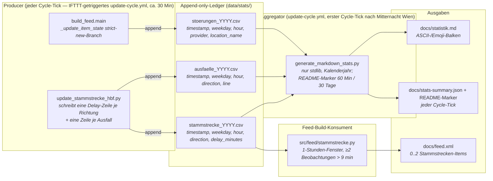

[Architektur-Karte — Wien ÖPNV Feed](architecture.md), Teil 5.

## 6. Statistik- und Dashboard-Pipeline

Drei Append-only-CSV-Ledger unter `data/stats/` fangen jede relevante
Beobachtung ein, sobald sie auftritt. Sie bedienen **zwei Konsumenten**
mit unterschiedlichen Fenstern: das tägliche Markdown-Dashboard
(`docs/statistik.md`, Kalenderjahr; das abgeschlossene Vorjahr steht in
`docs/statistik-<Vorjahr>.md`) plus die vier README-STATS-
Marker (`STATS:STAMMSTRECKE[_LIVE]` und `STATS:AUSFAELLE[_LIVE]`,
60-Min- und 30-Tage-Snapshots), sowie den RSS-Feed selbst
(Stammstrecken-Sektion, 1-Stunden-Fenster — siehe
[`docs/reference/stammstrecke_provider_logic.md`](reference/stammstrecke_provider_logic.md)).
Der Hot-Path-Build blockiert nie auf Observability-I/O — beide
Konsumenten tolerieren fehlende oder fehlerhafte Zeilen kulant.

### Architektur-Ziele

| Ziel | Verwirklicht durch |
| --- | --- |
| **CI/CD-Entkoppelung** — `docs/statistik.md` wird nur auf den Cycle-Ticks zwischen 00:00 und 00:29 Wiener Zeit neu gerendert (in der Regel einer am Tag), gegated durch ein Inline-`TZ=Europe/Vienna date +%H%M`-Check in `update-cycle.yml`; die README-STATS-Marker und `docs/stats-summary.json` werden bei jedem ca. 30-Min-Cycle-Tick aktualisiert (`--skip-dashboard`) | `.github/workflows/update-cycle.yml`, Step „Refresh statistics dashboard and README snapshot" (der separate `generate-stats.yml`-Workflow wurde zusammen mit den per-Provider-Escapes entfernt; Ad-hoc-Regenerationen laufen jetzt über `manual-full-refresh.yml`) |
| **Strikt null Data-Science-Abhängigkeiten** — kein `numpy`, `pandas`, `matplotlib`; die CI-Installation bleibt sub-sekundär | `scripts/generate_markdown_stats.py` kommt ohne externe Data-Science-Pakete aus — nur Python-Standardbibliothek (u. a. `csv`, `datetime`, `statistics`, `zoneinfo`) und projekteigene `src.*`-Module |
| **Append-only, lock-freie Producer** — Einzelzeilen-Writes sind unter POSIX bis `PIPE_BUF` (4 KiB) atomar, parallele Cycle-Ticks können also nicht mitten in einer Zeile Bytes verschachteln | `src/utils/stats.py:_append_row` (Modus `"a"`, kein `flock`) |
| **Eine Zeile je Auftreten** — eine langlebige Meldung wird einmal aufgezeichnet, nicht einmal pro Build; eine wiederkehrende WL-Meldung (gleiche guid, neues Auftreten) zählt bei jedem Auftreten neu | `src/build_feed.py:_update_item_state` schreibt beim State-Cache-Miss (weder `_identity` noch `guid` hatten einen Vorgängereintrag) und bei einem Eintrag, den `_restart_recurring_occurrences` als neues Auftreten markiert hat (`new_occurrence`), jeweils beim ersten Erscheinen im Feed |
| **Idempotente, byte-stabile Ausgabe** — ein erneuter Aggregator-Lauf auf identischer Eingabe erzeugt byte-identisches Markdown, damit der Commit-Schritt der Workflows (`scripts/publish_to_main.sh`) zum No-op wird, wenn sich nichts geändert hat | Stabiler Sekundär-Sort (alphabetische Tie-Breaks, z. B. `key=lambda pair: (-pair[1], pair[0])` in `_format_providers_section`, `_format_ausfall_directions_section`, `_format_ausfall_lines_section`) in jeder Rangliste; der Renderer liest `now()` nur für den Zeitstempel im Header |
| **Per-Jahr-Datei-Rotation** — die einzelne Ledger-Größe bleibt auch über Mehrjahres-Betrieb beschränkt | Dateiname wird aus dem Wien-lokalen `timestamp.year` der Zeile abgeleitet, nicht aus der Prozess-Uhr |

### Resilienz-Schichten

Die Producer sind Observability, keine Kern-Funktionalität, deshalb
ist jeder Fehlerpfad **best-effort, no-throw**: ein `OSError` aus dem
Writer wird auf WARNING geloggt und verschluckt. Produktions-Pipelines
crashen nie, weil die Platte vollgelaufen ist.

Der Aggregator hingegen ist der Engpass, der *nicht vertrauenswürdige*
Bytes von der Platte lesen muss (eine im CI-Runner manipulierte
riesige CSV ist das kanonische Threat-Modell). Drei gestaffelte
Verteidigungslinien decken ihn ab:

1. **Begrenzte Reads** — jede CSV wird über `read_capped_text` geladen
   (`open` + `fstat` auf den offenen Filedescriptor + gedeckeltes
   `read(MAX_CSV_BYTES + 1)`) und über `csv.reader` über einem
   In-Memory-`io.StringIO` geparst. Das „kein bares
   `csv.reader(handle)` in `src/` oder `scripts/`"-Invariant ist über
   `tests/test_sentinel_csv_size_bomb.py` durchgesetzt.
2. **Toleranz gegenüber fehlerhaften Zeilen** —
   `_parse_stammstrecke_rows` / `_parse_stoerung_rows` /
   `_parse_ausfall_rows` überspringen einzelne Zeilen, die
   `fromisoformat` oder `float()` werfen. Ein fehlerhaft editierter
   Eintrag legt nicht das ganze Dashboard lahm.
3. **Atomarer Dashboard-Write** — das gerenderte Markdown landet via
   `src.utils.files.atomic_write` auf der Platte. Ein Kill-Signal
   mitten im Render-Vorgang kann das vorhandene Dashboard nicht durch
   eine halbgeschriebene Datei ersetzen.

### Test-Isolation

Die Produktion-Writer defaulten via `src.utils.stats.DEFAULT_STATS_DIR`
auf `<repo>/data/stats/`. Eine autouse-Fixture `isolate_stats_writes`
in `tests/conftest.py` monkey-patcht diese Konstante für **jeden** Test
auf einen per-Test-`tmp_path`, sodass jeder Test, der transitiv einen
Hot-Path triggert, der Statistik schreibt (der
`_update_item_state`-strict-new-Branch, die
Stammstrecken-Processing-Schleife) den committeten CSV-Ledger nicht
verunreinigen kann. Tests, die explizit ein anderes `stats_dir` ansetzen
(die dedizierten Unit-Tests in `tests/test_utils_stats/`), bleiben
unberührt, weil das explizite Keyword innerhalb von `stats_path` immer
gewinnt.

### Woher das Live-Dashboard seine Zahlen nimmt

`docs/site.html` las die drei Jahres-Ledger bis 2026-09-14 direkt von
`raw.githubusercontent.com` und verdichtete sie im Browser — rund
**705 KB pro Seitenaufruf** (und über das Jahr wachsend), um ein paar
KPI-Kacheln und Balken zu zeichnen. Seit Audit-Befund **E.3** schreibt
`scripts/generate_markdown_stats.py` bei jedem Tick zusätzlich
`docs/stats-summary.json` (~3 KB, feste Dimensionen: 7 Wochentage,
24 Stunden, eine Handvoll Provider, Linien und Richtungen) und die Seite
rendert ausschließlich daraus. Zwei Konsequenzen über die Bytes hinaus:

* **Gleiche Origin.** `raw.githubusercontent.com` ist kein
  Auslieferungs-CDN, hat eigene Rate-Limits und liegt außerhalb der
  Pages-Zusage. Der Host steht deshalb nicht mehr im `connect-src` der
  Seite.
* **Eine Rechenstelle.** Kennzahlen wie „kritische Verspätungen"
  (`delay_minutes > DELAY_THRESHOLD_MINUTES`) werden nur noch in Python
  gebildet; die frühere JS-Zweitimplementierung — die Quelle einer
  echten Drift (`>=` auf der Website, `>` im Backend) — ist entfallen.

Die Roh-Ledger bleiben unverändert unter `data/stats/` und sind auf der
Seite weiterhin verlinkt. `SUMMARY_SCHEMA_VERSION` versioniert das
Format; die Seite verweigert ein unbekanntes, statt eine halbe
Auswertung zu rendern.

**Leeres Live-Fenster: „Keine Fahrten“ oder „N/A“ (Entscheidung Michael,
2026-10-30).** Die Live-Kachel „Ø Verspätung Stammstrecke“ und der
README-Block `STATS:STAMMSTRECKE_LIVE` zeigen den Mittelwert der letzten
60 Minuten. Liegt darin keine Beobachtung, zeigen beide „Keine Fahrten“
(EN „No trains“), wenn der letzte erfolgreiche Abruf des Monitors
(`coverage.poll.last_success`) im selben 60-Minuten-Fenster liegt: Der
Abruf lief, gefahren ist kein Zug (Nachtpause oder alle Züge der Stunde
ausgefallen, so am 30.10. 15:00–16:00 bei einem Gleisschaden zwischen
Meidling und Liesing). Ohne einen solchen Abruf wurde nichts gemessen, und
die Anzeige bleibt „N/A“. Die Grenze ist das Live-Fenster, nicht die drei
Stunden des Health Checks. Python (`_live_fetch_covers`) und Seite
(`renderStammstreckeLiveTile`) prüfen dieselbe Regel; die Seite misst gegen
die Uhr des Browsers, damit ein liegengebliebener Stand nicht weiter
„Keine Fahrten“ behauptet.

### Was das Dashboard beantwortet

| Frage | Sektion in `docs/statistik.md` |
|---|---|
| **Wann** treten Stammstrecken-Verspätungen auf? | „Stammstrecke" — Wochentag- und Stunden-Verteilung sowohl der Beobachtungszahl als auch der mittleren Verspätung |
| **Wie häufig** fallen auf der Stammstrecke Züge aus? | „Ausfälle" — per-Richtung- und per-Linien-Tabellen plus Wochentag- und Stunden-Verteilung |
| **Wann** bündeln sich Disruption-Events? | „Störungen" — per-Provider-Tabelle plus Wochentag- und Stunden-Verteilung |

`extract_location_name` ist weiterhin Teil der Producer-Pipeline (siehe
`src/utils/stats.py` und `src/build_feed.py`) und persistiert die
abgeleitete Location pro Disruption-Zeile in
`data/stats/stoerungen_<YYYY>.csv`. Die aktuelle Dashboard-Renderung
aggregiert die Daten allerdings nur nach `provider`, `weekday` und
`hour` (siehe `aggregate_stoerungen` in
`scripts/generate_markdown_stats.py`) — eine frühere „Top-5
Hotspots mit Stundenprofil"-Sektion wurde entfernt, die Roh-Daten in
der CSV bleiben aber für Ad-hoc-Analysen erhalten. Die Heuristik selbst
ist katalog-zentriert: Ein Kandidat wird nur zurückgegeben, wenn er
über die kuratierte Verzeichnisdatei `data/stations.json` (`station_info`)
auflösbar ist. In dieser Reihenfolge versucht sie — (1)
`| Haltestelle:` (WL-`relatedStops`, erster Eintrag, verbatim
akzeptiert), (2) `| Station:` / `| Location:` (WL-Extras), (3)
`in Richtung X` (Stammstrecke-Renderer), (4) `zwischen X und Y`
(ÖBB-Phrasierung, Capture Group 1), (5) `Wien <Stadtteil>`, (6) einen
Sliding-Window-Verzeichnis-Scan über Titel + Beschreibung; der Scan
nimmt nur einen Stationsnamen, keinen Code und keine ID
(`station_named_in_text`, seit 2026-10-05, vorher stand etwa „am
Olympiaplatz“ unter der WL-Haltestelle „Am Bahnhof“). Einziger
Fallback ist `"unbekannt"`; einen Freitext-/Token-Fallback samt
Stoppwortliste gibt es bewusst **nicht** mehr (die Freitext-Regex-
Matches wurden 2026-05-09 entfernt, weil deutsche Substantive durchweg
großgeschrieben sind und Störungstypen wie `Demonstration Linie`
fälschlich als Haltestellen akzeptiert wurden). So rendert das Dashboard
auch bei adversarial Provider-Input noch.

### Gestaltung des Live-Dashboards (Kacheln, 2026-10-17)

Michael am 17.10.2026 zu `site.html`: „Der Aufbau selbst ist gut. Ich mag
auch die Farben. Der kleine Zug ist ein Hingucker und die Fußzeile ist, mit
dem Hintergrund, auch in Ordnung. Die Kacheln selbst sehen aber ziemlich
generisch aus.“ Daraus folgt, was bleibt und was neu ist:

* **Bleibt, auf seinen Wunsch:** Aufbau und Reihenfolge der Sektionen,
  Farbpalette (alle Tokens in `:root`), der fahrende Zug, Kopfzeile und die
  Fußzeile mit Foto-Hintergrund. HTML und JavaScript sind unverändert; die
  Änderung steckt allein in `docs/assets/site.css` (und dem daraus erzeugten
  `site.min.css`).
* **Neu: Jede Kachel trägt die Farbe dessen, wofür sie steht.** Eine Meldung
  hat die Farbe ihrer Quelle als `--src` (Randstreifen links, ein Hauch der
  Farbe hinter dem Etikett, das Etikett selbst in der Quellfarbe; ein
  farbiger Punkt steht im passenden Filter-Chip). Das Etikett trägt seit
  dem 30.10.2026 keinen Punkt mehr (Michael: „Bitte entferne den Punkt aus
  den 'Pillen'“), nur noch den Namen der Quelle; der Punkt im Filter-Chip
  bleibt. Im Dunkelmodus sind das die dunkleren
  Markenrot-Varianten, die schon vorher für die weiße Etikettschrift galten
  (Kontrast ≥ 6:1).
* **Neu: Jede Statistik-Sektion hat einen Ton** (`--tone`): Störungen Blau,
  Stammstrecken-Verspätungen Orange, Ausfälle Rot, also die Farbe ihrer
  Balken. Der Ton färbt das Quadrat vor der Überschrift, den Schimmer und das
  Quadrat der Kennzahl-Kacheln, den Strich unter jedem Diagrammtitel und das
  Hover-Band einer Balkenzeile. Die Live-Kachel „Ø Verspätung Stammstrecke“
  nimmt den Ton der Sektion, auf die sie verlinkt, und trägt einen
  pulsierenden Live-Punkt.
* **Neu: Beginn, Bis und Erstmals** stehen als kleine Kapseln unter dem
  Meldungstext statt als lose Textzeile.
* **Bewegung:** Kacheln blenden beim Rendern kurz nacheinander ein, Meldungen
  heben sich bei Hover an (nur mit Maus). Alles nur über `opacity` und
  `transform`, also ohne Layout-Verschiebung; bei
  `prefers-reduced-motion: reduce` ist beides aus.
* **Behoben dabei:** Der aktive Filter-Chip nutzte `--c-brand` als
  Hintergrund, das im Dunkelmodus die Seitenfarbe ist; „Alle“ war dort nicht
  als aktiv erkennbar. Er nutzt jetzt die Textfarbe als Hintergrund.

Geprüft vor dem Merge in Chromium (Desktop 1366 px hell/dunkel, Handy
375 px und 320 px, DE und EN): keine axe-Verstöße, kein waagrechter
Überlauf, ein `<h1>`, Feed-Autodiscovery DE/EN und beide Open-Meteo-Links
vorhanden, keine Konsolenfehler unter der strengen CSP. Wächter:
`tests/test_site_css_tiles.py`. Wie das Ergebnis auf seinem eigenen Gerät
wirkt (Bildschirm, Schrift, Bewegung), beurteilt Michael selbst.

### Was eine Meldungskachel zeigt (2026-10-25)

Die Kachel einer Meldung auf `site.html` sagt dasselbe wie ihr Text am TV:

* **Quelle:** Etikett, Farbe und Filter-Chip folgen dem RSS-`<source>` der
  Meldung (`_ITEM_SOURCES` in `src/build_feed.py`, deutsche und englische
  Namen). Link und Titel entscheiden nur noch bei einer Meldung ohne
  bekannten Tag. Vorher entschied der Link: Baustellen der Stadt Wien
  verlinken seit 17.10.2026 auf `wien.gv.at/verkehr/baustellen` und wären
  unter „Andere“ gelandet, die Stammstrecken-Meldung (Link zur
  ÖBB-Streckeninformation, Tag „VOR/VAO“) unter „ÖBB“.
* **Beginn** ist `ext:starts_at`, wie in der Zeitzeile; ein früheres
  `pubDate` desselben Wiener Tages, das nicht auf einer vollen Stunde liegt,
  ist die Minute, in der WL die Störung eingetragen hat, und gilt dann
  (`_incident_since`). `pubDate` allein ist kein Beginn: WL veröffentlicht
  geplante Ereignisse Tage vorher („1/2/71/D: Nationalfeiertag“, Beginn
  bisher 16.10., Text „[Am Mo 26.10.]“), ÖBB rückt es bei jeder
  Aktualisierung weiter. Ein Beginn um 00:00 Uhr steht als Datum da.
* **Bis** ist ein Datum ohne Uhrzeit, wie am TV: Die Uhrzeit eines Endes ist
  ein Puffer (23:59, 01:00, 04:00) oder WLs Standardwert, keine Ankündigung.
  `ext:ends_at` trägt das Ende, das die Zeitzeile nennt (`_shown_end`);
  WLs 11:11-Ablaufdatum ohne Ende im Text fehlt dort wie in der Zeitzeile
  („48A: Neubaugasse, Neustiftgasse“: TV „[Seit 19.10.]“, Website bisher
  „Bis: 08.10.2027, 11:11“). Im Cache bleibt es das Ablaufdatum der Meldung.
* **Datenstand** im Kopf ist das `lastBuildDate` des Feeds, also der Stand
  der Daten. Bisher stand dort die Uhrzeit, zu der der Browser geladen
  hatte; ein Feed, der nicht mehr aktualisiert wurde, sah dadurch aktuell
  aus.

Der Abdeckungshinweis der Stammstrecke beurteilt die Kennzahlen an den
Zeilen, aus denen sie bestehen: im README am 30-Tage-Fenster, auf der Website
und in `docs/statistik.md` am ganzen Jahr. Die Jahreszahlen enthalten
Praterstern bis 14.08.2026 (3.831 Beobachtungen); der Hinweis sagt deshalb
„Die Jahreszahlen unten enthalten Richtung Praterstern daher nur bis dahin.“
statt „decken nur Richtung Meidling ab“, was die Tabelle direkt darunter
widerlegte (`render_direction_coverage_note(..., yearly=True)`,
`renderCoverageNotice` in `site.js`).

Replay vor dem Merge: 109 Feed-Stände seit 04.10. auf der alten und der
neuen Seite (Chromium, Uhr auf den Stand eingefroren): 37 Kacheln, deren
Beginn oder Bis der Zeitzeile widersprach, und 314 mit einer Uhrzeit beim
Ende vorher, 0 nachher. 61 echte Stände durch `build_feed.main()`: Titel und
Texte gleich, es fehlen nur die `ext:ends_at`-Zeilen mit 11:11-Ablaufdatum. Tests:
`tests/test_site_feed_tiles.py`, `tests/test_stammstrecke_direction_health/`.

### Bilder ohne Marken, Hinweis „inoffiziell“ (2026-10-17)

Beide Bilder der Seite (`docs/assets/train.png`, der fahrende Zug, und
`docs/assets/footer-bg.jpg`, der Hintergrund der Fußzeile) sind laut Michael
KI-generiert. Sie zeigten aber ÖBB-Marken: das ÖBB-Logo und den Schriftzug
„cityjet“ am Zug, ÖBB-Logos auf Sitzen, Liniennetzplan und Fahrschein im
Hintergrund. Die Nutzungsbedingungen von oebb.at (Punkt 3) verlangen auch für
Markennamen eine vorherige schriftliche Genehmigung. Michael hat am 17.10.2026
entschieden, nur Inhalte mit geklärten Nutzungsrechten zu zeigen. Deshalb sind die Marken
aus beiden Bildern entfernt (übermalt aus der umgebenden Fläche); Motiv,
Farben, Größe und Aufbau bleiben, die WebP-Fassungen sind aus den neuen
Bildern erzeugt. Aus demselben Grund steht am Anfang des `<copyright>` beider
Feeds, in der Fußzeile (DE/EN) und im README der Satz „Inoffizielles Projekt
ohne Verbindung zu Wiener Linien, ÖBB, Stadt Wien und VOR/VAO; maßgeblich sind
die verlinkten Originalmeldungen.“ (`_UNOFFICIAL_DE`/`_EN` in
`src/build_feed.py`, Test `tests/test_channel_copyright.py`). Titel und Texte
der Meldungen ändern sich dadurch nicht. Ein neues Bild für die Seite trägt
keine Marke eines Verkehrsunternehmens.

---

## 7. VOR/VAO-API — Stammstrecke-only-Scope (2026-05-11)

Die VOR/VAO-ReST-API erlaubt **100 Requests pro Tag** (`VAO Start`-
Kontingent). Seit 2026-05-11 (Operator-Policy „VOR nur noch für die
Verspätungen der Stammstrecke") ist der Stammstrecken-Monitor der
**dominierende** automatisierte VOR-Konsument im Projekt; daneben
steht nur noch der CI-Smoke-Test in `test-vor-api.yml` (siehe
Tabelle). Der frühere
wöchentliche Station-Enrichment-Pfad und das optionale
Disruption-Polling sind aus den automatisierten Pfaden entfernt;
die zugehörigen Helper-Skripte (`update_vor_cache.py`,
`update_vor_stations.py`, `fetch_vor_haltestellen.py`) wurden
2026-05-11 aus `scripts/` gelöscht. VOR-Stop-IDs kommen jetzt
ausschließlich aus dem gepinnten
`data/vor-haltestellen.csv`-Snapshot. Seit 2026-05-15 verbraucht der
Monitor zudem nur noch **48 Calls/Tag** (vorher 96): das aktive
`scripts/update_stammstrecke_hbf.py`-Skript setzt pro Cron-Tick
**eine** `/departureBoard`-Query am Wien Hauptbahnhof ab statt zwei
`/trip`-Queries (Floridsdorf ↔ Meidling). Siehe
[`docs/reference/stammstrecke_provider_logic.md`](reference/stammstrecke_provider_logic.md)
für Details zum Stammstrecken-Monitor.

| Konsument | Default-Calls/Tag | Konfigurierbar |
| :--- | ---: | :--- |
| **Stammstrecke `/departureBoard`** (ca. alle 30 Min × 1 Hbf-Call) | 48 | IFTTT-Cadence des `update-cycle.yml`-Triggers |
| **CI-Smoke-Test `location.name`** (`test-vor-api.yml`) | **0–4** | feuert nur bei Push auf VOR-Pfade; Pre-flight-Gate + `external-api-fetch`-Concurrency |
| **Station-Enrichment `location.name`** | **0** (Pfad und Skript 2026-05-11 entfernt) | — |
| **Disruption-Polling `departureBoard`** | **0** (Pfad und Skript 2026-05-11 entfernt) | — |
| **Auth-Diagnose** (`verify_vor_access_id.py`, `check_vor_auth.py`) | **0–2** | nur manueller Operator-Aufruf, einmalige Smoke-Tests |
| **Tagesbudget gesamt** | **48–54 / 100** | — |

> **Korrektur 2026-09-13 (Audit A.1/F.1).** Diese Tabelle führte den
> CI-Smoke-Test zuvor nicht auf und schrieb `location.name` pauschal auf
> **0** Calls/Tag. Tatsächlich setzte `test-vor-api.yml` bei jedem Push auf
> `scripts/**` (ein Filter, der ~40 Dateien traf) einen echten
> `location.name`-Request per rohem `curl` ab — an `save_request_count`
> vorbei, ohne Pre-flight-Gate und außerhalb der
> `external-api-fetch`-Concurrency-Gruppe. Der Verbrauch war damit real,
> aber für den Zähler unsichtbar. Behoben am 2026-09-13: Pfad-Filter auf die
> VOR-relevanten Skripte verengt, Concurrency-Gruppe ergänzt, Pre-flight-Gate
> davorgeschaltet und der `curl` durch `scripts/verify_vor_access_id.py`
> ersetzt, das den Request über `reserve_request_slot()` bucht.

Zwei zusammenwirkende Mechanismen schützen das Budget:

1. **Keine automatisierten Nicht-Stammstrecke-Pfade**: Weder
   `update-cycle.yml` noch `update-stations.yml` noch
   `manual-full-refresh.yml` rufen VOR-Disruption-Polling oder
   VOR-Station-Enrichment auf. Die früheren Helper-Skripte existieren
   nicht mehr; nur die Auth-Diagnose-Helfer
   (`scripts/verify_vor_access_id.py`, `scripts/check_vor_auth.py`)
   bleiben für gezielte manuelle Smoke-Tests verfügbar. Der einzige
   weitere automatisierte Pfad ist `test-vor-api.yml`: er ruft
   `verify_vor_access_id.py` auf, ist seit 2026-09-13 auf die
   VOR-relevanten Pfade verengt, hängt in derselben
   `external-api-fetch`-Concurrency-Gruppe und wird vom selben
   Pre-flight-Gate abgeschaltet, sobald der Zähler keinen Slot mehr
   lässt.

2. **`_charge_one_request`** (definiert in
   `scripts/update_stammstrecke_status.py`, vom aktiven
   `update_stammstrecke_hbf.py` per Import wiederverwendet). Vor
   jedem `/departureBoard`-Call wird über
   `vor_provider.save_request_count` ein Quota-Slot reserviert; ein
   Lauf, der das Tagesbudget reißen würde, raised `_QuotaExceeded`
   *vor* dem Network-Call. Defense-in-Depth: `update-cycle.yml` und
   `manual-full-refresh.yml` (seit 2026-09-27, Audit A.6) schalten den
   Step zusätzlich über
   `scripts/preflight_quota_check.py --check vor --margin 1` aus, sobald
   der persistierte Counter keinen Slot mehr lässt.

Mit 48 von 100 Calls/Tag bleibt komfortabel ein Puffer von ca. 52
Calls für Operator-Direktaufrufe (`workflow_dispatch` auf
`update-cycle.yml`, manuelle Smoke-Tests). Sollte das Budget in
Zukunft enger werden, sind die niedrig hängenden Hebel:

* IFTTT-Applet von ca. 30-Min- auf Stunden-Cadence umstellen (halbiert
  die Stammstrecke auf 24 Calls/Tag).
* `DEPARTURE_BOARD_DURATION_MIN = 45` → kürzeres Fenster (kein
  API-Effekt, aber kleinere Antwort-Payloads).
* Operating-Hours-Cadence im IFTTT-Applet (nur 04–23 Uhr statt
  ganztägig) — die Stammstrecke fährt zwischen 00:30 und 04:00 nur
  ausgedünnt, das Monitoring liefert dort kaum Signal. Seit 2026-10-28
  hängen daran alle Dauerschwellen, nicht nur `POLL_STALE_HOURS` (unten):
  die drei Stunden aller vier Quellen und die vier Stunden Feed-Alter im
  Health check, `quelle-ohne-antwort` (2 h) und `feed-alter` (90 min) im
  Feed-Wächter. Ohne nächtliche Läufe startet auch der stündliche Health
  check nicht, und der Rückfall-Cron fände einen alten Stand. Jede dieser
  Regeln bräuchte eine Ausnahme für die Pause, sonst färbt sie den Health
  check jede Nacht rot („Alarmwege“ in diesem Abschnitt).

### Der VAO-„Start“-Vertrag (geprüft 2026-10-17)

Michael nutzt das kostenlose Paket „Start“ der Verkehrsauskunft Österreich
VAO GmbH; den Vertrag hat er am 17.10.2026 übergeben, sein Text liegt nicht
im Repository. Was er für dieses Projekt bedeutet:

* **Abfragen:** bis zu 100 pro Kalendertag (Punkt 1.3). Der Zähler
  `data/vor_request_count.json` rechnet nach Wiener Kalendertag, die beiden
  Schutzschichten oben halten den Monitor bei 48.
* **Nutzung:** produktiver Einsatz und das Einbetten der Abfrageergebnisse
  in den eigenen Dienst sind erlaubt (Präambel Punkt 4, Punkt 1.3); Rechte an
  den Daten selbst räumt die VAO nicht ein. Feed und Statistik zeigen deshalb
  nur eigene Auswertungen (Verspätungsepisoden, Ausfallzählungen), nie
  Rohantworten.
* **Zugangsdaten und Doku:** die Access-ID liegt nur im Secret
  `VOR_ACCESS_ID` und wird in Logs maskiert (Punkt 5.4); es gibt genau einen
  Zugang (Punkt 5.5). Das Handbuch stellt die VAO selbst öffentlich bereit;
  das Repository verlinkt es nur (`docs/development.md`).
* **Hinweis auf die Grundlage (Punkt 5.3):** Michael hat am 17.10.2026
  entschieden, den Satz „Stammstrecken-Daten: Grundlage ist der
  VAO-„Start“-Zugang der Verkehrsauskunft Österreich VAO GmbH.“ überall zu
  führen: im `<copyright>` beider Feeds (`_VAO_BASIS_DE`/`_VAO_BASIS_EN` in
  `src/build_feed.py`), in der Fußzeile der Webseite (DE in
  `docs/site.html`, EN in `docs/assets/site.js`), auf `docs/statistik.md`
  (`VAO_BASIS_NOTE` in `scripts/generate_markdown_stats.py`), im README und in
  `NOTICE.md`. VAO ist dort Grundlage, kein Lizenzgeber: Die
  Stammstrecken-Meldung ist ein eigener Text. Der Quellen-Tag `<source>`
  VOR/VAO am Item bleibt. Endet der Vertrag, müssen diese Hinweise wieder
  entfernt werden (Punkt 7.7).
* **API-Version:** seit 28.10.2026 v1.12.0 (`DEFAULT_VERSION` in
  `src/providers/vor.py`), in Betrieb bis 30.08.2027. Michael, 24.10.2026: „Wir
  können die VAO-Version gerne anheben“. Gewählt ist die neueste Version, die
  die VAO unter `https://routenplaner.verkehrsauskunft.at/vao/restproxy`
  listet, weil sie am längsten läuft. Das war vom 24.10. an v1.13.0, bis die
  VAO sie am 28.10.2026 zwischen 14:30 und 15:00 zurückzog: Seitdem antwortet
  jede v1.13.0-Anfrage mit HTTP 404, und jeder Stammstrecken-Abruf scheiterte
  bis zum Wechsel. Dieselbe `/departureBoard`-Abfrage an v1.11.0, v1.12.0 und
  v1.13.0 lieferte am 24.10. dieselben Abfahrten und Beobachtungen. Vorgehen beim nächsten
  Umstieg: `docs/how-to/versions.md`, „Version anheben“.
* **Automatische Wahl der Version (seit 29.10.2026):** Michael, 29.10.2026:
  „Eine dynamische und automatische Wahl für ein Fallback klingt für mich
  besser“ (ein Wechsel per PR bräuchte jedes Mal seinen Merge) und „Lies
  automatisch aus, was die neuste Version ist. Wenn sie nicht funktioniert,
  nimm automatisch die davor“. Jeder Stammstrecken-Abruf liest zuerst die
  Versionsliste der VAO (ohne Access-ID, zählt nicht zum Tageskontingent) und
  fragt die neueste Version, deren Abschaltdatum noch nicht vorbei ist.
  Antwortet sie nicht brauchbar, fragt derselbe Abruf die nächstältere. Eine
  gescheiterte Version kommt 24 Stunden lang erst nach den anderen dran:
  Scheitert jede Version (abgelehnter Schlüssel, Ausfall der VAO), kostet ein
  Abruf so einen Platz im Kontingent, nicht einen je Version. Ist die Liste
  nicht lesbar, gilt die zuletzt funktionierende Version, sonst
  `DEFAULT_VERSION`. Die Wahl steht in `cache/stammstrecke/vao_version.json`
  und kommt mit dem Update-Lauf ins Repository. Die CI-Probe
  (`verify_vor_access_id.py`) und `check_vor_auth.py` fragen dieselbe
  Version. Setzt die Umgebung `VOR_VERSION` oder `VOR_BASE_URL`, gilt diese
  Vorgabe ohne Wahl. Jeder Wechsel öffnet die Feed-Wächter-Regel
  `vao-version` als Issue, das sich nach zwei Läufen selbst schließt. Code:
  `src/utils/vao_version.py`, `_poll_listed_versions` in
  `scripts/update_stammstrecke_hbf.py`. Nachgespielt mit den echten
  Abrufzeiten des 28.10.2026: Ab 15:01 hätte jeder Abruf v1.12.0 gefragt und
  funktioniert. Nennt die Liste die kaputte Version weiter, kostet der Wechsel
  einen Platz mehr (20 statt 19 Plätze von 14:00 bis 23:01). Bis dahin
  scheiterten 16 Abrufe von 15:00 bis 22:30.
* **Jede Quelle ihr eigener Hinweis:** Michael, 17.10.2026: „Bitte beachte,
  dass jede Quelle den passenden Quellenhinweis erhält. ÖBB für die ÖBB, WL
  für WL und VOR/VAO für VOR/VAO“, und „Am TV soll sich weiterhin nichts
  ändern“. Der VAO-Satz steht deshalb nur bei den Stammstrecken-Daten, nie
  als Hinweis für den ganzen Dienst: im Feed als eigener Satz im
  `<copyright>` neben den anderen Quellen, auf `docs/statistik.md` unter
  „Stammstrecke“ und „Ausfälle“ (beide aus denselben VAO-Abfragen), im
  Dashboard „Quelle: VOR/VAO“ an diesen Abschnitten. Die Störungsstatistik
  nennt ihre vier Quellen (`STOERUNGEN_SOURCES_NOTE`), jede Meldung zählt
  unter ihrer eigenen; im Feed trägt jede Meldung ihre Quelle im `<source>`
  (siehe §1, „Link und Quelle jeder Meldung“). Titel und Texte der
  Meldungen bleiben unberührt.

### Überwachung: Abruf kaputt oder keine Züge (seit 2026-10-10)

Betreiberentscheidung (Michael, 2026-10-10): „Der Check soll nur auf
rot, wenn der Abruf nicht funktioniert. Wenn die Technik funktioniert
gehört er auch auf grün. Wenn wirklich keine Züge fahren, gehört dies
auf der Homepage gemeldet, aber der Check bleibt grün.“

Vorher wurde ein komplett ausgefallener Monitor nirgends rot: Die
Richtungsprüfung im Health check wird nie rot (Entscheidung 2026-10-03,
#1939), und ein Korridor ohne Ledger-Zeilen sieht aus wie eine Nacht.
Die Ledger halten nur Züge fest, sie können „kein Zug fuhr“ und „wir
haben nichts gesehen“ nicht unterscheiden. Deshalb schreibt der Monitor
jeden Abruf, auch den gescheiterten, nach
`cache/stammstrecke/poll_status.json` (letzter Versuch und sein
Ergebnis, letzter erfolgreicher Abruf, Abfahrten und Stammstrecken-Züge
darauf, letzter Abruf mit Zug). Die Regel steht einmal in
`src/utils/stammstrecke_poll.py`:

* **Abruf kaputt** heißt: seit `POLL_STALE_HOURS` (3 h) kein
  erfolgreicher Abruf, oder kein lesbarer Status. Darunter fallen ein
  gescheiterter Request (HTTP-Fehler, Timeout), eine unlesbare Antwort
  (kein JSON, `errorCode`-Hülle), eine **unvollständige** Antwort (die
  Tafel listet Abfahrten, aber keine trägt Linie, Planzeit und
  Bahnsteig; strukturell, ohne Wortliste), ein übersprungener Abruf
  (Tageslimit, Circuit Breaker) und ein Monitor, der gar nicht mehr
  läuft. Drei Stunden: Der längste Abstand zwischen zwei Abrufen vom
  09.09. bis 10.10.2026 war 2:00 h (1 492 Abrufe, rekonstruiert aus dem
  VAO-Zähler in der Git-Historie). Ein einzelner gescheiterter Abruf
  macht noch nichts rot.
* **Abruf funktioniert, keine Züge** heißt: eine gültige Antwort ohne
  Stammstrecken-Zug, auch eine leere Tafel. Beispiel 22.09.2026 21:00:
  29 Abfahrten am Hbf, 16 auf anderen Bahnsteigen, kein Zug auf Gleis
  1/2; der Monitor-Schritt lief erfolgreich.

Wer die Regel liest:

* `scripts/health_check.py`, Prüfung `Stammstrecke-Abruf`: rot nur im
  ersten Fall; im zweiten grün mit „derzeit kein Stammstrecken-Zug auf
  der Tafel“. Kein ℹ️-Hinweis, weil die Nachtpause sonst jede Nacht
  einen erzeugte. Die Richtungsprüfung bleibt unverändert nie rot.
* Website (`docs/assets/site.js`) und README/Statistik
  (`render_direction_coverage_note` in
  `scripts/generate_markdown_stats.py`): Den ganzen Korridor („Aktuell
  keine Fahrten von Wien Hbf Richtung Meidling und Praterstern“) nennen
  sie nur, solange der Abruf funktioniert (`fetch_working`;
  `coverage.poll` in `docs/stats-summary.json`, im Browser gegen die
  Uhr des Lesers geprüft). Hinter einem kaputten Abruf wäre der Satz
  eine Behauptung, die der Monitor nicht machen kann; der Fall gehört
  dem Health check. Die Schwellen des Hinweises (eine Stunde je
  Richtung mit Nachweis aus der Gegenrichtung, acht Stunden für den
  ganzen Korridor) bleiben, ebenso der Hinweis für eine einzelne stille
  Richtung.

Seit 2026-10-28 schreibt der Monitor zu einem gescheiterten Abruf den Grund
in Log und `poll_status.json` (`last_error`), nicht nur den Namen der
Ausnahme: etwa `ValueError: Invalid Content-Type: text/html (expected
('application/json',))` oder die `errorCode`-Hülle mit ihrem `errorText`.
Am 21.10.2026 von 17:31 bis 20:01 und ab 28.10.2026 15:00 stand dort nur
„ValueError“, eine falsche Antwortart, eine `errorCode`-Hülle und ein
kaputter Text sahen gleich aus. `describe_failure` in
`src/providers/vor.py` schickt die Meldung durch den VOR-Filter, der den
`accessId` selbst und jeden Parameter mit Zugangsnamen maskiert, und kürzt
sie auf 240 Zeichen; der Feed-Wächter und der Health check zeigen sie mit.
Dieselbe Funktion nutzen die CI-Probe `scripts/verify_vor_access_id.py`
(dort stand am 28.10.2026 nur „HTTPError“, ein 403 und ein 503 sahen gleich
aus) und der frühere `/trip`-Monitor.

### Überwachung: Nebenschritte (seit 2026-10-28)

Betreiberentscheidung (Michael, 2026-10-28, auf die Frage, ob ein
Nebenschritt, der nicht laufen kann, den Health check rot machen soll):
„Ich tendiere zu ‚er soll rot werden‘, denn ein Fehler sollte auffallen.“
Für Nebenschritte ersetzt das die Regel vom 2026-10-10 („rot nur, wenn der
Abruf nicht funktioniert“, #1939, #1999). Die Schwellen für Quellen bleiben:
Die Stammstrecke wird erst nach drei Stunden ohne erfolgreichen Abruf rot,
die Richtungsprüfung nie, ein Inhaltsfund des Feed-Wächters bleibt ein
Hinweis.

Nebenschritte sind die Schritte mit `continue-on-error`, die die
Veröffentlichung nie aufhalten dürfen: Statistik
(`generate_markdown_stats.py`), Linienprüfung (`check_feed_lines.py`) und
Feed-Wächter (`feed_watch.py`) im Update-Lauf, ÖBB-Stationslinien
(`update_oebb_station_lines.py`) im Stationslauf, seit 2026-10-31 die
Repository-Metadaten (`REPO_ADMIN_TOKEN`) im SEO-Lauf (siehe „Werkzeuge“
unten) und der tägliche KI-Wächter (`ki-waechter.yml`, Grenze 36 h). Bis 2026-10-28 hinterließ
ihr Scheitern nur eine orange Annotation in einem grünen Lauf, und GitHub
schickte keine Mail. Gemessen ist keiner gescheitert (Update-Läufe seit
01.09.2026, Stationsläufe seit 01.01.2026), der Mangel war latent.

* Der letzte Schritt vor der Veröffentlichung (`Record side-step outcomes`)
  ruft `scripts/record_side_steps.py` mit dem Ergebnis jedes Nebenschritts
  auf. Er liest `steps.<id>.outcome`, nicht `conclusion`: Unter
  `continue-on-error` heißt die `conclusion` eines gescheiterten Schritts
  `success`. Das Ergebnis landet in `data/side_steps/update-cycle.json` bzw.
  `data/side_steps/update-stations.json` (eine Datei je Workflow, damit zwei
  gleichzeitige Veröffentlichungen nie dieselbe Datei schreiben) und fährt
  im Commit des Laufs mit. Ein übersprungener oder abgebrochener Schritt
  ändert seinen Eintrag nicht.
* Die Prüfung `Nebenschritte` in `scripts/health_check.py` ist rot, solange
  der letzte Lauf eines Nebenschritts scheiterte, und nennt Schritt,
  Zeitpunkt, letzten sauberen Lauf und den Link zum Lauf. Rot ist sie auch,
  wenn eine Aufzeichnung älter ist als die Grenze ihres Workflows (4 h für
  den Update-Lauf, 192 h für den Stationslauf): Dann konnte die
  Aufzeichnung selbst nicht laufen. Fehlt eine Datei noch (vor dem ersten
  Lauf mit der Aufzeichnung), ist das ein Hinweis.
* Die Prüfung `Feed-Wächter` ist rot, wenn der Wächter nicht prüfen konnte
  (Feld `error` in `data/feed_watch.json`); er endet in diesem Fall mit
  Exit-Code 0, damit die Veröffentlichung weiterläuft, und sein Schritt
  zählt deshalb als sauber.

### Überwachung: Veröffentlichung (seit 2026-10-31)

Anlass war der Architektur-Review vom 2026-10-31 (Michael: „Ja, A bauen“ auf
der Karte „Soll der Health check die Live-URL der Feeds gegen das Repo
prüfen?“). Die Kette endet nicht bei `docs/feed.xml` im Repository, sondern
am Fernseher: Zwischen dem Commit und der Anzeige liegt der Pages-Build von
GitHub (`pages-build-deployment`, Jekyll mit dem Theme aus
`docs/_config.yml`). Jede andere Prüfung liest den Checkout; ein Pages-Build,
der nicht mehr ausliefert, ließ den Fernseher auf dem alten Stand, während
Update-Lauf, Health check und Feed-Wächter grün blieben. Den einzigen Blick
auf die Live-Adresse hatte der SEO-Lauf einmal am Tag, als Warnung mit
Exit-Code 0 und ohne das Datum zu vergleichen.

Die Prüfung `Veröffentlichung` (`check_published_feeds` in
`scripts/health_check.py`) holt `feed.xml` und `feed.en.xml` von der
Pages-Adresse (`PAGES_BASE_URL`, aus dem Repository-Namen abgeleitet wie in
`build-feed.yml`; über `request_safe`, höchstens 2 MB, nur XML) und
vergleicht ihr `<lastBuildDate>` mit der Kopie im Checkout. Nach der
Alarmlinie unten:

* **Rot**, wenn eine Live-Kopie mehr als 4 Stunden hinter der Repo-Kopie
  liegt (`HEALTH_LIVE_LAG_MAX_HOURS`): Pages liefert anhaltend nicht aus. Die
  Meldung nennt beide Stände.
* **Grün**, wenn Live und Repo gleich sind oder die Live-Kopie neuer ist (ein
  Update-Lauf hat seit dem Checkout dieses Laufs veröffentlicht) oder nur
  Minuten dahinter (der Pages-Build braucht nach dem Commit ein bis zwei
  Minuten; gemessen am 2026-10-31: 65 Sekunden).
* **Hinweis**, wenn der Live-Abruf gerade nicht gelingt oder die Live-Kopie
  kein `<lastBuildDate>` trägt: ein einzelner Abruf sagt nichts über die
  Dauer, und bei einer Pages-Störung bleibt die letzte Auslieferung in der
  Regel erreichbar, sodass der veraltete Stand der Fall ist, der zählt. Eine
  Repo-Kopie, die nicht lesbar ist, ist in `Feed-Build` schon rot und hier nur
  ein Hinweis, damit sie nicht doppelt zählt.

Weiter in [Teil 6](architecture-teil-6.md).
