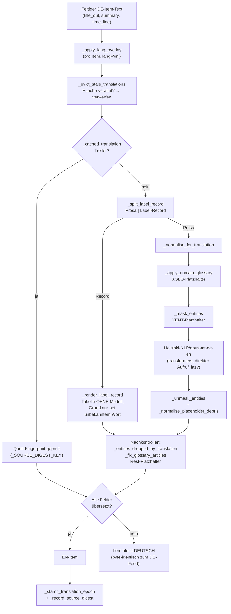

[Architektur-Karte — Wien ÖPNV Feed](architecture.md), Teil 6.

### Überwachung: Pages-Build (seit 2026-11-01)

Betreiberentscheidung (Michael, 2026-11-01, Karte „Soll ein gescheiterter
Pages-Build künftig sofort auffallen?“, Antwort „Beides bauen“). Anlass: Ab
dem Merge von #2092 um 08:43 Uhr Wiener Zeit hielt ein Liquid-Tag in
`docs/reference/ki_waechter.md` jeden Lauf von „pages build and deployment“
an (bis 11:13 Uhr Wiener Zeit 22 gescheitert, 4 abgebrochen). Der Fernseher
blieb auf dem Stand von 08:30 Uhr Wiener Zeit, die Update-Läufe blieben grün,
und der Health check meldete den Ausfall nicht (rot war er ab 10:01 Uhr
Wiener Zeit nur wegen des gescheiterten KI-Wächters, Prüfung
`Nebenschritte`); `Veröffentlichung` hätte erst bei vier Stunden Rückstand
gegen 13:00 Uhr Wiener Zeit angeschlagen. Beides gilt seither:

* **Health check, Prüfung `Pages-Build`** (`check_pages_build` in
  `scripts/health_check.py`). Sie liest über die Actions-API (`actions:
  read`, eigenes `GITHUB_TOKEN` des Laufs) die letzten 20 abgeschlossenen
  Läufe des Pages-Workflows; solange keiner davon sauber war oder zwischen
  dem neuesten und dem neuesten sauberen eine Laufnummer fehlt, bis zu 40
  weitere. Ein Lauf, den zwei Seiten listen, zählt einmal. Er hat keine
  Datei im Repository; seine Id findet sie über den
  Pfad `dynamic/pages/pages-build-deployment`. Läufe, die GitHub abbricht,
  weil ein neuerer Commit kam (165 von 1.972 vom 01.10. bis 01.11.2026),
  zählen nicht. Der letzte übrige Lauf nach **Laufnummer** entscheidet,
  nicht nach GitHubs Zeitstempel: Am 01.11. gab die Actions-API allen
  Läufen, die zwischen 08:00 und 08:59 UTC begannen, eine Stunde zu späte
  Zeiten (Ende der US-Sommerzeit) und listete sie vor neueren Läufen. Eine
  Zeit nach der Prüfung selbst kann nicht stimmen und bleibt weg. Dasselbe
  gilt für die Prüfung `Werkzeuge`.
  * `success`: grün.
  * Gescheitert im Schritt „Build with Jekyll“ (außer an GitHubs API,
    nächster Punkt): **sofort rot**. Der Inhalt unter `docs/` lässt sich
    nicht bauen, und jeder weitere Lauf scheitert gleich, bis die Seite
    korrigiert ist. Die Meldung nennt den Link zum
    Lauf und, solange der erste gescheiterte Lauf unter den gelesenen (bis
    zu 60) liegt, seit wann und wie viele Läufe in Folge und den Commit,
    nach dem der Build zuerst scheiterte; sonst „mindestens N Läufe in
    Folge“. 20 Läufe reichten im Oktober 2026 im Mittel etwa acht Stunden
    zurück, am 01.11. um 11:02 Uhr Wiener Zeit wegen der vielen Merges
    nicht bis zum Beginn um 08:43 Uhr Wiener Zeit.
  * Gescheitert im Schritt „Build with Jekyll“, aber an GitHubs API (die
    Fehlermeldung des Schritts, gelesen über die Annotationen des Jobs mit
    `checks: read`, nennt einen HTTP-Fehler von `api.github.com` oder
    ungültige Zugangsdaten): GitHubs Seite wie im nächsten Punkt. Das Gem
    `jekyll-github-metadata` fragt die API bei jedem Build und fängt nur
    Ratenlimit, 404 und Verbindungsabbruch ab; so scheiterte am 23.05.2026
    um 12:01 Uhr Wiener Zeit ein einzelner Lauf (ungültige Zugangsdaten, der
    nächste baute fünf Minuten später) und in der Nacht auf den 17.07.2026
    von 00:31 bis 01:31 Uhr Wiener Zeit drei in Folge (HTTP 503). Ist die
    Meldung nicht lesbar, bleibt es sofort rot.
  * Gescheitert an anderer Stelle (Image laden, Upload, Auslieferung):
    GitHubs Seite. Ein einzelner Lauf ist ein **Hinweis**, rot wird es,
    wenn auch der Lauf davor scheiterte. Das folgt der Alarmlinie unten
    (ein einzelner Aussetzer schickt keine Mail): Im Oktober 2026 scheiterte
    die Auslieferung viermal, jedes Mal einzeln, und der nächste Lauf
    lieferte wieder aus.
  * Gescheitert, aber die Jobs des Laufs sind nicht lesbar: rot.
  * Actions-API antwortet nicht, kein Pages-Workflow, kein abgeschlossener
    Lauf: Hinweis.

  Nachgerechnet über die Pages-Läufe vom 01.10. bis 01.11.2026, in der
  Reihenfolge, in der die API sie listete, mit einer Prüfung je Stunde (wie
  seit dem 28.10.): rot nur am 01.11. um 9, 10 und 11 Uhr Wiener Zeit, dazu
  drei Hinweise für die Auslieferungsfehler vom 05.10. und 08.10.; die vom
  14.10. und 20.10. endeten erst nach der Prüfung ihrer Stunde und waren vor
  der nächsten behoben. Zu den Zeiten der echten Health-check-Läufe am
  01.11. wäre `Pages-Build` um 09:01, 10:01 und 11:02 Uhr Wiener Zeit rot
  gewesen, jedes Mal mit dem Merge von #2092 als Beginn. Mit den echten
  Läufen der beiden API-Ausfälle: am 23.05. ein Hinweis, am 17.07. ein
  Hinweis nach dem ersten und rot ab dem zweiten gescheiterten Lauf, bis der
  vierte wieder baute. `Veröffentlichung` bleibt als Rückfall für einen
  Ausfall ohne gescheiterten Lauf (Pages abgeschaltet, ein Lauf, der nie
  startet).
* **Pull Requests, Workflow `pages-build-check.yml`.** Jeder Pull Request
  mit Änderungen unter `docs/` baut die Website mit derselben Action wie
  der Pages-Lauf (`actions/jekyll-build-pages` 1.0.13, Jekyll 3.10 mit dem
  Gem `github-pages`, Quelle `./docs`) und liefert nichts aus. Ein Fehler
  zeigt sich als roter Check am PR, bevor er `main` erreicht (der Check ist
  kein Pflicht-Check im Ruleset). Er fängt, was den Build anhält; gibt eine
  Vorlage nur still etwas anderes aus (eine unbekannte Variable, ein
  unbekannter Filter), bleibt er grün. Endet die erste Backtrace-Zeile im
  Protokoll des Schritts „Build with Jekyll“ mit `(Octokit::…)`,
  `(Faraday::…)` oder `(Jekyll::GitHubMetadata::Client::BadCredentialsError)`
  (ungültige Zugangsdaten; das Gem meldet `Octokit::Unauthorized` unter
  dieser Klasse, das Original steht weiter unten als Ursache), lag es an
  GitHubs API, auch wenn darüber `Liquid Exception` steht
  (`jekyll-github-metadata` fragt die API vor dem Rendern und noch einmal im
  ersten Layout); ein neuer Lauf behebt es. Die Annotation am Check nennt
  statt der Klasse den HTTP-Fehler von `api.github.com` oder die ungültigen
  Zugangsdaten. Seiten, die Workflows
  selbst nach `main` schreiben, erreichen keinen Pull Request (ein Push mit
  dem `GITHUB_TOKEN` startet außer dem Pages-Build keinen Workflow); für sie
  gilt der Liquid-Schritt in `scripts/publish_to_main.sh`
  ([`development.md`](development.md), „Veröffentlichen auf `main`“).

### Überwachung: Werkzeuge (seit 2026-10-31)

Fund B des Architektur-Reviews vom 2026-10-31 (Michael: „ja, bau das
bitte“): Zwei Werkzeug-Secrets konnten still sterben. `claude-code-review.yml`
ließ den Review-Schritt mit `continue-on-error` laufen (Entscheidung vom
2026-05-30 gegen rote Checks bei Aussetzern), sodass ein abgelaufener
`CLAUDE_CODE_OAUTH_TOKEN` nur einen grünen Check ohne Kommentare hinterließ;
`seo-guard.yml` beendete den Schritt für Beschreibung und Homepage des
Repositorys bei leerem `REPO_ADMIN_TOKEN` mit einer Zeile auf stderr und
Exit 0. Die Prüfung `Secrets` sieht beide nicht, weil sie als `tooling`
nicht an den Health check gehen ([„Nebenschritte“](architecture-teil-5.md#überwachung-nebenschritte-seit-2026-10-28)
gilt seither auch für sie, Regel vom 2026-10-28: „ein Fehler sollte auffallen“).

* **Repository-Metadaten (`seo-guard.yml`).** Der Schritt scheitert bei
  leerem Token und bei einer abgelehnten Anfrage (jeder HTTP-Code außer
  2xx, etwa 401 bei abgelaufenem Token), läuft mit `continue-on-error` vor der
  Veröffentlichung, und `record_side_steps.py` schreibt sein Ergebnis nach
  `data/side_steps/seo-guard.json`, das mit `sitemap.xml` und `llms.txt` im
  selben Commit mitfährt. Die Prüfung `Nebenschritte` ist rot, solange der
  letzte Lauf scheiterte oder die Aufzeichnung älter als 48 Stunden ist
  (`HEALTH_SEO_MAX_AGE_HOURS`; der tägliche Cron kommt Stunden verspätet,
  zwei Tage ohne Lauf sind ein Ausfall). Seit 2026-11-04 (Michael, Karte
  „Beides“; Anlass: ein 502 von GitHub um 11:03 Wien während eines
  GitHub-Ausfalls, im Log als „Token abgelaufen“ gemeldet) unterscheidet der
  Schritt: Eine Störung bei GitHub (5xx oder keine Verbindung) wiederholt er
  nach 30 und 90 Sekunden; hält sie an, zählt er als `overloaded`, und die
  Prüfung bleibt ein Hinweis, bis 48 Stunden kein Lauf gelang
  (`HEALTH_SEO_OVERLOAD_HOURS`); den nächsten Lauf (Merge mit Änderung unter
  `docs/` oder täglicher Cron) heilt es von selbst. 401, 403, 404 und 422
  bleiben sofort rot und nennen den HTTP-Code.
* **Code-Review (`claude-code-review.yml`).** Der Workflow läuft auf Pull
  Requests und kann nichts nach `main` schreiben, deshalb gibt es keine
  Aufzeichnung. Stattdessen darf der Review-Schritt seit 2026-10-31
  scheitern (kein `continue-on-error` mehr): Der Check am PR wird rot (er ist
  kein Pflicht-Check im Ruleset und hält keinen Merge auf), und die neue
  Prüfung `Werkzeuge` (`check_tooling_runs`) liest über die Actions-API
  (`actions: read`, eigenes `GITHUB_TOKEN` des Laufs) das Ergebnis des
  letzten abgeschlossenen Laufs, der lief (nach Laufnummer, siehe
  „Pages-Build“; übersprungene und abgebrochene Läufe zählen nicht, etwa die
  von Dependabot, am 01.11. neun in Folge): `success` grün, alles andere
  rot mit Link zum Lauf, bis ein Review wieder lief. Nur wenn keiner der
  letzten 30 Läufe lief, ist das ein Hinweis.
  Pull Requests aus Forks und von Dependabot haben keine Secrets und werden
  wie bisher übersprungen. Eine Actions-API, die nicht antwortet, ist ein
  Hinweis, denn sie sagt nichts über das Werkzeug.

### Alarmwege: rot, Issue, Hinweis (seit 2026-10-28)

Betreiberentscheidung (Michael, 2026-10-28, Karte „Linie, Issue als
Frühwarnung“, auf seine Bitte „Finde eine klare Linie, damit dies in der
Zukunft ein klares System hat“). Jede Prüfung beantwortet genau eine der
drei Fragen und hat damit genau einen Weg:

| Weg | Frage | Wer meldet | Fälle |
| --- | --- | --- | --- |
| **Rot** (GitHub-Mail) | Arbeitet die Technik nicht, und zwar anhaltend? | Health check (`scripts/health_check.py`), stündlich | Eine Quelle (WL, ÖBB, Baustellen, Stammstrecke) gab den Update-Läufen seit **3 h** keine brauchbare Antwort; der Feed ist seit **4 h** nicht neu gebaut; die veröffentlichten Feeds auf GitHub Pages liegen seit **4 h** hinter dem Repo; der letzte Pages-Lauf scheiterte im Jekyll-Build (sofort) oder zwei Pages-Läufe in Folge scheiterten bei GitHub; der Stationslauf ist älter als 8 Tage, ein Teilschritt scheiterte oder die Validierung fand Sicherheitsprobleme; eine Quelle des Stationslaufs antwortete seit 15 Tagen nicht; ein Nebenschritt scheiterte im letzten Lauf oder seine Aufzeichnung ist veraltet; der SEO-Lauf konnte die Repository-Metadaten nicht setzen (`REPO_ADMIN_TOKEN`); der letzte Lauf des Code-Reviews scheiterte (`CLAUDE_CODE_OAUTH_TOKEN`); der Feed-Wächter konnte nicht prüfen; das Übersetzungsmodell lud in zwei Builds in Folge nicht (seit 2026-11-01); IFTTT schweigt, und auch der Takt-Fallback brachte seit **80 min** keinen neuen Build (Prüfung `Takt`, seit 2026-11-04; diese Läufe startet der Bot, die Mail kommt deshalb über den Kommentar im Issue `ifttt-ausfall`, siehe unten); ein Pflicht-Secret ist leer. |
| **Issue** (Lauf bleibt grün) | Arbeitet die Technik, aber Feed-Inhalt oder Quelle sehen falsch aus? | Feed-Wächter (`scripts/feed_watch.py`), jeder Update-Lauf; je Regel ein Issue, das sich nach zwei sauberen Läufen selbst schließt | Die Inhaltsregeln (doppelter Eintrag, Anzahl, alte Meldung als neu, „Seit“ zu früh, ÖBB-Zweitsatz, Zeitzeile, Zeit vorbei, Länge, Höflichkeitssatz) und die Quellenregeln (`quelle-leer`, `quelle-einbruch`, `verwurf-sprung`, seit 2026-10-29 `vao-version`: die automatisch gewählte VAO-Version hat gewechselt); seit 2026-11-10 `meldung-uebersprungen`: der Bau hat eine Meldung übersprungen, an der die Feed-Kette scheiterte (§10). |
| **Hinweis** (ℹ️, `::warning`) | Ist die Lage bekannt und verlangt nichts? | Health check | Eine stille Stammstrecken-Richtung, ein Korridor ohne Züge (die Website meldet ihn), eine gescheiterte Stichprobe, während die Update-Läufe noch Antworten bekommen, ein Live-Abruf der veröffentlichten Feeds, der gerade nicht gelang, ein einzelner Pages-Lauf, dessen Auslieferung bei GitHub oder dessen Jekyll-Build an GitHubs API scheiterte, eine Aufzeichnung, die vor dem ersten Lauf noch fehlt, IFTTT schweigt, während der Takt-Fallback den Feed aktuell hält (seit 2026-11-04). |

**Frühwarnung:** Drei Technikfälle melden zusätzlich früher ein Issue, bevor
sie rot werden: `quelle-ohne-antwort` nach 2 h (rot nach 3 h),
`feed-alter` nach 90 min (rot nach 4 h) und seit 2026-11-04 `ifttt-ausfall`:
Kam 40 Minuten lang kein Update-Lauf, startet der Takt-Fallback
(`.github/workflows/takt-fallback.yml`) ihn selbst, alle 40 Minuten, und
öffnet das Issue; der nächste IFTTT-Lauf schließt es. Gewartet wird ohne
Rechner (Wartezeit der Umgebung `takt-wartezeit`). Rot wird
erst, wenn auch der Fallback seit 80 Minuten keinen neuen Build brachte.
Diese roten Läufe startet der Bot, und GitHub mailt einen roten Lauf nur
dem, der ihn startete; deshalb kommentiert der Fallback das Issue, sobald er
scheitert, und noch einmal, wenn er wieder läuft (Michael, 2026-11-04,
Karte „Ja, Kommentar im Issue“).
Betreiberentscheidung (Michael, 2026-11-04): „Sorge aber bitte dafür, dass
der Fallback wirklich nur läuft, wenn IFTTT nicht funktioniert hat. Wenn
IFTTT nicht funktioniert erstelle einen Issue. Wenn der Fallback auch nicht
funktioniert, und der Feed nicht mehr aktualisiert werden kann, mach den
Health Check rot.“ Andere Technikfälle bekommen kein Issue. Ein Inhaltsfund wird nie rot.

**Für eine neue Prüfung:** Fragt sie, ob die Technik läuft, wird sie rot,
mit einer Dauerschwelle, damit ein einzelner Aussetzer keine Mail
auslöst. Fragt sie, ob das Ergebnis stimmt, wird sie eine Feed-Wächter-Regel
mit Issue. Beschreibt sie eine bekannte Lage ohne Handlung, wird sie ein
Hinweis. Die Frühwarnung bleibt den Technikfällen vorbehalten, die später
rot werden.

Umgesetzt mit dieser Entscheidung:

* **Gleiche Regel für alle Quellen.** Vorher wurden WL, ÖBB und Baustellen
  nur rot, wenn die eigene Stichprobe des Health checks im Moment seines
  Laufs scheiterte: ein einzelner Aussetzer reichte, ein siebenstündiger
  Ausfall (WL, 21.10.2026) wurde einmal rot, weil zufällig ein Lauf in ihn
  fiel. Jetzt entscheidet, wann die Update-Läufe zuletzt eine brauchbare
  Antwort bekamen (Exit-Code 0 des Abrufs, festgehalten vom Feed-Wächter in
  `data/feed_watch.json` → `fetch`, `assess_source` in
  `scripts/health_check.py`). Die Stichprobe entscheidet allein nur noch,
  wenn dieser Stand nicht taugt (fehlt, veraltet, Wächter mit Fehler).
* **Stündlicher Health check.** GitHub stellt den Cron des Health checks
  unzuverlässig zu: Am 28.10.2026 lief er zwischen 13:19 und 23:19 nicht,
  der Stammstrecken-Ausfall von 15:00 bis 23:00 wurde deshalb nie rot.
  `health-check.yml` startet jetzt zusätzlich nach jedem Update-Lauf
  (`workflow_run`); die Bedingung des Jobs `health` lässt jeden zweiten
  durch (gerade Laufnummer des Update-Laufs). Bis 2026-11-05 tat das ein
  Job `gate` nach der Uhr (UTC-Minute unter 30) und startete dafür 48-mal
  am Tag einen Rechner; nachgespielt über die 1.607 Update-Läufe vom 05.10.
  bis 04.11.2026 gibt die Laufnummer im Median 26 statt 27 Prüfungen am Tag,
  denselben größten Abstand (120 Minuten, einmal) und keine zwei Prüfungen
  binnen 20 Minuten mehr (die Uhr gab 67, nach einem Backup-Cron um :17).
  Der Cron bleibt als Rückfall, falls der Update-Lauf ausfällt. Während
  eines anhaltenden Ausfalls kommt jede Stunde eine Mail.

Rückprüfung 01.09.–28.10.2026 (2 776 Update-Läufe mit Abruf, 1 388
simulierte stündliche Prüfungen): Nach der neuen Regel wären es zehn rote
Stunden gewesen, alle in den zwei echten langen Ausfällen: WL am 21.10.
von 19:00 bis 23:00 und die Stammstrecke am 28.10. von 18:00 bis 22:00. Eine
stündliche Stichprobe nach der alten Regel hätte 29-mal rot gemeldet, davon
24-mal für Aussetzer, die der nächste Update-Lauf schon hinter sich hatte
(ÖBB 15-mal, WL 8-mal, Baustellen einmal).

**Nächtliche Betriebspause** (auf Michaels Hinweis „Vergiss die
Betriebspause in der Nacht nicht“, 2026-10-28): Sie macht keine Prüfung
rot, denn jede Regel misst die Antwort der Quelle, nie die Zahl der Züge
oder Meldungen. Nachgemessen über die Läufe seit September: Die
Stammstrecken-Abfrage bekam auch nachts alle 30 Minuten eine Antwort; von
01:00 bis 03:00 war die Tafel 35-mal leer, was nach der Entscheidung vom
2026-10-10 ein funktionierender Abruf ist (die Website nennt den Korridor
ohne Züge). Die Update-Läufe kamen in 58 Nächten ohne Lücke über 45
Minuten. WL und ÖBB lieferten nie eine leere Liste (mindestens 68 bzw. 9
Meldungen im Cache). Eine leere Liste zählt beim Abruf als unbrauchbar
(Exit 1) und würde nach 3 h rot; das passt, weil beide Quellen auch nachts
Dauermeldungen führen. Die Richtungsprüfung der Stammstrecke vergleicht die
Richtungen miteinander und ist deshalb nachts ruhig (siehe oben). Fällt eine
Quelle nachts wirklich aus, kommt die Mail wie tagsüber jede Stunde.

---

## 8. Der zweisprachige Feed (DE → EN)

`docs/feed.en.xml` ist kein eigener Feed, sondern ein **Spiegel** von
`docs/feed.xml`: dieselben Items, dieselbe Reihenfolge, dieselben Zeiträume
— nur Titel und Rumpf auf Englisch. Beide Dateien entstehen im selben
Build-Lauf (`build_feed.main`, Ende von `src/build_feed.py`), der den
fertigen deutschen Feed schreibt und danach denselben Item-Satz ein zweites
Mal durch `_make_rss(..., lang="en")` schickt.

Der Code der Übersetzung steht seit 2026-11-03 in Teilen unter
`src/feed_build/` (Etappe 8, [Modularisierung](modularisierung.md));
`src/build_feed.py` reicht die Namen weiter. Die Schritte des Diagramms
unten liegen so:

| Teil | Schritte |
| --- | --- |
| `translation_cache` | `_apply_lang_overlay`, `_cached_translation`, `_cached_translation_defect` |
| `translation_epoch` | `_TRANSLATION_CACHE_EPOCH`, `_evict_stale_translations`, `_stamp_translation_epoch`, `_record_source_digest` |
| `pretranslate` | `_split_label_record`, `_normalise_for_translation` |
| `translate_run` | `_translate_text_attempt`, `_render_label_record` |
| `translate_titles` | `_translate_text`, `_translate_title_attempt` |
| `placeholders` | `_PLACEHOLDER_NONCE`, `_placeholder_nonce`, `_apply_domain_glossary`, `_normalise_placeholder_debris` |
| `entities`, `masking` | Entitätsmuster, `_mask_entities`, `_unmask_entities` |
| `model_pass` | `_model_pass`, Prüfung auf Platzhalterreste |
| `en_repairs`, `en_templates` | `_entities_dropped_by_translation`, `_fix_glossary_articles`, EN-Vorlagen |
| `translator` | `_get_translation_pipeline`, `_MarianTranslator`, `_TRANSLATION_STATE`, `_record_translation_status` |

Ein Test ersetzt einen dieser Namen in dem Teil, dessen Code ihn liest;
`_get_translation_pipeline` lesen mehrere Teile, dort ersetzt `setattr_all`
ihn in jedem.

Übersetzt wird **auf Item-Ebene, nach der deutschen Formatierung**. Das ist
wichtig für das Verständnis der ganzen Kette: Kürzung auf 180 Zeichen,
Satz-Auswahl, Dedupe gegen den Titel und `MaxItems` sind zu diesem Zeitpunkt
längst passiert. Die Übersetzung sieht genau den Text, den auch ein deutscher
Leser sieht — nicht den Rohtext des Providers.

### Die beiden Invarianten

**1. Ein Item ist ganz englisch oder ganz deutsch.** `_apply_lang_overlay`
gibt bei einem Fehlschlag in *irgendeinem* Feld (`title`, `summary`,
`time_line`) das unveränderte `base` zurück. Ein gemischtsprachiges Item oder
ein „Partially translated"-Marker würde bedeuten, dass der englische Abonnent
etwas anderes liest als der deutsche — genau das verbietet der
Content-Parity-Vertrag. Wer hier eine „wenigstens teilweise"-Logik einbaut,
bricht ihn.

**2. Der Cache wird pro Identität geführt, nicht pro Text.** Die EN-Strings
liegen in `state[ident]["translations"]["en"]` und überleben Builds — bei
einer mehrjährigen Baustelle also Jahre. Zwei Mechanismen brechen diese
Persistenz auf, und sie haben **getrennte Zuständigkeiten**:

| Mechanismus | Invalidiert bei | Wer ihn zieht |
| --- | --- | --- |
| `_TRANSLATION_CACHE_EPOCH` | Änderungen auf **unserer** Seite (Masking, Glossar, Entity-Muster) | du, von Hand, im selben PR |
| `_SOURCE_DIGEST_KEY` | Änderungen **upstreams** (WL formuliert dieselbe Störung um) | automatisch, pro Feld |

Die „Sticky-German"-Bremse erzwingt einen neuen Versuch nur, wenn der
gecachte Wert *gleich dem deutschen Quelltext* ist. Eine **falsche, aber
nicht-deutsche** Übersetzung — `Schlachthausgasse` als „slaughterhouse gas",
bevor der Straßen-Suffix-Masker existierte — wird ohne Epochen-Bump für die
Lebensdauer des Items weiter ausgeliefert. Das ist die praktische Regel:
**wer Masking oder Glossar verbessert, erhöht die Epoche im selben PR**,
sonst sieht niemand die Verbesserung. Die Epochen-Historie steht als
Kommentar bei der Konstante in `src/feed_build/translation_epoch.py` und ist
dort zu ergänzen.

### Was am Modell vorbeigeht

Nicht jeder Text gehört in ein NMT-Modell:

* **Label-Records.** Endet der Text auf mindestens
  `_MIN_LABELS_FOR_RECORD` (= 2) `Label: Wert`-Paare — bis 2026-10-05 vor
  allem die WL-Haltestellenverlegungen mit `Haltestelle:` / `Von:` /
  `Nach:` / `Dauer:`, seither der WL-Störungsschluss „Voraussichtliche
  Dauer: … Grund: …“ —, trennt
  `_split_label_record` sie ab und `_render_label_record` setzt sie **ohne
  Modell** aus dem Glossar zusammen. Nur die Prosa davor geht durch Marian.
  Ein Modell, das eine Tabelle als Satz liest, erfindet Zusammenhänge.
  Die *Werte* setzt `_gloss_record_values` um — eine eigene, nur hier
  wirkende Wortliste für die kleine Grammatik hinter `Dauer:` und
  `Nach:` (Datumspräposition an eine Ziffer gebunden, Monatsnamen, „etwa",
  „bis auf Widerruf", „Meter in Richtung"). Nicht im Glossar, weil „ab",
  „bis", „vor", „nach" in Prosa gewöhnliches Deutsch sind. „bis
  voraussichtlich“ wird im Record vorher zu „bis etwa“ und damit „until
  approx.“, am Wertanfang groß („Duration: Until approx. 22:00“); in Prosa
  greift der Glossar-Eintrag „bis voraussichtlich“ → „until approx.“
  (seit 2026-09-26, Audit vom 25.09., A.3; vorher „until expected“).
  Seit 2026-10-06 steht im deutschen Text „Voraussichtlich bis 14:10 Uhr.“
  statt „Voraussichtliche Dauer: 14:10 Uhr.“ (§1, „Titel und Beschreibung“). Der Satz zählt wie ein
  Label und beginnt den Record (`_EXPECTED_UNTIL_RE`); als letzter Satz ist
  er auch allein ein Record. `_render_record_table` setzt ihn als „bis …“
  zusammen und stellt „Expected“ davor: „Expected until 14:10.“, „Expected
  until approx. 22:00.“, „Expected until Sunday end of service.“ Die
  Wertliste kennt dafür die Wochentage, „circa“ und „Anfang“/„Mitte“ vor
  einem Monat („Wien Mitte“ bleibt ein Name), das Glossar
  „Betriebsschluß“ und „Betriebschluss“. Eine Hausnummernspanne beginnt
  nicht mehr an der Ziffer eines Label-Platzhalters („Duration:-19
  September“ wurde „Duration: Until 19 September“). Kleingeschriebenes
  „voraussichtlich bis“ in Prosa (ÖBB, WLs „Die Störung dauert …“) bleibt
  Prosa.
  Seit dem EN-Audit vom 2026-10-03 gehört ein „Voraussichtliche“ vor dem
  ersten Label zum Record („Expected duration:“; vorher blieb es als letztes
  Wort der Prosa stehen und wurde verschluckt oder einzeln übersetzt), und
  ein abschließendes `Grund:` wird eigens behandelt: Kennt das Glossar jedes
  Wort, entsteht es ohne Modell („Reason: third-party traffic accident in the
  stop area of Broßmannplatz.“), sonst geht nur dieser kurze Satz durchs
  Modell. Vorher blieb jedes unbekannte Ursachenwort deutsch, weil der Record
  das Modell nie sah („Reason: Tiere im Gleis im Haltestellenbereich …“).
  Seit 2026-10-05 stehen „Von:“ und „Nach:“ einer Verlegung als
  „Donaufelder Straße 48 → Donaufelder Straße 40-42“ im deutschen Text
  (`_relocation_first`). Der Pfeil wird wie jeder Pfeil maskiert
  (`_PRESERVED_SYMBOLS_RE`). Durchs Modell kamen die Orte verklebt und mit
  Platzhalter-Resten heraus (erster Lauf 05.10. 17:45: „Wienerbergstraße27b-27c
  →Wienerbergstraße27a. … 15A5X …“); seit Epoche 23 setzt
  `_render_wl_sentence` jeden Satz mit Pfeil wie früher den Record ohne
  Modell zusammen (`_render_record_table`: „Hartäckerstraße 65 → approx. 50
  metres towards Borkowskigasse.“). Die Lage am Ort bekommt dabei ihr
  englisches Wort, für jedes Wort, das von Juli bis 23.10.2026 in den 101
  Verlegungen deutsch blieb (Epoche 26, `_RECORD_VALUE_RULES`: „Gleiskörper“
  → „track area“, „Haltestelle Straßenbahn“ → „tram stop“, „Parkanlage“,
  „Einfahrt“, „Stiege“, „Richtung Ampel“, „unter“, „in Fahrtrichtung
  Kagran“ → „in the direction of Kagran“). Seit Epoche 33 auch der Eingang
  eines Parks oder Gebäudes, gebunden an den Genitiv oder „zum“/„zur“
  dahinter (`_ENTRANCE_OF_RE`): „Filmteichstraße vor Nordeingang des
  Kurparks“ (68A, 05.11.2026) las „Filmteichstraße before Nordeingang des
  Kurparks“ und liest nun „Filmteichstraße before the north entrance of
  Kurpark“; der Name dahinter steht in der Grundform wie jeder Name im
  englischen Feed. Eine Haltestelle mit dem Wort im Namen („Kurpark
  Nordeingang“, „Laaer Berg, Nordosteingang“) bleibt ihr Name. Unter den
  188 Verlegungs-Records von WL seit Februar 2026 ändert sich nur dieser.
  Seit Epoche 34 gilt das für jeden Weg hinein oder hinaus, nicht nur den
  Eingang (`_ACCESS_NOUNS_EN`: Eingang, Ausgang, Zugang, Einfahrt,
  Ausfahrt, Zufahrt, Hauseinfahrt): „Würzburggasse nach Einfahrt zum
  Friedhof“ (8A, 13.11.2026, KI-Wächter-Issue #2209) las „Würzburggasse
  after the driveway zum Friedhof“ und liest nun „Würzburggasse after the
  driveway to Friedhof“. „Zufahrt zum Campingplatz“ behält seinen festen
  Wortlaut. Unter den 256 Verlegungswerten von WL seit 28.09.2026 ändert
  sich nur dieser.
  Ein Satz endet dabei nicht hinter einer
  Ordnungszahl am Adressanfang („1. Haidequerstraße“) oder einer Abkürzung
  („ggü. 40“, `_WL_SENTENCE_SPLIT_RE`).
* **ÖBB-Sätze nach Vorlage.** ÖBB schreibt Störungen fast immer in einem
  Satz mit festen Feldern: „Wegen <Ursache> sind|waren zwischen <A> und
  <B>|in <A> [Zugfahrten] [bis [voraussichtlich] <Zeit> Uhr|derzeit] keine
  Fahrten|nur eingeschränkt möglich.“ (407 der 455 ÖBB-„Wegen“-Sätze seit
  Mai). `_translate_oebb_templates` setzt solche Sätze aus den Feldern
  zusammen („Due to a police operation, no trains can run between …
  until approx. 20:30.“); nur „Wegen <Ursache>“ geht als kurze Phrase durchs
  Modell, Stationsnamen bleiben wie ÖBB sie schreibt, nur ein nachgestelltes
  „Bahnhof“/„Bahnhst“ wird „station“. Vorher verlor das Modell regelmäßig das
  Verb am Satzende („… to 23:48 were not possible.“). Sätze ohne Vorlage
  nehmen den normalen Weg. Die Vorlage kennt auch ein Datum vor der Uhrzeit
  („bis voraussichtlich 27.08.2026, 23:59 Uhr“), die Wortfolge
  „voraussichtlich bis“ und die Gemeinde in eckigen Klammern hinter dem
  Bahnhof („Hinterstoder Bahnhof [in St.Pankraz]“). Ein Stationsfeld enthält
  nur einen Namen: Steht darin eine Ziffer oder ein Wort wie „Zugfahrten“,
  „bis“, „bzw“ oder „am“ (`_OEBB_SLOT_NOT_A_NAME_RE`), weicht der Satz von
  der Vorlage ab und nimmt ebenfalls den normalen Weg. Vorher landete jede
  Abweichung nach der zweiten Station im Stationsfeld, Deutsch mitten im
  englischen Satz („… and Gramatneusiedl Bahnhof Zugfahrten bis
  voraussichtlich 27.08.2026, 23:59 Uhr.“; vierte Nachprüfung 2026-10-03).
  Seit 2026-10-09 (Epoche 25) darf der Ort fehlen, weil der deutsche Text
  ihn weglässt, wenn der Titel ihn nennt („…, no trains could run until
  20:18.“, siehe §1, „ÖBB: der zweite Satz“). ÖBBs feste Folgesätze setzt
  `_render_oebb_follow_up` ohne Modell zusammen („Planen Sie derzeit noch
  bis zu 10 Minuten mehr Reisezeit ein.“ → „For now, allow up to 10
  minutes of extra travel time.“; ebenso „Es kommt noch zu vereinzelten
  Zugausfällen und Verzögerungen.“, „Über die Dauer der Unterbrechung kann
  derzeit noch keine Angabe gemacht werden.“, „Die Züge warten die Sperre
  vorerst ab.“, „Ihre Reisezeit verlängert sich um bis zu N Minuten.“):
  249 der 261 zweiten Sätze, die der deutsche Text seither behält; die
  übrigen („Fernverkehrszüge und CJX Züge werden umgeleitet.“) nehmen den
  normalen Weg. Der Satz endet nicht mehr hinter „St.“ („in St. Pölten
  Hbf“): 42 der 443 ÖBB-Texte gingen vorher in zwei Hälften durchs Modell.
* **WL-Sätze mit „Wegen …“ (seit 2026-10-05).** WL schreibt Ursachen wie
  ÖBB vor den Hauptsatz („Wegen Bauarbeiten im Bereich Wildbadgasse wird die
  Linie 20A umgeleitet.“), und das Modell verlor daran den Sinn
  („Construction works in the area of Wildbadgasse is redirected to line
  20A.“, 3 sinnentstellte Sätze seit Juli; nach der Textänderung bei U6 Neue
  Donau fiel der Grund ganz weg). Die Hauptsätze sind freie Prosa, Felder
  gibt es nicht: `_render_wl_because_sentence` übersetzt die Ursache als
  kurze Phrase (wie bei ÖBB) und den Hauptsatz als eigenen Satz, eröffnet
  mit „Deshalb“, damit das Verb an zweiter Stelle bleibt. Das „Therefore,“
  des Modells fällt weg, die Ursache tritt an seine Stelle („Due to
  construction works in the area of Wildbadgasse, line 20A is diverted.“).
  Beginnt das Modell den Hauptsatz anders oder enthält die Ursache ein Komma
  (244 von 255 WL-„Wegen“-Sätzen seit Juli passen), geht der Satz wie bisher
  als Ganzes durchs Modell. Epoche 22. Gibt das Modell die Ursache als
  bloßes Hauptwort zurück („Renovation of the platform“, erster echter Lauf
  05.10. 17:45), setzt `_oebb_cause_en` „Due to“ davor (Epoche 23, gilt auch
  für ÖBB).
* **Ursachen heißen immer „Due to“ (seit 2026-10-08).** Betreiberentscheidung
  vom 05.10. Das Modell gibt „Wegen“ mal als „Due to“, mal als „Because of“
  wieder: 72 der 309 verschiedenen Sätze, die der EN-Feed seit Juli mit
  einer Ursache eröffnete, begannen mit „Because of“ (63A, 29B), drei
  weitere sagten „because of“ mitten im Satz, und die Ursachen-Bausteine
  von ÖBB und WL nahmen beides an. `_cause_due_to` macht nach jedem
  Modelldurchlauf (`_model_pass`) aus „because of“, „owing to“, „on account
  of“ und „as a result of“ ein „due to“, wo immer es steht; ein großer
  Anfangsbuchstabe bleibt. Wörter ohne Ursachen-Bedeutung („following“,
  „As a result,“ ohne „of“, „Because the …“) bleiben unberührt. Werte aus
  dem Übersetzungs-Cache bekommen dieselbe Behandlung beim Ausliefern
  (`_cached_translation`), darum ohne Epochenwechsel und ohne neue
  Übersetzung. Nachgespielt über alle 4.820 EN-Feed-Stände seit Juli: 134
  der 4.205 verschiedenen Titel und Beschreibungen ändern sich, und zwar
  nur in diesem einen Wort. Seit der EN-Prüfung vom 2026-10-08 gehört auch
  „in view of“ dazu (kam nie vor, aber `_CAUSE_EN_RE` nimmt es als Ursache).
* **EN-Sinnfehler als Klassen (seit 2026-10-08, Epoche 24).** Alle 3.003
  verschiedenen deutschen Texte des Feeds seit Juli liefen durch das echte
  Modell; was den Sinn verfehlte, ist nach Klassen behoben:
  * WLs „Wegen <Ursache> kommt es zu (folgenden) Verkehrsmaßnahmen (für die
    Linie X).“ wird ohne Modell geschrieben (`_WL_SERVICE_CHANGES_RE`):
    „Due to <cause>, there are service changes.“ bzw. „…, the following
    service changes apply (to line X).“ (Wortwahl des Betreibers vom
    08.10.; vorher „transport is taking place“). Ebenso WLs zwei Sätze zu
    unregelmäßigen Intervallen (`_WL_IRREGULAR_INTERVALS_RE`): „Currently,
    there are irregular intervals on line N31 in both directions.“ und
    „After a service obstruction, there are irregular intervals.“
  * `_normalise_for_translation` schreibt WLs Kürzel aus („Li.“, „Ri.“,
    „Hlst.“/„Haltest.“, „Fahrleitungsgebr“, „Steig A“, „ONr.“), macht
    „Einstieg bei Linie 44“ zu „bei Haltestelle der Linie“, eine
    Querstraße hinter „nach“ in Halte- und Einstiegsmeldungen zu „just
    after“ und „kann nicht eingehalten werden“ / „hält … die Station … ein“
    zu „not served“ / „stops at“; „kann/können … die Haltestelle(n)/Station(en)
    … nicht einhalten“ mit dem Subjekt davor („Die Linie 66A kann die
    Haltestelle Atzgersdorf, Kirchenplatz in Richtung Reumannplatz nicht
    einhalten“, vorher „cannot follow the stop“) wird zu „hält nicht an der
    Haltestelle …“, das Glossar sagt „does not stop at“ (15.10.). Steht das
    Subjekt hinter dem Verb („Derzeit können die Züge der Linie U6 die Station
    Alser Straße in beiden Richtungen nicht einhalten“, U1, U2 und U6 seit Juli),
    kommt es vor das Verb und die Richtung hinter die Station („Derzeit die
    Züge der Linie U6 halten nicht in der Station Alser Straße in beiden
    Richtungen“), damit das Glossar greift. Vorher blieb der Satz ungeglost,
    und das Modell schrieb je nach Platzhalter-Nonce des zweiten Durchlaufs
    etwas anderes („stop towards Floridsdorf do not stop at the station“,
    „are unable to meet the Stadlau station“). Michael wählte die Behebung am
    16.10. (Karte „Englischer U6-Text“): Der Satz soll bei jedem Durchlauf
    gleich und sauber herauskommen. Mit dem Glossar besteht schon der erste
    Durchlauf mit den kurzen Platzhaltern; der Zufalls-Nonce des zweiten wird
    nicht mehr gebraucht, und das Ergebnis ist bei jedem Build dasselbe.
    Seit der Prüfung vom 16.10. gilt das auch für die Einzahl „die Station“
    mit dem Subjekt davor oder einer Uhrzeit hinter der Station („Die Linie
    U6 kann die Station Alser Straße nicht einhalten“; das Muster
    `Stationen?` traf nur „Statione(n)“) und für ein Subjekt mit „Linien“
    hinter dem Verb („die Züge der Linien U2 und U3“, „die Busse der Linien
    54A und 54B“, `_STOP_RULE_SUBJECT`). Ein Partizip, das das Glossar übersetzt
    („kurzgeführt“, „gesperrt“, „nicht angefahren“, „aufrecht gehalten“),
    kommt mit seinem Hilfsverb zusammen (`_GLOSSED_PARTICIPLE_RE`), damit das
    Modell es nicht abtrennt („line 5A curtailed“, „can be be maintained“).
  * Neue Glossar-Einträge: „unterschiedlichen Intervallen“, „über Gleis
    1/2“, „kurzgeführt“ → „curtailed“, „Ausgang“, „Sperre“, „gesperrt“,
    „Weichentausch“, „betriebslose Zeit“, „Nebenfahrbahn“, „Umleitung
    nach“, „verlegt nach“, „im Bereich der/des“ (vorher „in the area of
    of“).
  * Namen bleiben Namen: Wiener Orte, die gewöhnliche Nomen sind („Ring“,
    „Gürtel“, „Oper“, „Innere Stadt“, „Kurpark“, `_PLACE_NAME_ENTITIES`),
    Straßen mit Leerzeichen („Julius Raab Platz“, `_SPACED_STREET_NAME_RE`),
    Stationsnamen, deren Bindestrich zwischen zwei Leerzeichen steht
    („Burggasse - Stadthalle“ für „Burggasse-Stadthalle“, „Michelbeuern -
    AKH“, „Julius - Raab - Platz“; vorher „Burggasse - City Hall“, „Julius -
    Raab - square“, 16.10.; ein Leerzeichen nur auf einer Seite wie in
    „Lorenz-Müller- Gasse“ oder „Josef- Baumann- Gasse“ ist ein Tippfehler
    der Quelle, den das Modell in der Probe vom 16.10. stehen ließ, wie er
    geschrieben ist: der Name bleibt ein Name; ein Name mit diesem Tippfehler
    in einem ÖBB-Text, „Wien Erzherzog- Karl Straße“ (03.07.2026, nur im
    dritten Satz, den der Feed nicht zeigt), wird bewusst nicht eigens
    geschützt, Betreiberentscheidung 2026-10-16 „So lassen“: er kam nie ins
    Modell),
    „Erlaaer Schleife“ und das eine Wort nach „Richtung“
    (`_DIRECTION_NAME_RE`, außer Himmelsrichtungen und „Zentrum“). „in
    Richtung Bahnhof Heiligenstadt S U“ (43 Texte seit Juli) bleibt dem
    Modell überlassen, Betreiberentscheidung 2026-10-16 „So lassen“: meist
    kommt „towards the station Heiligenstadt S U“ heraus, selten „direction
    Heiligenstadt S U“ (05.10.); beides ist verständlich und richtig, und nur
    der englische Feed ist betroffen.
  Nachgespielt mit dem echten Modell über alle 3.003 Texte: Nur Texte mit
  einer dieser Formen ändern sich; die übrigen Unterschiede sind das
  bekannte Rauschen der Wiederholung unter zufälliger Nonce.
* **Ein Haltestellenname beginnt groß (seit 2026-11-12).** Die Suche nach
  Stationsnamen (`_station_entity_pattern`) ignoriert Groß- und
  Kleinschreibung, damit WLs Listen in Großbuchstaben („STADION U“) geschützt
  bleiben. Dadurch traf die Haltestelle „Am Bahnhof“ auch die Wendung „am
  Bahnhof“ im Fließtext: ÖBBs „Wegen einer Stellwerkstörung am Bahnhof …“
  stand im englischen Feed als „Due to an interlocking malfunction am
  Bahnhof, …“ (31.05. bis 02.10.2026; „interlocking fault am Bahnhof“ ab
  19.06.). Seit dem Glossareintrag „am Bahnhof“ → „at the station“ vom
  03.10.2026 verschwindet die Wendung vor der Maskierung, die Maskierung
  blieb aber falsch. Jetzt darf ein Treffer nicht mit der Kleinschreibung
  eines Anfangsbuchstabens aus dem Verzeichnis beginnen („a“, „ö“, „š“ von
  „Šatov“); jeder Name dort beginnt mit einem Großbuchstaben oder einer
  Ziffer. Gemessen an allen 10.309 Quelltexten seit Juni (jeder Cache-Stand
  von WL, ÖBB und Baustellen): Nur die 90 Texte mit „am Bahnhof“, alle von
  ÖBB, werden anders maskiert; alle großgeschriebenen Treffer („Am Platz“,
  „Am Schöpfwerk“, „Unter St. Veit“, „STADION“) bleiben Namen.
* **ÖBBs Abschnittsnamen auf Englisch (seit 2026-10-23).** Der
  deutsche Feed schreibt ÖBBs Abschnittsnamen normal („Teilausfall:“, §1,
  `_oebb_section_labels_cased`); das Modell machte daraus „Partial
  failure:“ (RJ 263, 18.–19.10.2026). Michael wählte am 23.10. feste Namen
  für alle Abschnittsnamen statt der Modellübersetzung. Steht ein solcher
  Name am Satzanfang (`_OEBB_LABELLED_SENTENCE_RE`: großgeschriebene Wörter,
  durch Leerzeichen oder „/“ verbunden, dann der Doppelpunkt), schreibt
  `_render_oebb_sentence` ihn aus `_OEBB_SECTION_LABELS_EN`, und nur der Rest
  des Satzes geht durch seine Vorlage oder das Modell. Die Liste enthält jeden
  Abschnittsnamen der 926 ÖBB-Meldungen in der Cache-Geschichte: „Achtung“ →
  „Please note“, „Ausfall“ → „Cancellation“, „Teilausfall“ → „Partial
  cancellation“, „Haltausfall“ → „Cancelled stops“, „Ersatzbeförderung“ →
  „Replacement service“, „Schienenersatzverkehr“ → „Rail replacement
  service“, „Geänderte Fahrzeiten“ → „Timetable changes“, „Hinweis(e)“ →
  „Note(s)“. Zwei Namen mit „/“ („Teilausfall/Schienenersatzverkehr“) werden
  Teil für Teil nachgeschlagen („Partial cancellation/rail replacement
  service“). Hat der Rest des Satzes eine ÖBB-Vorlage, wird er nach ihr
  geschrieben; sonst bekommt das Modell den Satz wie bisher samt Namen, und
  nur die Wörter vor seinem Doppelpunkt werden ersetzt. So liest das Modell
  den Rest im selben Zusammenhang, und im englischen Text ändert sich nur
  der Name. Ein unbekannter Name bleibt beim Modell wie bisher; andere
  Quellen sind nicht betroffen. Dabei kam ein Fehler der Satztrennung heraus:
  `_OEBB_SENTENCE_SPLIT_RE` trennte nach „bzw.“, „Wr.“ und „b.“ wie nach
  einem Satzende („zwischen Budapest-Keleti und Wien Hbf bzw. Salzburg Hbf
  fahren …“); diese Kürzel stehen vor einem Namen und trennen jetzt so wenig
  wie „St.“. Nachgespielt mit allen 926 ÖBB-Meldungen der Cache-Geschichte:
  die deutsche Fassung ist gleich; mit einem festen Echo-Modell ändern sich
  im englischen Feed vier Meldungsfassungen (RJ 263 dreimal, „Geänderte
  Fahrzeiten“ Budapest–Salzburg einmal), und zwar nur im Namen; mit dem
  echten Modell ebenso („Partial failure:“ → „Partial cancellation:“,
  „Modified journey times:“ → „Timetable changes:“). Von den 25 Sätzen mit
  Abschnittsnamen in den vollen Texten behalten 22 ihren englischen Rest
  wörtlich; zwei „Achtung: Ihre Reisezeit verlängert sich …“ bekommen die
  feste Folgesatz-Vorlage („Your journey takes up to 15 minutes longer.“),
  und der Budapest-Satz ist wieder ganz. Ein Wert im Übersetzungs-Cache, dem
  der feste Name fehlt („Partial failure:“), gilt als Fehler und wird neu
  übersetzt (`_oebb_section_label_defect` in `_cached_translation`, nur für
  ÖBB); eine neue Epoche hätte jede Meldung neu übersetzt.
* **ÖBBs „kann … nicht fahren“ auf Englisch (seit 2026-10-25).** Das Modell
  verlor das Verb hinter Strecken und Tagen (Jules-Audit 2026-10-25, beide
  aus dem EN-Feed): „… the S2 train can't drive 23360.“ und „Construction
  works allows between … on individual days of the S1 train …“, als führe
  der Zug. Über alle ÖBB-Texte seit Dezember 2025 las es diesen Satzbau oft
  falsch („… can be used by 10.08.2026“, „… cannot drive R95 trains“). Der
  Satz wird jetzt aus seinen Teilen geschrieben, in ÖBBs Reihenfolge wie in
  der mit den Zügen vorn (§1): „Due to construction works, the S2 train 23360
  cannot run between Wien Leopoldau station (U) and Mistelbach/Zaya station on
  25.10.2026 and 01.11.2026.“ (`_oebb_cannot_run_parts`). Nur die Ursache geht
  durch das Modell. Züge: „der S1-Zug 23626“ → „the S1 train 23626“, „der Zug
  RJ 650“ → „train RJ 650“, „keine Nahverkehrszüge … fahren“ → „no local
  trains can run“, „einige …“ → „some …“, „Fernverkehrszüge“ → „long-distance
  trains“. Strecken und Tage aus einer festen Menge: „zwischen A und B“ (auch
  „A bzw. B“ → „A or B“), „am …“ → „on …“, „von … bis …“ → „from … to …“,
  „bis voraussichtlich Ende 2027“ → „until probably the end of 2027“, „an
  einzelnen Tagen“ → „on certain days“, „(jeweils 08:45 Uhr - 14:45 Uhr)“ →
  „(each day 08:45 - 14:45)“. Steht etwas anderes da („in der Nacht von …“,
  „(jeweils Samstag, Sonntag und Feiertag)“), bleiben Züge und Verb fest, und
  nur Strecken und Tage gehen hinter einem Doppelpunkt durch das Modell. Ein
  vom Schnitt gekürzter Satz behält sein „…“. Ein Satz mit „Teilausfall:“
  vorn oder einem anderen Satzbau bleibt beim bisherigen Weg. Ein Wert im
  Übersetzungs-Cache ohne die feste Form gilt als Fehler und wird neu
  übersetzt (`_oebb_cannot_run_defect`, nur ÖBB, keine neue Epoche).
  Nachgespielt mit dem echten Modell über die 102 betroffenen ÖBB-Texte:
  98 ändern sich, alle lesen jetzt „cannot run“ oder „can run“; der
  Feed-Neubau vom 25.10. ändert nur S1 und S2.
* **„<Anlass>verkehr“ bei WL und ÖBB (seit 2026-10-30).** Das Modell kennt
  solche Komposita nicht und verliert den Kopf oder den Sinn: „38B/39B:
  Allerheiligenverkehr 01.11.2026“ stand als „38B/39B: All Saints' Worship
  01.11.2026“ im EN-Feed (Jules-Audit 2026-10-30), „Feiertagsverkehr“ wird
  „Public holidays“, „Konzertverkehr“ „Concertation“. Den Anlass allein
  übersetzt es richtig („Allerheiligen“ → „All Saints“, „Fronleichnam“ →
  „Corpus Christi“, „Silvester“ → „New Year's Eve“). Schreibt ein Betreiber
  über seine Linien, ist „Verkehr“ am Ende eines Kompositums sein Angebot.
  Darum ersetzt `_mask_service_compounds` (nach dem Glossar, vor dem
  Maskieren) in WL- und ÖBB-Texten jedes „<Anlass>verkehr“ (auch mit
  Fugen-s, Endung „-s“/„-es“ oder „-Verkehr“) durch einen Glossar-Platzhalter:
  den Anlass, allein durch das Modell übersetzt (`_service_modifier_en`, pro
  Lauf einmal je Anlass), plus „service“, also „All Saints service“. Ein
  gebeugtes Glossar-Kompositum („des Schienenersatzverkehres“) bekommt das
  Englisch seiner Grundform. Beim Modell wie bisher bleiben Komposita, deren
  erster Teil Straßenverkehr, ein Verkehrsmittel, ein Gebiet oder eine
  Tageszeit nennt, die das Modell allein falsch liest
  (`_SERVICE_COMPOUND_KEEP`: „Kreisverkehr“ → „roundabout“,
  „Gesamtverkehr“, „Individualverkehr“, „Pendelbusverkehr“ → „shuttle bus
  service“, „Straßenbahnverkehr“, „Regionalverkehr“, „Morgenverkehr“, weil
  „Morgen“ allein „Tomorrow“ wird). Ebenso ein Anlass, dessen Übersetzung
  leer, länger als vier Wörter oder noch deutsch ist. Baustellen-Texte
  handeln vom Straßenverkehr und bleiben unberührt. Ein Wert im
  Übersetzungs-Cache, dem das feste Englisch eines Anlasses fehlt, gilt als
  Fehler und wird neu übersetzt (`_service_compound_defect`, keine neue
  Epoche).
  Nachgespielt mit dem echten Modell über alle 281 WL- und ÖBB-Meldungen
  der Cache-Geschichte mit einem solchen Kompositum: Im Feed ändert sich nur
  der Titel „38B/39B: Allerheiligenverkehr 01.11.2026“ („All Saints'
  Worship“ → „All Saints service“); der Feed-Neubau vom 30.10. mit dem
  Übersetzungs-Cache ebenso, der deutsche Feed ist gleich.
* **Halte-Meldungen der WL.** Nach „Busse/Züge halten“ und „Ersatzbus hält“
  wählte das Modell die Präposition in jedem Lauf neu („Buses stop
  Salvatorianerplatz“, „Trains stop for lines 6 and 18“). Seit 2026-10-04
  (Jules-Audits vom 02. und 04.10., Epoche 21) schreibt
  `_normalise_stop_verbs` den deutschen Text vorher um: Ein Ort direkt nach
  dem Verb oder nach „bei“ bekommt „an“, das Glossar macht daraus „… stop
  at“; die Haltestelle einer anderen Linie („bei [der] Linie 18“, „Linien 6
  und 18“) wird „bei Haltestelle der Linie“ bzw. „bei den Haltestellen der
  Linien“ („at the stop(s) of line(s)“). Eine eigene Präposition („in“,
  „auf“, „am“, „vor“, „nach“, „gegenüber“, „Richtung“) bleibt dem Modell.
  „Züge/Busse halten nicht“ ist „… do not stop“. Seit 2026-10-09 (Epoche
  25) gilt das auch, wenn ein einzelnes Fahrzeug seine Linie trägt
  („Ersatzbus 26E hält Karl-Waldbrunner-Platz“, „Linie 26E hält …“,
  „Ersatzverkehr hält …“): Das Modell las „hält“ dort als „holds“
  („replacement bus 26E holds Karl-Waldbrunner-Platz ahead of …“, offener
  Punkt r). „hält an“ am Satzende ist das andere Verb („Die Störung hält
  an.“) und wird vorher zu „dauert an“ (`_PERSISTS_RE`), damit es nicht
  „stops at“ wird.
* **Nicht-übersetzbarer Inhalt.** `_is_non_translatable_content` erkennt
  maskierte Texte, in denen nach dem Maskieren nichts mehr steht, was ein
  Modell übersetzen könnte. Das sind reine Linien- und Stationsfolgen, seit
  2026-09-25 auch Linie plus Glossar-Begriff: „94A: Verkehrsunfall“ →
  `XENT…: XGLO…` → „94A: traffic accident“. Ein Glossar-Platzhalter steht
  bereits für den englischen Begriff. Solche Texte gehen nicht mehr ans
  Modell, das sie je nach Nonce verstümmelte. Die Umsteige-Kennungen hinter
  einem Haltestellennamen („Meidling Hauptstraße U“, „S U“) zählen dabei
  nicht als Wort (seit 2026-10-03).
* **Der Gedankenstrich der Ticker-Titel.** `_separate_reason_word` schreibt
  `31: Demonstration – Betrieb ab Wallensteinstraße`. Der Strich ist ein
  geschütztes Zeichen und stünde im Modell als Platzhalter zwischen zwei
  Wörtern — eine Form, die Marian mit Anhängsel oder verstümmelt zurückgibt
  (EN-Feed 19.09.2026: „Demonstration –Xservice from …"). Darum übersetzt
  `_translate_title_attempt` solche Titel in zwei Hälften (`_split_reason_title`:
  Linienpräfix mit Ursachenwort, dann das Fragment) und setzt den Strich
  wörtlich wieder ein. Nur der Titel-Pfad des Caches nimmt diesen Weg.
  Trenner und Zerlegung lesen dieselbe Wortmenge `_TITLE_REASON_WORDS`
  (geplante Arbeiten und Veranstaltungen plus Störungsursachen wie
  `Fremdunfall`); ein Wort, das nur der Trenner kennt, schickte den Strich
  wieder ins Modell.
Wie Titel und Beschreibung im deutschen Feed entstehen (Ticker-Titel,
„Ein Vorfall, ein Platz“, „Fahrtbehinderung <Ursache>“, „ÖBB-Ersatzbus“),
steht in §1 unter „Titel und Beschreibung im deutschen Feed“. Der EN-Feed
übersetzt das Ergebnis.

Weiter in [Teil 7](architecture-teil-7.md).
