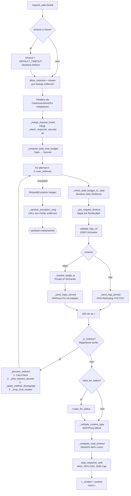
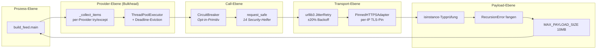

[Architektur-Karte — Wien ÖPNV Feed](architecture.md), Teil 7.

## 2. Die `request_safe`-Security-State-Machine

`request_safe` ist ein einzelner 75-Zeilen-Orchestrator, der 14
kohäsive Security-Helfer in strikter Reihenfolge aufruft. Jeder Helfer
dokumentiert den Angriffsvektor, den er entschärft. Das Flussdiagramm
unten zeigt die Reihenfolge, die Tabelle darunter fasst zusammen,
warum jede Schranke existiert.



**Warum jede Schranke existiert** (auch in den Helper-Docstrings dokumentiert):

| Schranke | Entschärft |
|---|---|
| Slowloris-Default-Timeout | Aufrufer:in vergisst Timeout → endlos hängender Call |
| Auto-Redirects deaktivieren | DNS-Rebinding-TOCTOU zwischen Sicherheitsprüfung und Connect |
| `_merge_request_hooks` | Stilles Überspringen der `_check_response_security` IP-Verifikation |
| `_compute_total_time_budget` (Tuple-Summe) | Angreifer:in verkettet Redirects, um das Wall-Clock-Budget zu strecken |
| `_check_total_budget_or_raise` | Slowloris über mehrere Redirects |
| `_per_request_timeout` | Per-Step-Timeout-Decay entlang der Kette |
| `validate_http_url` | SSRF über interne/private Hostnames |
| `_resolve_target_ip` | SSRF via DNS-Auflösung mit privater IP |
| `_send_http_pinned` | DNS-Rebinding-TOCTOU auf plain HTTP |
| `_send_https_pinned` | DNS-Rebinding-TOCTOU auf HTTPS + SNI/Host-Mismatch |
| `_is_redirect` (MagicMock-Schutz) | Falsch-positive Redirects in Mock-basierten Tests |
| `_strip_redirect_secrets` | Token-/Credential-Leak über Origin-Grenzen |
| `_apply_method_downgrade` | RFC-7231-konforme Methoden-Erhaltung/-Herabstufung |
| `_drop_host_header` | SNI/Host-Mismatch beim weitergeleiteten Request |
| `_validate_content_type` | Fehlinterpretation der Block-Page eines WAF/Proxys (text/html-Angriff) |
| `_compute_read_timeout` | Slowloris auf der Body-Read-Seite |
| `read_response_safe` | Payload-Größen-Cap (MAX_PAYLOAD_SIZE = 10 MB) |
| `_sanitize_exception_msg` | Sensible URLs lecken in Fehlertexte und Logs |
| `PROXY_TRUSTED_HOSTS` (in `TimeoutHTTPAdapter.send` und `verify_response_ip`) | DNS-Rebinding hinter einem Proxy: Der Proxy löst den Hostnamen selbst auf, IP-Pinning und Peer-Prüfung greifen dann nicht |

Das 2026-05-07-Audit hat diese Angriffsfläche geschlossen.

**Hinter einem Proxy (seit 2026-09-26, Audit vom 17.09., B.3).** Ist für eine
Anfrage ein Proxy im Spiel (`HTTP_PROXY`, `HTTPS_PROXY`, `ALL_PROXY`, unter
Beachtung von `NO_PROXY`), löst der Proxy den Hostnamen selbst auf. Für
getunneltes HTTPS halten dann weder die gepinnte IP noch die Prüfung der
verbundenen IP; die Gegenstelle ist der Proxy. Früher wurde die Prüfung in
diesem Fall still übersprungen. Jetzt gilt:

- Durch einen Proxy gehen nur Anfragen an die Hosts in `PROXY_TRUSTED_HOSTS`
  (`src/utils/http.py`) oder an eine literale, sichere IP. Die gepinnte
  HTTP-Anfrage adressiert die geprüfte IP, der Proxy verbindet genau dorthin.
- Jeder andere Host wird abgewiesen, bevor ein Byte gesendet wird
  (`TimeoutHTTPAdapter.send`, gilt für alle Sessions aus
  `session_with_retries` und für `request_safe`). `verify_response_ip` prüft
  dasselbe nach der Antwort.
- Die Liste nennt genau die Upstreams des Projekts: Wiener Linien, ÖBB
  (Fahrplan und Daten), VAO, Stadt Wien (Baustellen), Overpass, GitHub-API
  und `raw.githubusercontent.com` (Google Places ist seit 2026-10-16
  entfernt). Ein Test gleicht sie mit den im Code konfigurierten Hosts ab,
  in beide Richtungen. Ein neuer Upstream muss dort eingetragen werden.
- Die Produktions-Workflows setzen keinen Proxy. Betroffen sind
  Entwicklungsrechner und Sandboxes. GitHub-Enterprise-Hosts aus
  `FEED_GITHUB_ENTERPRISE_HOSTS` stehen nicht auf der Liste und scheitern
  hinter einem Proxy.
- `tests/conftest.py` entfernt die Proxy-Variablen des Rechners für jeden
  Test. So liefert die Suite auf den CI-Runnern und in einer Sandbox mit
  Proxy dasselbe Ergebnis; Tests, die einen Proxy brauchen, setzen ihn selbst.

---

## 3. Resilienz-Layer-Stack

Das System trägt fünf gestaffelte Verteidigungslinien gegen ein
feindliches Netzwerk oder eine feindliche Upstream-Quelle. Jede Schicht
hat ihren eigenen Geltungsbereich; zusammen ergeben sie
Defense-in-Depth.



**Schicht für Schicht:**

- **Prozess-Ebene** — der Cron-Eintrittspunkt. Wenn `main()` wirft, ist der Cron-Lauf die Fehler-Einheit; das ist Absicht, damit ein korrupter Schreibvorgang keinen halbgaren Feed veröffentlicht. Seit 2026-11-10 wirft `main()` nicht mehr, wenn Feed-Kette oder Ausgabe an einzelnen Meldungen scheitern (höchstens der Hälfte): Sie fallen aus dem Lauf und werden gemeldet (`build_isolating`, §10, „Eine Meldung hält den Bau nicht an“).
- **Provider-Ebene** — `_collect_items` hüllt den Loader jedes Providers in ein try/except, sodass eine Provider-Exception die Items der anderen nicht mit in den Abgrund nimmt. Der `ThreadPoolExecutor` plus die Apex-Phase-1-Deadline-Eviction-Schleife begrenzt das Wall-Clock-Budget für nicht antwortende Provider.
- **Call-Ebene** — `request_safe` ist die per-Call-Security-State-Machine (§2). `CircuitBreaker` ist ein zur Übernahme bereitstehendes Resilienz-Primitiv; die gemeinsam genutzte Klasse `src.utils.circuit_breaker.CircuitBreaker` umhüllt den OSM-Client (`src/places/osm_client.py`), den HAFAS-Client (`src/places/hafas_client.py`), den Stammstrecken-Hbf-Monitor (`scripts/update_stammstrecke_hbf.py`) und das Rollback-Skript `scripts/update_stammstrecke_status.py`.
- **Transport-Ebene** — `JitterRetry` (in `session_with_retries`) behandelt transiente 5xx und Connection-Resets per jitter-belegtem Exponential-Backoff. `PinnedHTTPSAdapter` hält die SNI beim TLS-Handshake auf dem ursprünglichen Hostnamen, während der TCP-Connect die aufgelöste (geprüfte) IP anvisiert.
- **Payload-Ebene** — sobald Bytes eintreffen, validiert jeder Provider den Top-Level-Typ (Zero-Trust-Shape), fängt `RecursionError` aus JSON-Tiefenbomben und arbeitet innerhalb des 10-MB-Body-Caps.

---

## 4. Provider-Plugin-Vertrag

Ein neuer Provider lässt sich in drei Schritten ergänzen. Das Diagramm
zeigt, was dein neues Modul exportieren muss und wie `_collect_items`
es entdeckt.

```mermaid
flowchart TB
    A[Dein neues Modul:<br/>src/providers/yourapi.py] --> B[def fetch_events<br/>timeout: int = 25<br/>-&gt; list[FeedItem]]
    A --> C[Optional:<br/>fetch_events._provider_cache_name<br/><i>markiert als disk-bound</i>]

    D[Registrierung:<br/>register_provider env_var, loader<br/>cache_key=...] --> E[ProviderSpec im Registry abgelegt]
    E --> F[iter_providers] --> G[_collect_items.<br/>_categorize_providers]
    G --> H{_provider_cache_name<br/>gesetzt?}
    H -- ja --> I[cache_fetchers<br/><i>sync</i>]
    H -- nein --> J[network_fetchers<br/><i>async via Executor</i>]
```

**Pflicht-Vertrag:**

```python
# src/providers/yourapi.py
from src.feed_types import FeedItem

def fetch_events(timeout: int = 25) -> list[FeedItem]:
    """Liefert eine typisierte Feed-Item-Liste für diesen Provider.

    Darf bei Netzwerk-Fehlern NICHT raisen — loggen und leere Liste
    zurückgeben.
    Darf insgesamt NICHT länger als ``timeout`` Sekunden blockieren.
    Muss vor dem Parsen den Top-Level-Payload-Typ validieren
    (Zero-Trust).
    """
    ...
```

**Empfohlenes Pattern (CircuitBreaker):**

```python
from src.utils.circuit_breaker import CircuitBreaker, CircuitBreakerOpen

_BREAKER = CircuitBreaker("yourapi", failure_threshold=5, recovery_timeout=120.0)

def fetch_events(timeout: int = 25) -> list[FeedItem]:
    try:
        return _BREAKER.call(_actual_fetch, timeout=timeout)
    except CircuitBreakerOpen:
        log.warning("yourapi breaker open; returning empty list")
        return []
```

Der Breaker loggt seine eigenen State-Übergänge, sodass Operator:innen
ohne zusätzliche Verkabelung Einträge wie
`CircuitBreaker[yourapi]: CLOSED → OPEN after 5 consecutive failures`
im Build-Log sehen.

---

Weiter in [Teil 8](architecture-teil-8.md).
