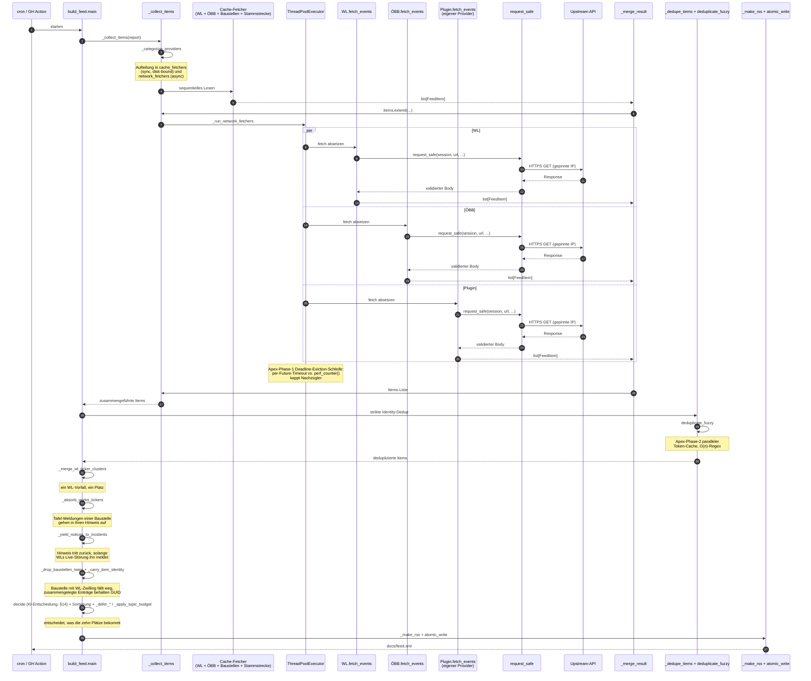

# Architektur-Karte — Wien ÖPNV Feed

Dieses Dokument ist die visuelle Ergänzung zur README. Es ist für
Entwickler:innen geschrieben, die in einem halben Jahr zum Projekt stoßen: jene Person,
die verstehen muss, **wie das System zusammenhängt**, bevor sie sich in irgendeine einzelne Datei stürzt.

Die Diagramme weiter unten werden von GitHub automatisch gerendert. Wer das
hier in einem Viewer ohne Mermaid-Unterstützung liest, findet zu jedem
Diagramm dieselbe Information zusätzlich als Fließtext darunter.

**Inhalt**

- [1. Die Pipeline für den Abruf der Verkehrsdaten](#1-die-pipeline-für-den-abruf-der-verkehrsdaten)
  - [Eine Feed-Kette, ein Modul (seit 2026-10-15)](#eine-feed-kette-ein-modul-seit-2026-10-15)
  - [Höchstens 700 Zeilen je Datei (seit 2026-11-02)](#höchstens-700-zeilen-je-datei-seit-2026-11-02)
  - [Titel und Beschreibung im deutschen Feed](architecture-teil-2.md#titel-und-beschreibung-im-deutschen-feed)
  - [Zeitraum einer WL-Meldung: Plausibilitätsprüfung (seit 2026-10-02)](architecture-teil-5.md#zeitraum-einer-wl-meldung-plausibilitätsprüfung-seit-2026-10-02)
  - [Rohdaten und Verwürfe des Abrufs (seit 2026-10-04)](architecture-teil-6.md#rohdaten-und-verwürfe-des-abrufs-seit-2026-10-04)
  - [Ausfall einer Quelle (seit 2026-10-04)](architecture-teil-6.md#ausfall-einer-quelle-seit-2026-10-04)
  - [Feed-Wächter (seit 2026-10-10)](architecture-teil-6.md#feed-wächter-seit-2026-10-10)
  - [KI-Wächter (seit 2026-10-31)](architecture-teil-6.md#ki-wächter-seit-2026-10-31)
  - [Geodaten im Feed: GeoRSS nur, wo der Ort sicher ist (seit 2026-10-16)](architecture-teil-6.md#geodaten-im-feed-georss-nur-wo-der-ort-sicher-ist-seit-2026-10-16)
  - [Link und Quelle jeder Meldung (seit 2026-10-17)](architecture-teil-6.md#link-und-quelle-jeder-meldung-seit-2026-10-17)
  - [Ein einheitliches Bild je Meldung (seit 2026-10-19)](architecture-teil-6.md#ein-einheitliches-bild-je-meldung-seit-2026-10-19)
- [2. Die `request_safe`-Security-State-Machine](architecture-teil-7.md#2-die-request_safe-security-state-machine)
- [3. Resilienz-Layer-Stack](architecture-teil-7.md#3-resilienz-layer-stack)
- [4. Provider-Plugin-Vertrag](architecture-teil-7.md#4-provider-plugin-vertrag)
- [5. Stationsverzeichnis-Anreicherung (GeoNetz → HAFAS)](architecture-teil-8.md#5-stationsverzeichnis-anreicherung-geonetz--hafas)
  - [5a. Wiener-Linien-OGD-Merge (die vierte Quelle)](architecture-teil-9.md#5a-wiener-linien-ogd-merge-die-vierte-quelle)
  - [Anzeige von Hauptbahnhöfen (seit 2026-11-02)](architecture-teil-9.md#anzeige-von-hauptbahnhöfen-seit-2026-11-02)
  - [Haltestellen ohne „S“ und „U“ (seit 2026-11-04)](architecture-teil-9.md#haltestellen-ohne-s-und-u-seit-2026-11-04)
- [6. Statistik- und Dashboard-Pipeline](architecture-teil-10.md#6-statistik--und-dashboard-pipeline)
  - [Architektur-Ziele](architecture-teil-10.md#architektur-ziele)
  - [Resilienz-Schichten](architecture-teil-10.md#resilienz-schichten)
  - [Test-Isolation](architecture-teil-10.md#test-isolation)
  - [Woher das Live-Dashboard seine Zahlen nimmt](architecture-teil-10.md#woher-das-live-dashboard-seine-zahlen-nimmt)
  - [Was das Dashboard beantwortet](architecture-teil-10.md#was-das-dashboard-beantwortet)
  - [Gestaltung des Live-Dashboards (Kacheln, 2026-10-17)](architecture-teil-10.md#gestaltung-des-live-dashboards-kacheln-2026-10-17)
  - [Was eine Meldungskachel zeigt (2026-10-25)](architecture-teil-10.md#was-eine-meldungskachel-zeigt-2026-10-25)
  - [Bilder ohne Marken, Hinweis „inoffiziell“ (2026-10-17)](architecture-teil-10.md#bilder-ohne-marken-hinweis-inoffiziell-2026-10-17)
- [7. VOR/VAO-API — Stammstrecke-only-Scope (2026-05-11)](architecture-teil-11.md#7-vorvao-api--stammstrecke-only-scope-2026-05-11)
  - [Der VAO-„Start“-Vertrag (geprüft 2026-10-17)](architecture-teil-11.md#der-vao-start-vertrag-geprüft-2026-10-17)
  - [Überwachung: Abruf kaputt oder keine Züge (seit 2026-10-10)](architecture-teil-12.md#überwachung-abruf-kaputt-oder-keine-züge-seit-2026-10-10)
  - [Überwachung: Nebenschritte (seit 2026-10-28)](architecture-teil-12.md#überwachung-nebenschritte-seit-2026-10-28)
  - [Überwachung: Veröffentlichung (seit 2026-10-31)](architecture-teil-12.md#überwachung-veröffentlichung-seit-2026-10-31)
  - [Überwachung: Pages-Build (seit 2026-11-01)](architecture-teil-12.md#überwachung-pages-build-seit-2026-11-01)
  - [Überwachung: Werkzeuge (seit 2026-10-31)](architecture-teil-12.md#überwachung-werkzeuge-seit-2026-10-31)
  - [Alarmwege: rot, Issue, Hinweis (seit 2026-10-28)](architecture-teil-12.md#alarmwege-rot-issue-hinweis-seit-2026-10-28)
- [8. Der zweisprachige Feed (DE → EN)](architecture-teil-13.md#8-der-zweisprachige-feed-de--en)
  - [Die beiden Invarianten](architecture-teil-13.md#die-beiden-invarianten)
  - [Was am Modell vorbeigeht](architecture-teil-13.md#was-am-modell-vorbeigeht)
  - [Die Platzhalter](architecture-teil-14.md#die-platzhalter)
  - [Nachkontrollen](architecture-teil-14.md#nachkontrollen)
  - [Betrieb](architecture-teil-14.md#betrieb)
- [9. Querverweise](architecture-teil-14.md#9-querverweise)
- [10. Robustheit und Laufzeit des Feed-Baus (seit 2026-11-10)](architecture-teil-15.md#10-robustheit-und-laufzeit-des-feed-baus-seit-2026-11-10)
- [11. Ein Vorfall, ein Platz: gekürzte Ursache und vertauschte Rollen (seit 2026-11-10)](architecture-teil-15.md#11-ein-vorfall-ein-platz-gekürzte-ursache-und-vertauschte-rollen-seit-2026-11-10)
- [12. Die Jahresseite der Statistik: Überblick, Baustellen, Rückblick (seit 2026-11-10)](architecture-teil-15.md#12-die-jahresseite-der-statistik-überblick-baustellen-rückblick-seit-2026-11-10)
- [13. Wo ein Satz endet: der Punkt einer Abkürzung (seit 2026-11-12)](architecture-teil-16.md#13-wo-ein-satz-endet-der-punkt-einer-abkürzung-seit-2026-11-12)
- [14. Gemini entscheidet, wo die Regeln eine Störung offen lassen (seit 2026-11-12)](architecture-teil-16.md#14-gemini-entscheidet-wo-die-regeln-eine-störung-offen-lassen-seit-2026-11-12)
- [15. Was nicht möglich ist, steht vorn (seit 2026-11-13)](architecture-teil-16.md#15-was-nicht-möglich-ist-steht-vorn-seit-2026-11-13)

---

## 1. Die Pipeline für den Abruf der Verkehrsdaten

Der zentrale Workflow: Ein Cron-Job (bzw. die GitHub-Action `update-cycle.yml`) startet `python -m src.cli feed build` (das wiederum
`build_feed.main()` aufruft), invokiert die registrierten
Verkehrsdaten-Provider, dedupliziert die zusammengeführten Events und
schreibt einen einzelnen RSS-Feed.

> **Hinweis zum aktuellen Default-Setup:** Das Diagramm illustriert
> beide Provider-Modi des Builders (sync cache vs. async network).
> Im aktuellen Cron-Setup (`update-cycle.yml`) werden die HTTP-Fetcher
> für WL, ÖBB und Baustellen aber **in eigenen Workflow-Steps** vor
> dem `feed build` ausgeführt und schreiben in `cache/<provider>/`;
> der Feed-Build selbst sieht alle Default-Provider (WL, ÖBB,
> Baustellen, Stammstrecke) deshalb als **cache_fetchers** (sync,
> disk-bound). Der Async-Pfad ist die Plug-in-Aufnahme-Stelle für
> nicht-cache-basierte Drittprovider — siehe §4.

**Warum jeder Schritt zählt:**

- **`_categorize_providers`** entscheidet, welche Provider synchron laufen können (Loader trägt das Attribut `_provider_cache_name` → liest von der Platte) und welche asynchron (echter Netzwerk-Abruf). Diese Trennung hält den Executor-Pool auf I/O-gebundene Arbeit fokussiert.
- **Der `par … and …`-Block** ist das **Bulkhead-Prinzip**: Ein Crash in einem einzelnen `fetch_events`-Aufruf wird von `_drain_completed_futures` abgefangen und als Fehler genau dieses Providers verbucht — die anderen laufen weiter. Genau das macht das System nie „komplett wegen einer kaputten Quelle aus".
- **Der Hinweis auf Apex-Phase-1** ist entscheidend: Ohne gedeckelte `wait()`-Timeouts würde die Schleife gegen `perf_counter()` busy-spinnen.
- **`request_safe`** ist die Security-State-Machine — siehe Diagramm §2.
- **`deduplicate_fuzzy`** ist Apex-Phase-2-Territorium: Der parallele `merged_cache` reduziert das O(n²)-Regex-Reparsing auf O(n).
- **Im Altersfilter** gilt ein reines Enddatum der Stadt-Wien-Baustellen („2026-09-04Z“, gelesen als Wiener Mitternacht) bis zum Ende dieses Tages (`_valid_until`, seit 2026-10-03). Das Beginndatum steht im WFS einen Tag zu früh; das Cache-Skript nimmt seit 2026-10-06 den Folgetag (`_first_day` in `src/providers/baustellen_events.py`, Belege dort und in `docs/development.md`, „Stadt Wien – Baustellen“). Die Zeitzeile zeigte „Bis Fr 04.09.“, der Filter warf die Baustelle aber schon um 00:10 dieses Tages hinaus; das traf alle 13 Baustellen, die von Juli bis Oktober bis zu ihrem Ende im Feed liefen.
- **Spätestens um Mitternacht raus (seit 2026-10-24):** Die Kulanz `ENDS_AT_GRACE_MINUTES` (10 Minuten) nach dem Ende reicht nie über die Wiener Mitternacht nach dem Tag, den die Zeitzeile nennt (`_drop_after`). Vorher blieb ein Ende am späten Abend über Mitternacht stehen: Am 20.10. um 00:00 zeigte der Feed „Wien Hütteldorf ↔ Wien Hauptbahnhof … [Bis 19.10.]“ (Ende 19.10. 23:59:59, Feed-Wächter-Issue #2044); ebenso verließe jede ÖBB-Meldung mit Tagesende und jede Baustelle an ihrem letzten Tag den Feed erst um 00:10. Ein Ende früher am Tag behält seine zehn Minuten.
- **Vor dem Altersfilter** verwirft `_drop_test_messages` Testmeldungen der Anbieter („Testmeldung“, oder ein Titel bzw. Text von höchstens fünf Wörtern mit dem Wort „Test“, wobei ein Bindestrich zum Wort gehört und „Test-Fahrten“ nicht trifft; Anlass: zwei WL-Testmeldungen am 23.09.2026). Seit 2026-10-03 zählen auch „Testfall“ und „Testtext“ und ein beliebig langer Text, der nur aus „Test“ besteht („Test Test Tes Test Test Test“); die Filterprüfung fand diese drei Formen in der WL-Cache-Historie. Sie belegten sonst einen der zehn Plätze.
- **Nach der Dedupe** legt `_merge_wl_ticker_clusters` die WL-Störungen eines Vorfalls zu einem Eintrag zusammen (seit 2026-09-26), und seit 2026-10-01 auch die einer Linie, deren Gültigkeit sich überschneidet (unten, „Titel und Beschreibung im deutschen Feed“). `deduplicate_fuzzy` lässt zwei WL-Störungen derselben Linien deshalb in Ruhe (`_may_merge`); WL-Störungen sich überschneidender, verschiedener Linien („40/41“ und „40“) führt es weiter selbst zusammen. Seit 2026-11-07 hält `_may_merge` (`src/feed/merge_items.py`) drei weitere Paare auseinander: Was erst nach dem Vorschautag beginnt (`_defer_upcoming_items`, Prädikat `announced` aus `_assemble_feed_items`), verschmilzt nur mit anderem Angekündigtem — „7A: Bauarbeiten“ (laufend, 09.10. 13:16) war in den Hinweis der Umleitung ab 14.10. aufgegangen und zeigte sie fünf Tage zu früh; eine Haltestellenverlegung oder -auflassung (`is_stop_notice`, Titel = Haltestellenname) nie mit einer Störung — „12: Feuerwehreinsatz Betrieb ab Albertgasse“ ging am 30.10. um 11:31 Uhr im Hinweis „5/12: Albertgasse“ auf; und ein Hinweis nie mit einer laufenden Störung, deren Titel und Text keine geplante Maßnahme nennen (`names_planned_measure`), denn der Überlebende ist der Eintrag mit der kleinsten Identität, bei WL stets der Hinweis („wl|hinweis|…“ vor „wl|störung|…“). Geplante Maßnahmen gehen weiter im Hinweis ihrer Arbeiten auf (Betreiberentscheidung 2026-11-03). Replay über 1 818 Cache-Stände 04.10.–07.11.: 202 Stände anders, alle durch diese drei Regeln. Anschließend gehen die Anzeigetafel-Meldungen einer Baustelle in deren Hinweis auf (`_absorb_works_tickers`, seit 2026-10-02): eine WL-Störung mit genau einem Vorfall, deren Ursache der Hinweis im Titel oder in der `<h2>`-Überschrift nennt, deren Linien er abdeckt, deren Gültigkeit in seiner liegt (± 1 Tag) und von deren Straßen er eine nennt. Anlass: „D: Gleisbauarbeiten [Am 01.10.2026]“ für Arbeiten vom 28.09. bis 07.11., ebenso 12A, 25, N20, N49, 37A und 74A in allen 68 WL-Cache-Ständen vom 30.09. bis 02.10.; WL veröffentlicht die Tafel-Meldungen jede Nacht neu, sie belegten so täglich einen vorderen Platz. Die Straße hält zwei Baustellen derselben Ursache auseinander („66A: Busse halten Salvatorianerplatz“ ist nicht der Hinweis „65A/66A: Inzersdorfer Straße“). Den WL-Merge einfach vor `deduplicate_fuzzy` zu ziehen hätte die Reste auch entfernt, nahm aber am 02.10. einen Rettungseinsatz der Linie D mit in den Hinweis. Ebenso geht seit 2026-10-29 die Tafel-Meldung einer verlegten Haltestelle in ihre Haltestellenverlegung auf (`_relocated_stops_shown`): eine WL-Störung, die nur „Busse/Züge halten <Adresse>“ sagt, jede Adresse ein „Nach:“ des Hinweises („Kärntner Ring 5“ für „Kärntner Ring 5, Nebenfahrbahn“), mit Linien des Hinweises, solange er gilt und solange sein Kurztext jede dieser Adressen zeigt. Anlass: „40A: Bauarbeiten“ („Busse halten Liechtensteinstraße 39, Liechtensteinstraße 38.“) stand vom 27. bis 29.10. in rund 100 Feed-Ständen neben „40A: Bauernfeldplatz“, der dieselben Haltestellen nennt; die Tafel sagte „Bauarbeiten“, der Hinweis „Kabelarbeiten“, und ein Verlegungstitel nennt die Haltestelle, nicht die Ursache. Seit Juli hatte der WL-Cache sechs solche Paare (13A, 12A/14A, 7A/N65/N66, 3A, N20, 40A). Eine Tafel-Meldung, die mehr sagt (eine andere Haltestelle, „Betrieb ab …“), die nach dem Ende des Hinweises weiterläuft (N20 nach dem 15.10.) oder deren Adresse die 180-Zeichen-Grenze im Hinweis abschneidet (die zweite Haltestelle von 15A/7A/N62 hinter drei Linien und ihren Richtungen), behält ihren Platz. Umgekehrt tritt seit 2026-11-01 ein WL-Hinweis, der bereits gilt, zurück, solange eine laufende WL-Störung mit WLs Vorfallsbeginn (ausführliche Meldung) dasselbe meldet (`_yield_notices_to_incidents`, Betreiberentscheidung 2026-11-01 „Störung bleibt“, mit dem Grundsatz vom selben Tag: „Störungen haben höchste Priorität im Feed! Hinweise sind weniger wichtig.“): der Hinweis nennt ihre Ursache im Titel oder in der `<h2>`-Überschrift, beide nennen eine gemeinsame Straße, sie begann frühestens einen Tag vor dem Hinweis und nennt jede seiner Linien, und der Hinweis gilt nur für einen Betriebstag: Er endet spätestens um 04:00 Uhr nach dem Wiener Datum, an dem die Störung begann (`_service_day_end`). Ein Hinweis über Wochen („1: Gleisbauarbeiten“, 21.10. bis 05.12.) sagt, was nach einer kurzen Störung derselben Ursache weiter gilt, und bleibt. Anlass (Fund des KI-Wächters vom 01.11.): „1/2/71/D: Nationalfeiertag“ (Hinweis, `<h2>` „Veranstaltung“, Ringstraße) und „1/2/71/D: Veranstaltung“ (Vorfall I20261026-0004, „Grund: Veranstaltung im Bereich Ringstraße.“) standen am 26.10. von 9:01 bis 17:31 Uhr nebeneinander (am 25.10. trug das Paar des Tages denselben Titel, und `deduplicate_fuzzy` zeigte es schon einmal). `_absorb_works_tickers` nahm die Störung nicht, weil ein laufender Vorfall kein Ende hat und so nie im Zeitraum des Hinweises liegt. Die Störung ist für den Zuschauer die bessere Meldung: Sie trägt WLs voraussichtliches Ende („Voraussichtlich bis 18:00 Uhr“) und verlässt den Feed, sobald WL sie schließt; danach steht der Hinweis wieder wie vorher. Meldet die Störung nur einen Teil der Linien („4A/74A: Demonstration“ neben dem Hinweis über 16 Linien am 22.10.), bleiben beide. Tafel-Meldungen ohne Vorfall bleiben bei der Regel oben und gehen in den Hinweis auf. Dasselbe gilt, wenn WL der Störung ein Ende gibt: `_absorb_works_tickers` nimmt eine solche Störung nicht mehr in einen Hinweis eines Betriebstags auf. Am 11.10. nahm es „18: Laufveranstaltung“ (Vorfall I20261011-0007, Ende 23:55 Uhr) von 9:01 bis 14:30 Uhr in „18: LCC-Herbstmarathon am 11.10.2026“ auf, das Gegenteil der Regel vom 26.10., nur weil WL ein Ende nannte. Im Replay über 555 Feed-Stände seit 01.10. und über alle 101 Stände vom 11.10., 26.10. und 30.10. 11:31 Uhr ändern sich nur zwei Tage: am 26.10. von 9:01 bis 17:31 Uhr fällt „1/2/71/D: Nationalfeiertag“ weg und Platz 10 bekommt die nächste Meldung; am 11.10. von 9:01 bis 14:30 Uhr steht „18: Laufveranstaltung“ (mit „Voraussichtlich bis 16:30“ und dem Ersatz U2 und U3) statt des Hinweises, als laufende Störung weiter vorn. Danach steht der Hinweis wieder wie vorher. Eine Stadt-Wien-Baustelle, deren Maßnahme ein laufender WL-Hinweis schon meldet, fällt danach weg (`_drop_baustellen_twins`, seit 2026-10-09, Betreiberentscheidung „WL-Meldung genügt“): Zwilling ist ein WL-Hinweis, der bereits gilt und in seinem Ursachensatz die Straße der Baustelle nennt („Wegen Bauarbeiten im Bereich Neilreichgasse # Davidgasse …“) oder dieselbe Adresse wie der Baustellentext („Nach: Burggasse 69“); eine Straße nur in Umleitung oder Haltestellenliste zählt nicht (`names_site_street`, `shares_address` in `src/providers/baustellen.py`). Die WL-Meldung nennt Linie und Richtung, die Baustelle nicht; seit Mai hatten fast alle Baustellen mit Öffi-Folge einen solchen Zwilling, zweimal standen beide tagelang unter den ersten zehn (Inzersdorfer Straße, Floridsdorfer Brücke). Ein zusammengelegter Eintrag behält danach GUID und Beginn, die er im Feed hatte, auch wenn die Meldung, von der beides stammt, vor den anderen wegfällt (`_carry_item_identity`, seit 2026-10-06; `docs/development.md`, „Eine Meldung, eine GUID“). Danach entscheidet die Reihenfolge, was die zehn Plätze bekommt: Sortierung nach `first_seen` (laufende ungeplante Störungen, seit höchstens 24 h im Feed, vor allem anderen, `_is_current_incident`, Betreiberentscheidung 2026-10-04; danach eine ÖBB-Sperre an den Sperrtagen ihres Leitsatzes, als Hinweis mit höherer Priorität vor den übrigen Hinweisen, `_is_oebb_closure_day` in `src/feed_build/oebb_days.py`, Betreiberentscheidung 2026-11-08: „Auf ungeplante Störungen kann man sich nicht vorbereiten. Auf geplante Bauarbeiten, Sperren etc schon.“, Anlass Gramatneusiedl ab 07.11. auf Platz 11 bis 14; eine Sperre, die länger als vier Wochen Tag für Tag sperrt, hat diesen Vorrang nur in ihren ersten sieben Tagen, reiht sich danach wie die übrigen Hinweise ein und zählt dort ab ihrem ersten Tag statt ab ihrem ersten Erscheinen im Feed, `_past_first_week` und `_long_closure_start`, Betreiberentscheidung 2026-11-12 „Vorrang nur in der ersten Woche“, Anlass „Wien Praterstern ↔ Wien Hauptbahnhof / Wien St. Marx“, gesperrt vom 07.09.2026 bis 31.10.2027 und seit 07.11. täglich unter den ersten zehn, maßgeblich ist die ununterbrochene Folge von Sperrtagen um den heutigen Tag, also behalten Wochenendnächte wie Gramatneusiedl und Sperren bis vier Wochen den Vorrang, eine Sperre in jeder Nacht über mehr als vier Wochen gilt als durchgehend, ein Text ohne lesbaren letzten Tag („bis Ende Oktober 2027“) oder ganz ohne Tag zählt mit dem Zeitraum der Meldung, mehrere Tage in einer Form, die das Lesen nicht kennt, bleiben bei der Regel vom 11.11., eine aktuelle Störung bleibt vorn, und den einen Platz eines ÖBB-Titels hält in `_defer_repeated_route_titles` nach der aktuellen Störung die Sperre mit Sperrtag vor dem frühesten Fenster, also auch vor der langen Sperre, von mehreren die mit dem frühesten Fenster (Betreiberentscheidung 2026-11-13 „Ja, Sperre des Tages zuerst“), an Samstag und Sonntag also das Fenster der Wochenendnächte vor einer Meldung des Tages, die nicht als aktuelle Störung zählt (Betreiberentscheidung 2026-11-13 „Nein, Fenster behält den Platz“; von der Karte nicht genannt und unverändert: am ersten Tag des Fensters beginnen beide am selben Tag, dort entscheidet der Platz in der Sortierung, `docs/development.md`, „Reihenfolge im Feed“); Leitsatz ist der Satz, den der Feed zuerst zeigt, und ein Leitsatz, der Tage nennt (auch in einer Form, die das Lesen nicht kennt), muss sagen, dass keine Züge fahren oder halten, nur eine Meldung ganz ohne Tag zählt jeden Tag, ein einzelner Zug wie „der S1-Zug 23626“ sperrt nichts, Betreiberentscheidung 2026-11-11 „Nein, nur echte Sperren“, `docs/development.md`, „Reihenfolge im Feed“; eine Meldung, deren Leitsatz nur einzelne Züge mit Nummer nennt, kommt seit demselben Tag gar nicht in den Feed („einige Züge“ ohne Nummer bleiben), Betreiberentscheidung „Einzelzüge sollen nicht in den Feed.“, `_oebb_single_trains_only` in `src/feed_build/oebb_single_trains.py`, `docs/development.md`, Abschnitt „ÖBB“; sonst neueste zuerst; eine wiederkehrende WL-Meldung bekommt vorher über `_restart_recurring_occurrences` den Beginn ihres aktuellen Auftretens, die WL-GUID enthält kein Datum; eine angekündigte Maßnahme zählt ab ihrem Beginn als neu, `announced_start` über `_note_announced_starts`; eine Stadt-Wien-Baustelle zählt nie später als an ihrem Starttag als neu, `_baustelle_start_cap`, seit 2026-10-09: ihre GUID enthält das Enddatum, eine verlängerte Baustelle kam sonst als brandneu zurück, „Burggasse 67“ am 08.10. auf Platz 9), dann `_defer_repeated_route_titles` (von wortgleichen ÖBB-Titeln bleibt nur einer vorn: eine laufende Störung, seit 2026-10-05, sonst eine Sperre an ihrem Sperrtag, seit 2026-11-13, sonst das früheste Zeitfenster), `_apply_topic_budget` (höchstens `MAX_ITEMS_PER_TOPIC` je Ursachenwort und Tag), `_defer_upcoming_items` (was erst nach `UPCOMING_PREVIEW_DAYS` Tagen beginnt, rückt hinter alles Laufende, Betreiberentscheidung 2026-10-02; Standard seit 2026-10-03 ein Tag, also ab dem Vortag, freitags und samstags bis einschließlich Montag) und `_defer_all_clear_items` (ÖBB-Entwarnungen „Aufhebung …“ ganz nach hinten, Betreiberentscheidung 2026-09-25). Die Regeln löschen nichts, sie stellen hinter das Feld — siehe `docs/development.md`, „Reihenfolge im Feed".

### Eine Feed-Kette, ein Modul (seit 2026-10-15)

Alle Schritte zwischen Abruf und RSS (Testmeldungen, Altersfilter, Dedupe, WL-Zusammenlegung,
Hinweis hinter der Live-Störung, Baustellen-Zwillinge, `_carry_item_identity`, Gemini-Antwort für
unklare Störungen, Sortierung und die `_defer_*`-Regeln) stehen in genau einer Funktion,
`_assemble_feed_items` in `src/build_feed.py`. `main()` ruft sie zwischen
`_invoke_collect_items` und `_make_rss` auf und liest Zählwerte und Zeiten für
den Health-Report aus `FeedAssemblyStats`. Jede Probe, die einen früheren
Feed-Stand aus dem Cache nachbaut (Replay alt gegen neu), ruft dieselbe
Funktion auf, statt die Schritte abzuschreiben: Abgeschriebene Ketten liefen
dem echten Build davon (die älteren Replay-Proben kannten den
Zwillingsschritt nicht). Auch `lint()` (`python -m src.cli feed lint`) ruft
sie auf; bis zur Nachprüfung vom 2026-10-15 trug es eine eigene Kopie ohne
`_carry_item_identity`, `_restart_recurring_occurrences` und
`_note_announced_starts`. `tests/test_assemble_feed_items.py` hält fest, dass
`main()` keinen Kettenschritt mehr selbst aufruft und keine andere Funktion
mehr als einen Kettenschritt aufruft, also keine zweite Kette entsteht.
Seit Etappe 8 der 700-Zeilen-Regel (2026-11-03) steht die Kette weiter in
`src/build_feed.py`, die einzelnen Schritte stehen in den Teilen unter
`src/feed_build/` (etwa `filters`, `wl_joins`, `wl_notices`, `item_history`,
`rss`; Liste in [Modularisierung](modularisierung.md)).

`build_feed.py` bleibt ansonsten ein Modul. Michaels Entscheidung vom
2026-10-15 nach Jules' Modularisierungs-Audit vom 2026-10-14
(`docs/archive/audits/audit-2026-10-14-build-feed-modularization.md`):
umgesetzt werden nur die Feed-Kette als Funktion und die Auslagerung der
reinen Glossar-Daten nach `src/feed/glossary.py` (siehe §8). Die vorgeschlagene
Aufteilung in Übersetzer-, Text- und XML-Module wird **nicht** gemacht. Grund:
Die Tests ersetzen Funktionen und Werte direkt in `build_feed`: am
2026-10-24 an 254 Stellen (242 per `patch.object(bf, …)` oder
`monkeypatch.setattr(bf, …)` am Modul, 12 über den Pfad
`src.build_feed.…`; 58-mal allein `_get_translation_pipeline`), und 223
Testdateien nennen das Modul. Nach derselben Zählung waren es vor der
Entscheidung 241 Stellen (die Zählung vom 2026-10-15 nannte 264, weil sie
die Ersetzungen in `bf.feed_config` mitzählte). Wandert eine Funktion in ein anderes
Modul, ruft der Code dort seine eigene Kopie auf; ein Re-Export in
`build_feed` hält den Import am Leben, aber die Attrappe läuft ins Leere, und
ein Test bricht oder ruft still das echte Übersetzungsmodell. Am TV brächte die
Aufteilung nichts, das Risiko trüge der deutsche Feed. Die Funktionen sind
einzeln klein genug: Nur `_dedupe_items` steht auf der Liste des C901-Gates.

Nachmessung vom 2026-10-24 (Michaels Frage, ob beim Monolithen
Handlungsbedarf besteht): `build_feed.py` wuchs von 11.275 Zeilen nach
#2017 auf 12.105 Zeilen, fast nur durch neue Regeln für den englischen Feed
und die ÖBB-Texte; 307 Funktionen, die längste ist `_format_item_content`
mit 251 Zeilen, `main()` hat 175. Ein zweiter großer Block reiner Daten wie
das Glossar existiert nicht mehr: Die übrigen Daten verteilen sich auf 283
kleine Zuweisungen mit zusammen rund 1.020 Zeilen (die größte,
`_RECORD_VALUE_RULES`, hat 72 Zeilen), meist ein Suchmuster neben der
Funktion, die es nutzt. Ein weiteres Datenmodul brächte deshalb wenig.
`src/utils/secret_scanner.py` (3.059 Zeilen, davon 2.162 für die Liste
`_KNOWN_TOKENS`, auf die die Tests 283-mal zugreifen) bleibt aus demselben
Grund, wie es ist (seit Michaels Regel vom 2026-11-02, höchstens 700 Zeilen
je Datei, steht die Liste in Teilen unter `src/utils/secret_patterns/`,
siehe [Modularisierung](modularisierung.md)). Entscheidung: Der Code bleibt so; geordnet wurden nur
die Dokumentation (Monatsüberschriften im CHANGELOG, Inhaltsverzeichnis
oben in diesem Dokument). Die Größe von `build_feed.py` allein ist damit
kein Befund für ein Audit.

Diese Entscheidung gilt nicht mehr: Am 2026-11-02 hat Michael die Aufteilung
beschlossen (nächster Abschnitt). Seit 2026-11-03 ist `src/build_feed.py`
Einstieg und Fassade mit der Kette (661 Zeilen), der übrige Code steht in 34
Modulen unter `src/feed_build/`. Tests ersetzen einen Namen in dem Modul, das
ihn liest (`tests/_conftest/build_feed_bindings.py`,
`tests/test_build_feed_patch_targets.py`).

### Höchstens 700 Zeilen je Datei (seit 2026-11-02)

Michaels Regel vom 2026-11-02: Das Projekt wird modularer, keine Datei hat
mehr als 700 Zeilen. Auf seine Wahl gilt die Grenze für **jede Textdatei**:
Code, Tests, Workflows, Doku, `CHANGELOG.md` und die archivierten Audits in
`docs/archive/`. Nicht gezählt werden nur die Quelldaten unter `data/` und
`cache/` sowie Dateien, die keine Textendung tragen (JSON, CSV, XML, Bilder);
die gezählten Endungen stehen in `_SUFFIXES` in
`tests/test_file_line_limit.py`. Gezählt wird wie mit `wc -l`.

Am 2026-11-02 lagen 58 Dateien darüber, zusammen rund 93.000 Zeilen (die
größte `src/build_feed.py` mit 13.725 Zeilen). Sie stehen in
`tests/line_limit_altfaelle.txt` und werden in Etappen aufgeteilt, jede
Etappe eine reine Verschiebung ohne Verhaltensänderung mit Replay alt gegen
neu (Plan: `CHANGELOG`, Tests, Doku, Skripte, `src/`, zuletzt
`build_feed.py` in mehreren Schritten mit Umstellung der Test-Ersetzungen auf
das neue Modul). Der Test hält drei Dinge fest: Keine Datei außerhalb der
Liste hat mehr als 700 Zeilen; die Liste bekommt keine neuen Einträge
(`_ALTFAELLE_COUNT` darf nur sinken); eine Datei, die auf 700 Zeilen oder
darunter fällt, wird aus der Liste gelöscht. Eine Datei, die wächst, wird
geteilt, bevor sie die Grenze überschreitet. Seit 2026-11-03 ist die Liste
leer: Mit dem letzten Schritt von Etappe 8 ist auch `src/build_feed.py`
aufgeteilt, und die Grenze gilt für jede gezählte Datei ohne Ausnahme.

Wie die Altfälle Etappe für Etappe aufgeteilt werden und wie die geteilten
Dateien aufgebaut sind (CHANGELOG nach Tagen, Testpakete, Markdown-Teile,
Stylesheet-Teile, Skript-Module, Fixtures von `tests/conftest.py`,
Fassaden unter `src/`, die Teile von `src/feed_build/`), steht in
[Modularisierung](modularisierung.md). Wer eine geteilte Datei ergänzt, liest
dort, wohin der neue Teil gehört.

Weiter in [Teil 2](architecture-teil-2.md).
