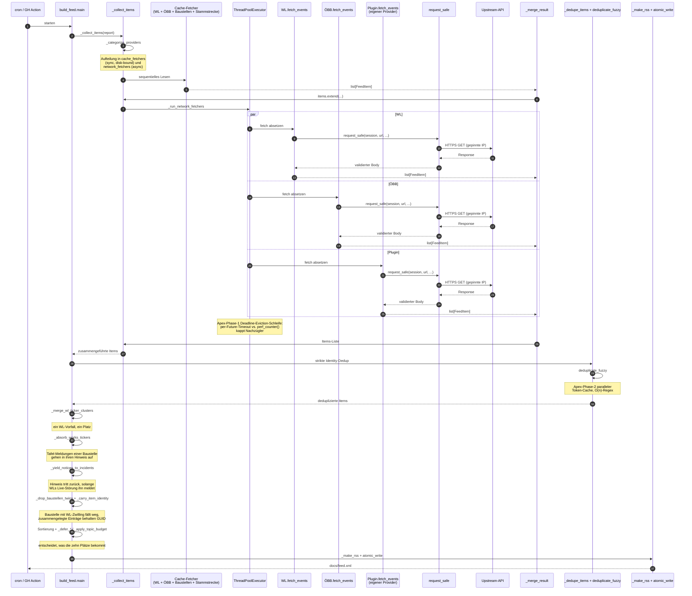

# Architektur-Karte — Wien ÖPNV Feed

Dieses Dokument ist die visuelle Ergänzung zur README. Es ist für
Entwickler:innen geschrieben, die in einem halben Jahr zum Projekt
stoßen: jene Person, die verstehen muss, **wie das System
zusammenhängt**, bevor sie sich in irgendeine einzelne Datei stürzt.

Die Diagramme weiter unten werden von GitHub automatisch gerendert.
Wer das hier in einem Viewer ohne Mermaid-Unterstützung liest, findet
zu jedem Diagramm dieselbe Information zusätzlich als Fließtext
darunter.

**Inhalt**

- [1. Die Pipeline für den Abruf der Verkehrsdaten](#1-die-pipeline-für-den-abruf-der-verkehrsdaten)
  - [Eine Feed-Kette, ein Modul (seit 2026-10-15)](#eine-feed-kette-ein-modul-seit-2026-10-15)
  - [Höchstens 700 Zeilen je Datei (seit 2026-11-02)](#höchstens-700-zeilen-je-datei-seit-2026-11-02)
  - [Titel und Beschreibung im deutschen Feed](#titel-und-beschreibung-im-deutschen-feed)
  - [Zeitraum einer WL-Meldung: Plausibilitätsprüfung (seit 2026-10-02)](architecture-teil-3.md#zeitraum-einer-wl-meldung-plausibilitätsprüfung-seit-2026-10-02)
  - [Rohdaten und Verwürfe des Abrufs (seit 2026-10-04)](architecture-teil-3.md#rohdaten-und-verwürfe-des-abrufs-seit-2026-10-04)
  - [Ausfall einer Quelle (seit 2026-10-04)](architecture-teil-3.md#ausfall-einer-quelle-seit-2026-10-04)
  - [Feed-Wächter (seit 2026-10-10)](architecture-teil-3.md#feed-wächter-seit-2026-10-10)
  - [KI-Wächter (seit 2026-10-31)](architecture-teil-3.md#ki-wächter-seit-2026-10-31)
  - [Geodaten im Feed: GeoRSS nur, wo der Ort sicher ist (seit 2026-10-16)](architecture-teil-3.md#geodaten-im-feed-georss-nur-wo-der-ort-sicher-ist-seit-2026-10-16)
  - [Link und Quelle jeder Meldung (seit 2026-10-17)](architecture-teil-3.md#link-und-quelle-jeder-meldung-seit-2026-10-17)
  - [Ein einheitliches Bild je Meldung (seit 2026-10-19)](architecture-teil-3.md#ein-einheitliches-bild-je-meldung-seit-2026-10-19)
- [2. Die `request_safe`-Security-State-Machine](architecture-teil-3.md#2-die-request_safe-security-state-machine)
- [3. Resilienz-Layer-Stack](architecture-teil-3.md#3-resilienz-layer-stack)
- [4. Provider-Plugin-Vertrag](architecture-teil-4.md#4-provider-plugin-vertrag)
- [5. Stationsverzeichnis-Anreicherung (GeoNetz → HAFAS)](architecture-teil-4.md#5-stationsverzeichnis-anreicherung-geonetz--hafas)
  - [5a. Wiener-Linien-OGD-Merge (die vierte Quelle)](architecture-teil-4.md#5a-wiener-linien-ogd-merge-die-vierte-quelle)
  - [Anzeige von Hauptbahnhöfen (seit 2026-11-02)](architecture-teil-4.md#anzeige-von-hauptbahnhöfen-seit-2026-11-02)
  - [Haltestellen ohne „S“ und „U“ (seit 2026-11-04)](architecture-teil-5.md#haltestellen-ohne-s-und-u-seit-2026-11-04)
- [6. Statistik- und Dashboard-Pipeline](architecture-teil-5.md#6-statistik--und-dashboard-pipeline)
  - [Architektur-Ziele](architecture-teil-5.md#architektur-ziele)
  - [Resilienz-Schichten](architecture-teil-5.md#resilienz-schichten)
  - [Test-Isolation](architecture-teil-5.md#test-isolation)
  - [Woher das Live-Dashboard seine Zahlen nimmt](architecture-teil-5.md#woher-das-live-dashboard-seine-zahlen-nimmt)
  - [Was das Dashboard beantwortet](architecture-teil-5.md#was-das-dashboard-beantwortet)
  - [Gestaltung des Live-Dashboards (Kacheln, 2026-10-17)](architecture-teil-5.md#gestaltung-des-live-dashboards-kacheln-2026-10-17)
  - [Was eine Meldungskachel zeigt (2026-10-25)](architecture-teil-5.md#was-eine-meldungskachel-zeigt-2026-10-25)
  - [Bilder ohne Marken, Hinweis „inoffiziell“ (2026-10-17)](architecture-teil-5.md#bilder-ohne-marken-hinweis-inoffiziell-2026-10-17)
- [7. VOR/VAO-API — Stammstrecke-only-Scope (2026-05-11)](architecture-teil-5.md#7-vorvao-api--stammstrecke-only-scope-2026-05-11)
  - [Der VAO-„Start“-Vertrag (geprüft 2026-10-17)](architecture-teil-5.md#der-vao-start-vertrag-geprüft-2026-10-17)
  - [Überwachung: Abruf kaputt oder keine Züge (seit 2026-10-10)](architecture-teil-5.md#überwachung-abruf-kaputt-oder-keine-züge-seit-2026-10-10)
  - [Überwachung: Nebenschritte (seit 2026-10-28)](architecture-teil-5.md#überwachung-nebenschritte-seit-2026-10-28)
  - [Überwachung: Veröffentlichung (seit 2026-10-31)](architecture-teil-5.md#überwachung-veröffentlichung-seit-2026-10-31)
  - [Überwachung: Pages-Build (seit 2026-11-01)](architecture-teil-6.md#überwachung-pages-build-seit-2026-11-01)
  - [Überwachung: Werkzeuge (seit 2026-10-31)](architecture-teil-6.md#überwachung-werkzeuge-seit-2026-10-31)
  - [Alarmwege: rot, Issue, Hinweis (seit 2026-10-28)](architecture-teil-6.md#alarmwege-rot-issue-hinweis-seit-2026-10-28)
- [8. Der zweisprachige Feed (DE → EN)](architecture-teil-6.md#8-der-zweisprachige-feed-de--en)
  - [Die beiden Invarianten](architecture-teil-6.md#die-beiden-invarianten)
  - [Was am Modell vorbeigeht](architecture-teil-6.md#was-am-modell-vorbeigeht)
  - [Die Platzhalter](architecture-teil-7.md#die-platzhalter)
  - [Nachkontrollen](architecture-teil-7.md#nachkontrollen)
  - [Betrieb](architecture-teil-7.md#betrieb)
- [9. Querverweise](architecture-teil-7.md#9-querverweise)

---

## 1. Die Pipeline für den Abruf der Verkehrsdaten

Der zentrale Workflow: Ein Cron-Job (bzw. die GitHub-Action
`update-cycle.yml`) startet `python -m src.cli feed build` (das wiederum
`build_feed.main()` aufruft), invokiert die registrierten
Verkehrsdaten-Provider, dedupliziert die zusammengeführten Events und
schreibt einen einzelnen RSS-Feed.

> **Hinweis zum aktuellen Default-Setup:** Das Diagramm illustriert
> beide Provider-Modi des Builders (sync cache vs. async network).
> Im aktuellen Cron-Setup (`update-cycle.yml`) werden die HTTP-Fetcher
> für WL, ÖBB und Baustellen aber **in eigenen Workflow-Steps** vor
> dem `feed build` ausgeführt und schreiben in `cache/<provider>/`;
> der Feed-Build selbst sieht alle Default-Provider (WL, ÖBB,
> Baustellen, Stammstrecke) deshalb als **cache_fetchers** (sync,
> disk-bound). Der Async-Pfad ist die Plug-in-Aufnahme-Stelle für
> nicht-cache-basierte Drittprovider — siehe §4.



**Warum jeder Schritt zählt:**

- **`_categorize_providers`** entscheidet, welche Provider synchron laufen können (Loader trägt das Attribut `_provider_cache_name` → liest von der Platte) und welche asynchron (echter Netzwerk-Abruf). Diese Trennung hält den Executor-Pool auf I/O-gebundene Arbeit fokussiert.
- **Der `par … and …`-Block** ist das **Bulkhead-Prinzip**: Ein Crash in einem einzelnen `fetch_events`-Aufruf wird von `_drain_completed_futures` abgefangen und als Fehler genau dieses Providers verbucht — die anderen laufen weiter. Genau das macht das System nie „komplett wegen einer kaputten Quelle aus".
- **Der Hinweis auf Apex-Phase-1** ist entscheidend: Ohne gedeckelte `wait()`-Timeouts würde die Schleife gegen `perf_counter()` busy-spinnen.
- **`request_safe`** ist die Security-State-Machine — siehe Diagramm §2.
- **`deduplicate_fuzzy`** ist Apex-Phase-2-Territorium: Der parallele `merged_cache` reduziert das O(n²)-Regex-Reparsing auf O(n).
- **Im Altersfilter** gilt ein reines Enddatum der Stadt-Wien-Baustellen („2026-09-04Z“, gelesen als Wiener Mitternacht) bis zum Ende dieses Tages (`_valid_until`, seit 2026-10-03). Das Beginndatum steht im WFS einen Tag zu früh; das Cache-Skript nimmt seit 2026-10-06 den Folgetag (`_first_day` in `src/providers/baustellen_events.py`, Belege dort und in `docs/development.md`, „Stadt Wien – Baustellen“). Die Zeitzeile zeigte „Bis Fr 04.09.“, der Filter warf die Baustelle aber schon um 00:10 dieses Tages hinaus; das traf alle 13 Baustellen, die von Juli bis Oktober bis zu ihrem Ende im Feed liefen.
- **Spätestens um Mitternacht raus (seit 2026-10-24):** Die Kulanz `ENDS_AT_GRACE_MINUTES` (10 Minuten) nach dem Ende reicht nie über die Wiener Mitternacht nach dem Tag, den die Zeitzeile nennt (`_drop_after`). Vorher blieb ein Ende am späten Abend über Mitternacht stehen: Am 20.10. um 00:00 zeigte der Feed „Wien Hütteldorf ↔ Wien Hauptbahnhof … [Bis 19.10.]“ (Ende 19.10. 23:59:59, Feed-Wächter-Issue #2044); ebenso verließe jede ÖBB-Meldung mit Tagesende und jede Baustelle an ihrem letzten Tag den Feed erst um 00:10. Ein Ende früher am Tag behält seine zehn Minuten.
- **Vor dem Altersfilter** verwirft `_drop_test_messages` Testmeldungen der Anbieter („Testmeldung“, oder ein Titel bzw. Text von höchstens fünf Wörtern mit dem Wort „Test“, wobei ein Bindestrich zum Wort gehört und „Test-Fahrten“ nicht trifft; Anlass: zwei WL-Testmeldungen am 23.09.2026). Seit 2026-10-03 zählen auch „Testfall“ und „Testtext“ und ein beliebig langer Text, der nur aus „Test“ besteht („Test Test Tes Test Test Test“); die Filterprüfung fand diese drei Formen in der WL-Cache-Historie. Sie belegten sonst einen der zehn Plätze.
- **Nach der Dedupe** legt `_merge_wl_ticker_clusters` die WL-Störungen eines Vorfalls zu einem Eintrag zusammen (seit 2026-09-26), und seit 2026-10-01 auch die einer Linie, deren Gültigkeit sich überschneidet (unten, „Titel und Beschreibung im deutschen Feed“). `deduplicate_fuzzy` lässt zwei WL-Störungen derselben Linien deshalb in Ruhe (`_may_merge`); WL-Störungen sich überschneidender, verschiedener Linien („40/41“ und „40“) führt es weiter selbst zusammen. Seit 2026-11-07 hält `_may_merge` (`src/feed/merge_items.py`) drei weitere Paare auseinander: Was erst nach dem Vorschautag beginnt (`_defer_upcoming_items`, Prädikat `announced` aus `_assemble_feed_items`), verschmilzt nur mit anderem Angekündigtem — „7A: Bauarbeiten“ (laufend, 09.10. 13:16) war in den Hinweis der Umleitung ab 14.10. aufgegangen und zeigte sie fünf Tage zu früh; eine Haltestellenverlegung oder -auflassung (`is_stop_notice`, Titel = Haltestellenname) nie mit einer Störung — „12: Feuerwehreinsatz Betrieb ab Albertgasse“ ging am 30.10. um 11:31 Uhr im Hinweis „5/12: Albertgasse“ auf; und ein Hinweis nie mit einer laufenden Störung, deren Titel und Text keine geplante Maßnahme nennen (`names_planned_measure`), denn der Überlebende ist der Eintrag mit der kleinsten Identität, bei WL stets der Hinweis („wl|hinweis|…“ vor „wl|störung|…“). Geplante Maßnahmen gehen weiter im Hinweis ihrer Arbeiten auf (Betreiberentscheidung 2026-11-03). Replay über 1 818 Cache-Stände 04.10.–07.11.: 202 Stände anders, alle durch diese drei Regeln. Anschließend gehen die Anzeigetafel-Meldungen einer Baustelle in deren Hinweis auf (`_absorb_works_tickers`, seit 2026-10-02): eine WL-Störung mit genau einem Vorfall, deren Ursache der Hinweis im Titel oder in der `<h2>`-Überschrift nennt, deren Linien er abdeckt, deren Gültigkeit in seiner liegt (± 1 Tag) und von deren Straßen er eine nennt. Anlass: „D: Gleisbauarbeiten [Am 01.10.2026]“ für Arbeiten vom 28.09. bis 07.11., ebenso 12A, 25, N20, N49, 37A und 74A in allen 68 WL-Cache-Ständen vom 30.09. bis 02.10.; WL veröffentlicht die Tafel-Meldungen jede Nacht neu, sie belegten so täglich einen vorderen Platz. Die Straße hält zwei Baustellen derselben Ursache auseinander („66A: Busse halten Salvatorianerplatz“ ist nicht der Hinweis „65A/66A: Inzersdorfer Straße“). Den WL-Merge einfach vor `deduplicate_fuzzy` zu ziehen hätte die Reste auch entfernt, nahm aber am 02.10. einen Rettungseinsatz der Linie D mit in den Hinweis. Ebenso geht seit 2026-10-29 die Tafel-Meldung einer verlegten Haltestelle in ihre Haltestellenverlegung auf (`_relocated_stops_shown`): eine WL-Störung, die nur „Busse/Züge halten <Adresse>“ sagt, jede Adresse ein „Nach:“ des Hinweises („Kärntner Ring 5“ für „Kärntner Ring 5, Nebenfahrbahn“), mit Linien des Hinweises, solange er gilt und solange sein Kurztext jede dieser Adressen zeigt. Anlass: „40A: Bauarbeiten“ („Busse halten Liechtensteinstraße 39, Liechtensteinstraße 38.“) stand vom 27. bis 29.10. in rund 100 Feed-Ständen neben „40A: Bauernfeldplatz“, der dieselben Haltestellen nennt; die Tafel sagte „Bauarbeiten“, der Hinweis „Kabelarbeiten“, und ein Verlegungstitel nennt die Haltestelle, nicht die Ursache. Seit Juli hatte der WL-Cache sechs solche Paare (13A, 12A/14A, 7A/N65/N66, 3A, N20, 40A). Eine Tafel-Meldung, die mehr sagt (eine andere Haltestelle, „Betrieb ab …“), die nach dem Ende des Hinweises weiterläuft (N20 nach dem 15.10.) oder deren Adresse die 180-Zeichen-Grenze im Hinweis abschneidet (die zweite Haltestelle von 15A/7A/N62 hinter drei Linien und ihren Richtungen), behält ihren Platz. Umgekehrt tritt seit 2026-11-01 ein WL-Hinweis, der bereits gilt, zurück, solange eine laufende WL-Störung mit WLs Vorfallsbeginn (ausführliche Meldung) dasselbe meldet (`_yield_notices_to_incidents`, Betreiberentscheidung 2026-11-01 „Störung bleibt“, mit dem Grundsatz vom selben Tag: „Störungen haben höchste Priorität im Feed! Hinweise sind weniger wichtig.“): der Hinweis nennt ihre Ursache im Titel oder in der `<h2>`-Überschrift, beide nennen eine gemeinsame Straße, sie begann frühestens einen Tag vor dem Hinweis und nennt jede seiner Linien, und der Hinweis gilt nur für einen Betriebstag: Er endet spätestens um 04:00 Uhr nach dem Wiener Datum, an dem die Störung begann (`_service_day_end`). Ein Hinweis über Wochen („1: Gleisbauarbeiten“, 21.10. bis 05.12.) sagt, was nach einer kurzen Störung derselben Ursache weiter gilt, und bleibt. Anlass (Fund des KI-Wächters vom 01.11.): „1/2/71/D: Nationalfeiertag“ (Hinweis, `<h2>` „Veranstaltung“, Ringstraße) und „1/2/71/D: Veranstaltung“ (Vorfall I20261026-0004, „Grund: Veranstaltung im Bereich Ringstraße.“) standen am 26.10. von 9:01 bis 17:31 Uhr nebeneinander (am 25.10. trug das Paar des Tages denselben Titel, und `deduplicate_fuzzy` zeigte es schon einmal). `_absorb_works_tickers` nahm die Störung nicht, weil ein laufender Vorfall kein Ende hat und so nie im Zeitraum des Hinweises liegt. Die Störung ist für den Zuschauer die bessere Meldung: Sie trägt WLs voraussichtliches Ende („Voraussichtlich bis 18:00 Uhr“) und verlässt den Feed, sobald WL sie schließt; danach steht der Hinweis wieder wie vorher. Meldet die Störung nur einen Teil der Linien („4A/74A: Demonstration“ neben dem Hinweis über 16 Linien am 22.10.), bleiben beide. Tafel-Meldungen ohne Vorfall bleiben bei der Regel oben und gehen in den Hinweis auf. Dasselbe gilt, wenn WL der Störung ein Ende gibt: `_absorb_works_tickers` nimmt eine solche Störung nicht mehr in einen Hinweis eines Betriebstags auf. Am 11.10. nahm es „18: Laufveranstaltung“ (Vorfall I20261011-0007, Ende 23:55 Uhr) von 9:01 bis 14:30 Uhr in „18: LCC-Herbstmarathon am 11.10.2026“ auf, das Gegenteil der Regel vom 26.10., nur weil WL ein Ende nannte. Im Replay über 555 Feed-Stände seit 01.10. und über alle 101 Stände vom 11.10., 26.10. und 30.10. 11:31 Uhr ändern sich nur zwei Tage: am 26.10. von 9:01 bis 17:31 Uhr fällt „1/2/71/D: Nationalfeiertag“ weg und Platz 10 bekommt die nächste Meldung; am 11.10. von 9:01 bis 14:30 Uhr steht „18: Laufveranstaltung“ (mit „Voraussichtlich bis 16:30“ und dem Ersatz U2 und U3) statt des Hinweises, als laufende Störung weiter vorn. Danach steht der Hinweis wieder wie vorher. Eine Stadt-Wien-Baustelle, deren Maßnahme ein laufender WL-Hinweis schon meldet, fällt danach weg (`_drop_baustellen_twins`, seit 2026-10-09, Betreiberentscheidung „WL-Meldung genügt“): Zwilling ist ein WL-Hinweis, der bereits gilt und in seinem Ursachensatz die Straße der Baustelle nennt („Wegen Bauarbeiten im Bereich Neilreichgasse # Davidgasse …“) oder dieselbe Adresse wie der Baustellentext („Nach: Burggasse 69“); eine Straße nur in Umleitung oder Haltestellenliste zählt nicht (`names_site_street`, `shares_address` in `src/providers/baustellen.py`). Die WL-Meldung nennt Linie und Richtung, die Baustelle nicht; seit Mai hatten fast alle Baustellen mit Öffi-Folge einen solchen Zwilling, zweimal standen beide tagelang unter den ersten zehn (Inzersdorfer Straße, Floridsdorfer Brücke). Ein zusammengelegter Eintrag behält danach GUID und Beginn, die er im Feed hatte, auch wenn die Meldung, von der beides stammt, vor den anderen wegfällt (`_carry_item_identity`, seit 2026-10-06; `docs/development.md`, „Eine Meldung, eine GUID“). Danach entscheidet die Reihenfolge, was die zehn Plätze bekommt: Sortierung nach `first_seen` (laufende ungeplante Störungen, seit höchstens 24 h im Feed, vor allem anderen, `_is_current_incident`, Betreiberentscheidung 2026-10-04; danach eine ÖBB-Sperre an den Sperrtagen ihres Leitsatzes, als Hinweis mit höherer Priorität vor den übrigen Hinweisen, `_is_oebb_closure_day` in `src/feed_build/oebb_days.py`, Betreiberentscheidung 2026-11-08: „Auf ungeplante Störungen kann man sich nicht vorbereiten. Auf geplante Bauarbeiten, Sperren etc schon.“, Anlass Gramatneusiedl ab 07.11. auf Platz 11 bis 14; sonst neueste zuerst; eine wiederkehrende WL-Meldung bekommt vorher über `_restart_recurring_occurrences` den Beginn ihres aktuellen Auftretens, die WL-GUID enthält kein Datum; eine angekündigte Maßnahme zählt ab ihrem Beginn als neu, `announced_start` über `_note_announced_starts`; eine Stadt-Wien-Baustelle zählt nie später als an ihrem Starttag als neu, `_baustelle_start_cap`, seit 2026-10-09: ihre GUID enthält das Enddatum, eine verlängerte Baustelle kam sonst als brandneu zurück, „Burggasse 67“ am 08.10. auf Platz 9), dann `_defer_repeated_route_titles` (von wortgleichen ÖBB-Titeln bleibt nur das früheste Zeitfenster vorn, eine laufende Störung aber immer, seit 2026-10-05), `_apply_topic_budget` (höchstens `MAX_ITEMS_PER_TOPIC` je Ursachenwort und Tag), `_defer_upcoming_items` (was erst nach `UPCOMING_PREVIEW_DAYS` Tagen beginnt, rückt hinter alles Laufende, Betreiberentscheidung 2026-10-02; Standard seit 2026-10-03 ein Tag, also ab dem Vortag, freitags und samstags bis einschließlich Montag) und `_defer_all_clear_items` (ÖBB-Entwarnungen „Aufhebung …“ ganz nach hinten, Betreiberentscheidung 2026-09-25). Die Regeln löschen nichts, sie stellen hinter das Feld — siehe `docs/development.md`, „Reihenfolge im Feed".

### Eine Feed-Kette, ein Modul (seit 2026-10-15)

Alle Schritte zwischen Abruf und RSS (Testmeldungen, Altersfilter, Dedupe,
WL-Zusammenlegung, Baustellen-Zwillinge, `_carry_item_identity`, Sortierung
und die `_defer_*`-Regeln) stehen in genau einer Funktion,
`_assemble_feed_items` in `src/build_feed.py`. `main()` ruft sie zwischen
`_invoke_collect_items` und `_make_rss` auf und liest Zählwerte und Zeiten für
den Health-Report aus `FeedAssemblyStats`. Jede Probe, die einen früheren
Feed-Stand aus dem Cache nachbaut (Replay alt gegen neu), ruft dieselbe
Funktion auf, statt die Schritte abzuschreiben: Abgeschriebene Ketten liefen
dem echten Build davon (die älteren Replay-Proben kannten den
Zwillingsschritt nicht). Auch `lint()` (`python -m src.cli feed lint`) ruft
sie auf; bis zur Nachprüfung vom 2026-10-15 trug es eine eigene Kopie ohne
`_carry_item_identity`, `_restart_recurring_occurrences` und
`_note_announced_starts`. `tests/test_assemble_feed_items.py` hält fest, dass
`main()` keinen Kettenschritt mehr selbst aufruft und keine andere Funktion
mehr als einen Kettenschritt aufruft, also keine zweite Kette entsteht.
Seit Etappe 8 der 700-Zeilen-Regel (2026-11-03) steht die Kette weiter in
`src/build_feed.py`, die einzelnen Schritte stehen in den Teilen unter
`src/feed_build/` (etwa `filters`, `wl_joins`, `wl_notices`, `item_history`,
`rss`; Liste in [Modularisierung](modularisierung.md)).

`build_feed.py` bleibt ansonsten ein Modul. Michaels Entscheidung vom
2026-10-15 nach Jules' Modularisierungs-Audit vom 2026-10-14
(`docs/archive/audits/audit-2026-10-14-build-feed-modularization.md`):
umgesetzt werden nur die Feed-Kette als Funktion und die Auslagerung der
reinen Glossar-Daten nach `src/feed/glossary.py` (siehe §8). Die vorgeschlagene
Aufteilung in Übersetzer-, Text- und XML-Module wird **nicht** gemacht. Grund:
Die Tests ersetzen Funktionen und Werte direkt in `build_feed`: am
2026-10-24 an 254 Stellen (242 per `patch.object(bf, …)` oder
`monkeypatch.setattr(bf, …)` am Modul, 12 über den Pfad
`src.build_feed.…`; 58-mal allein `_get_translation_pipeline`), und 223
Testdateien nennen das Modul. Nach derselben Zählung waren es vor der
Entscheidung 241 Stellen (die Zählung vom 2026-10-15 nannte 264, weil sie
die Ersetzungen in `bf.feed_config` mitzählte). Wandert eine Funktion in ein anderes
Modul, ruft der Code dort seine eigene Kopie auf; ein Re-Export in
`build_feed` hält den Import am Leben, aber die Attrappe läuft ins Leere, und
ein Test bricht oder ruft still das echte Übersetzungsmodell. Am TV brächte die
Aufteilung nichts, das Risiko trüge der deutsche Feed. Die Funktionen sind
einzeln klein genug: Nur `_dedupe_items` steht auf der Liste des
C901-Gates.

Nachmessung vom 2026-10-24 (Michaels Frage, ob beim Monolithen
Handlungsbedarf besteht): `build_feed.py` wuchs von 11.275 Zeilen nach
#2017 auf 12.105 Zeilen, fast nur durch neue Regeln für den englischen Feed
und die ÖBB-Texte; 307 Funktionen, die längste ist `_format_item_content`
mit 251 Zeilen, `main()` hat 175. Ein zweiter großer Block reiner Daten wie
das Glossar existiert nicht mehr: Die übrigen Daten verteilen sich auf 283
kleine Zuweisungen mit zusammen rund 1.020 Zeilen (die größte,
`_RECORD_VALUE_RULES`, hat 72 Zeilen), meist ein Suchmuster neben der
Funktion, die es nutzt. Ein weiteres Datenmodul brächte deshalb wenig.
`src/utils/secret_scanner.py` (3.059 Zeilen, davon 2.162 für die Liste
`_KNOWN_TOKENS`, auf die die Tests 283-mal zugreifen) bleibt aus demselben
Grund, wie es ist (seit Michaels Regel vom 2026-11-02, höchstens 700 Zeilen
je Datei, steht die Liste in Teilen unter `src/utils/secret_patterns/`,
siehe [Modularisierung](modularisierung.md)). Entscheidung: Der Code bleibt so; geordnet wurden nur
die Dokumentation (Monatsüberschriften im CHANGELOG, Inhaltsverzeichnis
oben in diesem Dokument). Die Größe von `build_feed.py` allein ist damit
kein Befund für ein Audit.

Diese Entscheidung gilt nicht mehr: Am 2026-11-02 hat Michael die Aufteilung
beschlossen (nächster Abschnitt). Seit 2026-11-03 ist `src/build_feed.py`
Einstieg und Fassade mit der Kette (661 Zeilen), der übrige Code steht in 34
Modulen unter `src/feed_build/`. Tests ersetzen einen Namen in dem Modul, das
ihn liest (`tests/_conftest/build_feed_bindings.py`,
`tests/test_build_feed_patch_targets.py`).

### Höchstens 700 Zeilen je Datei (seit 2026-11-02)

Michaels Regel vom 2026-11-02: Das Projekt wird modularer, keine Datei hat
mehr als 700 Zeilen. Auf seine Wahl gilt die Grenze für **jede Textdatei**:
Code, Tests, Workflows, Doku, `CHANGELOG.md` und die archivierten Audits in
`docs/archive/`. Nicht gezählt werden nur die Quelldaten unter `data/` und
`cache/` sowie Dateien, die keine Textendung tragen (JSON, CSV, XML, Bilder);
die gezählten Endungen stehen in `_SUFFIXES` in
`tests/test_file_line_limit.py`. Gezählt wird wie mit `wc -l`.

Am 2026-11-02 lagen 58 Dateien darüber, zusammen rund 93.000 Zeilen (die
größte `src/build_feed.py` mit 13.725 Zeilen). Sie stehen in
`tests/line_limit_altfaelle.txt` und werden in Etappen aufgeteilt, jede
Etappe eine reine Verschiebung ohne Verhaltensänderung mit Replay alt gegen
neu (Plan: `CHANGELOG`, Tests, Doku, Skripte, `src/`, zuletzt
`build_feed.py` in mehreren Schritten mit Umstellung der Test-Ersetzungen auf
das neue Modul). Der Test hält drei Dinge fest: Keine Datei außerhalb der
Liste hat mehr als 700 Zeilen; die Liste bekommt keine neuen Einträge
(`_ALTFAELLE_COUNT` darf nur sinken); eine Datei, die auf 700 Zeilen oder
darunter fällt, wird aus der Liste gelöscht. Eine Datei, die wächst, wird
geteilt, bevor sie die Grenze überschreitet. Seit 2026-11-03 ist die Liste
leer: Mit dem letzten Schritt von Etappe 8 ist auch `src/build_feed.py`
aufgeteilt, und die Grenze gilt für jede gezählte Datei ohne Ausnahme.

Wie die Altfälle Etappe für Etappe aufgeteilt werden und wie die geteilten
Dateien aufgebaut sind (CHANGELOG nach Tagen, Testpakete, Markdown-Teile,
Stylesheet-Teile, Skript-Module, Fixtures von `tests/conftest.py`,
Fassaden unter `src/`, die Teile von `src/feed_build/`), steht in
[Modularisierung](modularisierung.md). Wer eine geteilte Datei ergänzt, liest
dort, wohin der neue Teil gehört.

### Titel und Beschreibung im deutschen Feed

Diese Regeln entscheiden, was ein Eintrag im deutschen Feed zeigt. Sie
laufen vor jeder Übersetzung; der EN-Feed übersetzt ihr Ergebnis (§8). Der
Feed läuft auf Info-Displays mit zehn Plätzen (`AGENTS.md`, „Priorität der
Ausgaben“): Ein Titel muss für sich stehen, und ein doppelter Eintrag
verdrängt eine andere Störung.

* **Linien im Titel in der Reihenfolge der Wiener Linien (seit 2026-10-25,
  Betreiberentscheidung).** Jedes Linienpräfix folgt der Spalte
  `SortingHelp` der offenen WL-Liniendaten
  (`data/wienerlinien-ogd-linien.csv`, vom wöchentlichen Stationslauf
  aktualisiert): U-Bahn, Straßenbahn (D, O und LB nach den Nummern), Bus A,
  Bus B, dann Nachtbus und S-Bahn gemeinsam nach der Nummer (S1 bis S4, N6,
  S7, …); ein Rufbus steht, wo WL ihn einordnet (25BR nach den
  Straßenbahnen, 41AR bei 41A). Teilen sich zwei Linien einen Rang (41A und
  41AR, N60 und S60), entscheidet ihr Code, damit dieselben Linien immer
  gleich dastehen (`line_order_key` in `src/providers/wl_lines.py`).
  Das gilt für alle vier Stellen, die ein Präfix bauen: den WL-Abruf
  (`_ensure_line_prefix`), den WL-Cache vor dem Bau (`_post_filter_wl`,
  auch für einen Titel aus der Zeit davor), die unscharfe Zusammenführung
  (`deduplicate_fuzzy`) und den Vorfall mit seinen Kurzmeldungen
  (`_union_prefix`, `_twin_labels`). Eine Linie, die die Daten (noch) nicht
  kennen, steht nach ihrer Form an ihrem Platz („U5“ bei der U-Bahn, „3“
  bei den Straßenbahnen); ÖBB-Züge und Ersatzbusse („REX 51“, „U6E“) stehen
  am Ende. Anlass: Am 25.10. stand „1/2/71/D: Veranstaltung“ (Vorfall,
  nach Nummer sortiert) neben „1/2/D/71: Nationalfeiertag“ (Hinweis in der
  Reihenfolge, die WL in `relatedLines` schickte); seit 26.09. ändert sich
  so das Präfix von 22 Titeln des WL-Abrufs, darunter „12/5: Albertgasse“, „56B/56A/N62:
  Strampfergasse“ und dieselbe Meldung einmal als „56A/56B/58A/58B“, einmal
  als „56B/58B/56A/58A“. Nachbau des WL-Abrufs aus 80 Rohdaten-Ständen seit
  26.09. und der Feed-Kette aus 182 Ständen: Es ändert sich nur die
  Reihenfolge im Präfix, Linien, Meldungen, GUIDs und Plätze bleiben gleich.
* **Ticker-Titel: Ursache oben, Folge darunter (seit 2026-09-25).** Bei
  einer WL-Störung behält der Titel nur Linie und Ursache, die Folge wandert
  an den Anfang der Beschreibung (`_finish_reason_title`):
  `14A: Rettungseinsatz` über `Betrieb ab Laxenburger Straße / Gudrunstraße
  [Am 25.09.2026]`. Die Ursache findet `_reason_and_fragment` auf zwei Wegen:
  über `_TITLE_REASON_WORDS` oder, für Ursachen außerhalb der Liste
  („Schadhafter Zug“, „Signalstörung“, „PKW im Gleis“), über den Anfang der
  Folge (`_CONSEQUENCE_START_RE`: „Betrieb ab/nur/über“, „Kein Betrieb“,
  „Züge/Busse halten“, „Umleitung“). Davor dürfen höchstens drei Wörter ohne
  Ziffer stehen. Nennt die Beschreibung die Folge schon, bleibt sie, wie sie
  ist. Wiederholt sie nur Ursache und Folge, ersetzt die Folge sie. Sonst
  steht die Folge vorn, und gekürzt wird hinter dem letzten passenden Satz
  (`_last_sentence_end`). Den Strich behalten Hinweise, deren zweite Hälfte
  ein Ort ist (`D: Gleisbauarbeiten – Althanstraße`), sowie Ticker, deren
  kurzer Titel unter den sichtbaren Items doppelt wäre. WL schickt zu einem
  Vorfall oft mehrere Ticker (`49: Gleisschaden`, `… Betrieb ab
  Urban-Loritz-Platz`, `… Betrieb ab Hütteldorfer Straße`), und drei gleiche
  Zeilen auf dem Display wären schlechter als drei lange
  (`_short_title_collisions`, entschieden in `_make_rss` für DE und EN
  gemeinsam). Trägt ein anderes sichtbares Item den kurzen Titel schon als
  eigenen, bleiben alle lang. Sonst wird der am höchsten platzierte Ticker
  kurz, die übrigen bleiben lang. Seit 2026-09-26 kommen solche Gruppen
  meist gar nicht mehr so weit (nächster Punkt).
* **Ein Vorfall, ein Platz (seit 2026-09-26, Betreiberentscheidung).** Am
  26.09. belegte die Linie 62 drei der zehn Plätze mit drei Tickern aus 86
  Sekunden („ÖBB Bauarbeiten Betrieb ab Kliebergasse“, „Züge halte bei
  Linie 18, Richtung Burggasse“, „ÖBB Bauarbeiten Kein Betrieb“). Rückschau
  über 693 Feed-Stände: 242 mit einer solchen Gruppe, zusammen 485 Plätze.
  `_merge_wl_ticker_clusters` legt WL-Störungen derselben Linien, die
  innerhalb von `WL_TICKER_CLUSTER_SECONDS` (600 s) nach der ersten
  erscheinen, zu einem Eintrag zusammen, nach der Duplikatprüfung und vor
  Sortierung und Platzvergabe (`main` und `lint`):
  - Ausführliche Meldung (seit 2026-09-27): Sagt eine ausführliche
    WL-Meldung der Gruppe mehr als den Standardsatz, steht sie mit Titel
    und Text für die Gruppe; die Kurzmeldungen belegen keinen eigenen
    Platz. Was Kurzmeldungen ankündigen und ihr Text nicht nennt, bleibt
    (`_with_consequences`, seit 2026-10-01, Regeln unten bei „Eine Linie,
    ein Platz“): „Betrieb ab Mühlbreiten“ der 64A vom 01.10. stand sonst
    nirgends. Eine Tafel-Meldung anderer Ursache gibt nur ihre Maßnahme
    dazu, ihr Ursachenwort bleibt draußen (`_announced`, seit 2026-11-06;
    vorher fiel sie ganz weg: „12: Polizeieinsatz“ verlor am 05.11. „Betrieb
    ab Spitalgasse“ der Tafel „Verkehrsunfall“). Erkannt wird die
    ausführliche Meldung an ihren Sätzen (`_is_long_message`: Der Text endet
    mit einem Punkt; im WL-Cache vom September gilt das für alle 504 Texte in
    Sätzen und für keine der 247 Kurzmeldungen). Das Präfix „Linie 48A:“
    taugt dafür nicht, weil `_post_filter_wl` es beim Lesen des Caches
    entfernt (seit 2026-11-06 auch „Linie Badner Bahn:“, WLs Name der Linie
    LB, mit dem der Satz am 05.11. seine englische Vorlage verfehlte;
    `tests/test_wl_badner_bahn_prefix.py`) und manche Meldungen es nie hatten.
    Anlass: Am 27.09. stand „48A: Falschparker“ über „Grund: Fremder
    Verkehrsunfall“, und Kurzmeldungen schoben den zweiten Satz über 180 Zeichen.
  - Kurzmeldungen außerhalb des Fensters (seit 2026-10-01): Sie kommen
    über „Eine Linie, ein Platz“ (unten) zu ihrer ausführlichen Meldung
    und behalten, was sie zusätzlich sagen. Anlass: Am 30.09. kamen die
    Kurzmeldungen der Linie D um 04:00, die ausführliche Meldung um 04:30;
    „D: Gleisbauarbeiten“ stand bis zum 01.10. zweimal im Feed. Jetzt
    steht dort einmal „Kein Betrieb zwischen Börse und Augasse; Züge
    halten in Schleife, Wipplingerstr 39. Weichen Sie …“. Bei der 48A kam
    die Kurzmeldung um Mitternacht neu, die ausführliche Meldung um 21:47;
    jetzt steht „Shuttlebus eingerichtet, Abfahrtsstelle: Haltestelle
    Linie 46!“ hinter ihrer Maßnahme. Bis zum Abend des 01.10. verwarf
    eine eigene Zuordnung zur ausführlichen Meldung diese Kurzmeldungen
    samt ihrem Inhalt.
  - Kurzmeldungen einer erledigten Störung (seit 2026-10-05) kommen gar
    nicht erst hier an. WL schickt die erledigte Störung einen Abruf lang
    mit Status „resolved“, ihre Kurzmeldungen ohne Status bis zu deren
    eigenem Ende. Ohne die Störung zogen sie hier die erledigte Störung
    weiter in den Feed: „15A: Feuerwehreinsatz“ stand am 04.10. noch
    viereinhalb Stunden nach dem Abschluss, die Kurzmeldungen von „36B:
    Fremder Verkehrsunfall“ wurden am 05.10. ein neuer Eintrag auf Platz 1.
    `src/providers/wl_resolved.py` verwirft sie schon beim Abruf. Eine
    Kurzmeldung gehört zur jüngsten WL-Meldung ihrer Art auf ihren Linien:
    deren Linien umfassen die der Kurzmeldung (sonst aus dem Titel, die
    U6-Kurzmeldungen nennen keine), sie begann höchstens zehn Minuten nach
    der Kurzmeldung und von allen solchen Meldungen zuletzt, und beide sind
    geplante Maßnahmen oder beide nicht (`PLANNED_DISRUPTION_RE` im Titel,
    dieselbe Regel wie für „[Heute]“). Ist diese Meldung erledigt und begann
    die Kurzmeldung vor dem Ende der Störung, geht sie mit. Was die
    Kurzmeldung sagt, zählt seit 2026-10-08 nicht mehr: Vorher musste jedes
    ihrer Wörter in der Störung stehen, und „6: Rettungseinsatz züge halten
    Favoritenstraße 113“ stand am 08.10. noch vier Stunden nach dem
    Abschluss auf Platz 2, weil der Nachlauf keine Straße nennt. Eine
    jüngere laufende Störung einer anderen WL-Nummer auf denselben Linien
    behält ihre Kurzmeldungen („11, O: Fremder Verkehrsunfall“ ab 19:00
    neben der erledigten „74A, O: Verkehrsüberlastung“, 06.10.), eine
    Bauarbeiten-Kurzmeldung neben einer erledigten Störung bleibt („N49:
    Gleisbauarbeiten“ ab 01:00 während „N49: Verspätungen“, 06.10.; „66A:
    Bauarbeiten / Busse halten Salvatorianerplatz“ neben „66A: Störung an
    einem Bahnübergang“, 04.10.). Ist die erledigte Meldung eine
    Folgemeldung „Nach einer Fahrtbehinderung …“ (`…-F01`), endete die
    Störung, als WL sie anlegte; WL schließt sie erst 20 bis 90 Minuten
    später. Eine Kurzmeldung, die mehr als zwei Minuten nach der Anlage
    beginnt, gehört deshalb zu einer neuen Störung und bleibt („38A:
    Falschparker“, 05.10.: Nachlauf von 11:30 bis 12:59 Uhr).
    `scripts/update_wl_cache.py` merkt sich die Kurzmeldungen (Name, Beginn,
    Titel) in `data/wl_resolved_tickers.json`, bis WL sie entfernt.
  - Sonst ist der Titel Linie und die häufigste Ursache der Gruppe; ohne
    Ursache der Titel der ersten Meldung. Die Ursache kommt aus dem Titel
    (`_reason_and_fragment`), aus einer ausführlichen Meldung mit dem
    Standardsatz oder aus der ersten Zeile der Tafel („Gleisbauarbeiten /
    Betrieb ab Johnstraße U“). „Häufigste“ entscheidet nur noch zwischen
    WLs Namen derselben Ursache (`_CAUSE_SYNONYMS`): **Zwei Ursachen in
    einem Zeitfenster nennt der Titel beide (seit 2026-11-02,
    Betreiberentscheidung „Titel nennt beide Ursachen“).** Ein Zeitfenster
    ohne eigene ausführliche Meldung, das verschiedene Ursachen meldet,
    wird vor den Linien-Läufen nach Ursache geteilt (`_split_by_cause`);
    jede Ursache ist ein Vorfall des Laufs, und der Eintrag nennt jede, die
    neueste zuerst, wie zwei Vorfälle zehn Minuten auseinander (unten,
    „66A: Rettungseinsatz, Bauarbeiten“). Eine Meldung ohne Ursache bleibt
    bei der Ursache, die das Fenster bisher nannte; ist eine Ursache ein
    Satz (mehr als `_MAX_LISTED_WORDS` Wörter), bleibt das Fenster ganz.
    Anlass (Fund des KI-Wächters): Am 29.10. hatte die 71 zwei Vorfälle
    neun Minuten auseinander (I20261029-0032 Rettungseinsatz, -0034
    Polizeieinsatz), und der Feed las von 18:31 bis 18:59 Uhr „71:
    Rettungseinsatz“ über „Fahrtbehinderung wegen Polizeieinsatz.“, als wäre
    der Polizeieinsatz eine Folge. Jetzt: „71: Polizeieinsatz, Rettungseinsatz“
    über „Fahrtbehinderung.“ Sagen alle Vorfälle dieselbe Folge, steht sie
    einmal und ohne Ursache davor (`_incident_sentences`).
    Wer eine Ursache verursacht hat („durch einen LKW“), steht im Text, nicht
    im Titel (`_title_cause`, Betreiberentscheidung 2026-11-02): „27:
    Stromstörung, Signalstörung, Beschädigte Oberleitung“ über „Beschädigte
    Oberleitung durch einen LKW: Fahrtbehinderung.“ (27.10.). Ein Ort gehört
    zur Ursache und bleibt („PKW im Gleis“, „Störung an einem
    Bahnübergang“). Ein solcher Titel darf länger als 50 Zeichen sein: Jede
    Ursache bleibt im Titel.
    Ein Zeitfenster mit eigener ausführlicher Meldung bleibt ganz: WLs Text
    steht, die Tafel gibt ihre Maßnahme dazu (oben). Nur eine zweite ausführliche
    Meldung oder eine geplante Maßnahme neben einer Störung teilt es (`_another_incident`,
    seit 2026-11-06; am 30.10. fiel so die Baustellen-Haltestelle der N8 neben „N8: Feuerwehreinsatz“ weg).
  - Beschreibung: alle Folgen in der Reihenfolge, in der WL sie
    veröffentlicht hat, mit „;“ zu einem Satz verbunden, weil die
    Beschreibung höchstens zwei Sätze übernimmt. Was der Titel
    oder eine andere Meldung der Gruppe schon sagt, fällt weg; WLs
    Standardsatz „Nach einer Fahrtbehinderung …“ weicht allem Konkreten.
    Folgen mit denselben zwei ersten Wörtern nennen diese einmal
    (`_shared_openings`, seit 2026-10-01): „Busse halten Bessemerstraße 1-3,
    auf Hauptfahrbahn, Hoßplatz 11“. Eine Folge mit eigenem Komma bleibt für
    sich, sonst läse sich ihr zweiter Teil als weitere Haltestelle.
  - Der Eintrag behält GUID, Identität und Beginn der zuerst
    veröffentlichten Meldung und bekommt das späteste Ende; ein offenes Ende
    bleibt offen. Nicht der früheste Beginn: WL verwendet manchmal eine alte
    Tafel-Meldung für einen neuen Vorfall, und am 27.09. stand deshalb
    „23.09.2026 – 27.09.2026“ über einem Schaden vom selben Morgen.
  - `62: ÖBB Bauarbeiten` über „Betrieb ab Kliebergasse; Züge halte bei
    Linie 18, Richtung Burggasse; Kein Betrieb.“
  - Grenzen: Andere Linienmengen („62/18“, Ausnahmen unten), Hinweise und andere Quellen
    bleiben getrennt. Die Beschreibung ist auf 180 Zeichen begrenzt und wird
    an der Wortgrenze gekürzt, nicht am Satzende (Betreiberentscheidung
    2026-11-05, `changelog/2026-11-05.md`). Die Störungsstatistik zählt
    einen zusammengelegten Vorfall einmal.
  - Eine Ausnahme bei den Linienmengen (seit 2026-10-02): Zwei
    Kurzmeldungen verschiedener Linien mit gleichem Titeltext und gleichem
    Text im selben Fenster verbinden ihre Gruppen (`_join_twin_groups`).
    Der Eintrag steht unter allen Linien; eine Folge, die nur ein Teil der
    Linien meldet, behält deren Kürzel. Anlass: Am 02.10. um 01:00:12 kam
    „Busse halten Laxenburger Straße 66“ für N65 und für N66 und belegte
    zwei der zehn Plätze. Jetzt steht dort „N65/N66: Bauarbeiten“ über
    „Busse halten Laxenburger Straße 66; N66: Busse halten
    Salvatorianerplatz.“ Eine Gruppe mit ausführlicher Meldung verbindet
    sich nur mit einer Gruppe, die Meldung für Meldung dasselbe sagt (seit
    2026-10-03): WL schickt auch die ausführliche Meldung einmal je Linie,
    etwa „6: Schadhaftes Fahrzeug“ und „18: Schadhaftes Fahrzeug“, beide mit
    „Nach einer Fahrtbehinderung kommt es zu unterschiedlichen
    Intervallen.“, oder viermal „Störung an einem Bahnübergang“ für 16A,
    17A, 67A und 67B. Nachgerechnet über 3.875 Feed-Stände seit 15.07.
    standen solche Zwillinge in 540 Ständen und nahmen 808 Plätze, die
    anderen Störungen fehlten; nachher sind es 9. Jetzt steht
    „6/18: Schadhaftes Fahrzeug“ da. Unterscheidet sich eine Meldung,
    bleiben die Gruppen getrennt.
  - Eine zweite Ausnahme (seit 2026-10-15): Kurzmeldungen einzelner Linien
    eines Vorfalls mehrerer Linien gehen in dessen ausführliche Meldung auf
    (`_join_part_line_tickers`). WL schreibt eine ausführliche Meldung für
    alle Linien, aber eine Tafel-Kurzmeldung je Linie, und die Gruppen
    oben trafen sich nie. Am 11.10. von 11:30 bis 23:30 Uhr belegte ein
    Gasrohrbruch in der Brünner Straße so vier der zehn Plätze:
    „30A/31A/36B: Gasrohrgebrechen“ und daneben „30A: Gasrohrbruch“,
    „36B: Gasrohrbruch“ und „31A: Gasrohrbruch“ mit „Kein Betrieb.“, während
    die ausführliche Meldung sagt, dass die 31A umgeleitet wird. Der
    Provider legt eine Kurzmeldung nur dann in die ausführliche Meldung,
    wenn diese jedes ihrer Wörter wiederholt
    (`wl_fetch._fold_display_tickers`), und die Tafel sagt „Gasrohrbruch“,
    die Meldung „Gasrohrgebrechen“. Eine Kurzmeldung gehört zur
    ausführlichen Meldung, wenn deren Linien ihre umfassen, beide dieselbe
    Ursache nennen (mit WLs Synonymen, `_CAUSE_SYNONYMS`, jetzt auch
    „Gasrohrbruch“ = „Gasrohrgebrechen“), sie höchstens zehn Minuten vor ihr
    begann (wie `wl_resolved.TICKER_LEAD`) und sich die Gültigkeiten
    überschneiden; von mehreren gehört sie der zuletzt begonnenen. Eine
    Kurzmeldung anderer Ursache behält ihren Platz („43: Falschparker“ neben
    „43/44: Rettungseinsatz“, 09.10.), eine ohne Ursache ebenfalls. Spricht
    der Text der ausführlichen Meldung von der Linie („Die Linie 31A wird …
    umgeleitet“), steht dort WLs eigene Aussage, und die Kurzmeldung einer
    einzelnen Haltestellentafel fügt nichts hinzu; „31A: Kein Betrieb“
    hätte ihr auf dem Bildschirm widersprochen. Das gilt auch für die Linie,
    deren „Linie 2:“ das Einlesen vor der ersten Maßnahme gestrichen hat
    (`_stripped_label_line`, seit 2026-10-25, Nachprüfung: am 19.10. hängte
    „2/10: Fremder Verkehrsunfall“ hinter die Umleitung der 2 noch „2:
    Betrieb ab Mayssengasse; Züge halten bei Linie 9.“). Was die
    Kurzmeldung einer Linie ankündigt, die der Text nicht nennt, bleibt mit dem Linienkürzel
    stehen, platziert wie bei `_with_consequences` („14A: Umleitung über
    Gumpendorfer Str., Linke Wienzeile.“ vor WLs Standardsatz zu
    „13A/14A: Falschparker“, 06.10.). Die Kurzmeldungen werden Mitglieder
    des Eintrags (`_members`), damit GUID und Beginn bleiben, wenn die
    ausführliche Meldung zuerst endet. Nachgerechnet über alle Feed-Stände
    seit 15.07. (4.510 Stände): In 26 ändert sich etwas, alle am 06.10. und 11.10.; 24 davon sind der Gasrohrbruch (drei Plätze frei), je einer „37/38/40/41/42: Schadhaftes Fahrzeug“ (zwei Plätze frei) und „13A/14A: Falschparker“ (einer). Sonst bleibt jeder Stand gleich.
* **Eine Linie, ein Platz (seit 2026-10-01, Betreiberentscheidung).**
  „Wenn mehrere unterschiedliche Linien betroffen sind, soll die Störung
  auch angezeigt werden. Mehrere Störungsmeldungen zur selben Linie sollte
  so gut wie möglich zusammengefasst werden.“ Anlass: Am 01.10. stand
  „60: Schadhafter Pkw & Schadhafter Pkw Betrieb ab Anschützgasse“ im Feed.
  `deduplicate_fuzzy` hatte zwei Kurzmeldungen der Linie 60 vor der
  WL-Zusammenlegung mit „&“ verbunden (21 solche Titel seit 12.09.). Und
  „66A: Rettungseinsatz“ stand neben „66A: Busse halten
  Salvatorianerplatz“. Seit 27.09. hatten 112 von 236 Feed-Ständen eine
  Linie in mehr als einem Eintrag.
  - Nach den Fenstern legt
    `_merge_wl_ticker_clusters` die WL-Störungen derselben Linien
    zusammen, deren Gültigkeit sich überschneidet, auch über mehrere
    Schritte (`_line_runs`).
  - Eine Ursache: ein Vorfall, wie oben zusammengelegt. Beispiel: Die vier
    Kurzmeldungen der Linie 18 vom 01.10. kamen um 16:25, 16:31, 16:33 und
    16:37, über das 10-Minuten-Fenster hinaus. Steht eine ausführliche
    Meldung darin, steht sie für den Vorfall, von mehreren die neueste
    (`_incident_entry`). Was die übrigen Kurzmeldungen ankündigen und ihr
    Text nicht nennt, bleibt (`_with_consequences`), nach diesen Regeln:
    - Was Fahrgäste tun müssen („Kein Betrieb“, „Betrieb ab/nur/…“, „Züge
      halten“, „Busse halten“, „Umleitung“, „Ersatzbus“, „Shuttlebus“,
      „Einstieg“, „benützen“, „ausweichen“), steht vorn. Nennt der Text
      selbst eine Maßnahme, hängt es mit „; “ an deren Satz, vor „Weichen
      Sie …“ und vor „Voraussichtliche Dauer“. Beispiel 60 am 22.09.:
      „Betrieb nur zwischen Westbahnhof S U und Hofwiesengasse; Züge halten
      bei der Linie 62 Fahrtrichtung Lainz. Weichen Sie …“. Ein eigener
      Satz ginge verloren, wenn die Kurzmeldung auf eine Hausnummer endet:
      Hinter „Wipplingerstr 39.“ erkennt die Zusammenfassung keine
      Satzgrenze und nahm bei der Linie D samt der Folge auch „Weichen Sie
      …“ mit. Ohne eigene Maßnahme steht es als erster Satz davor; so
      stehen die Haltestellen des Ersatzbusses 26E seit dem 25.09. neben
      „26E: Gleisbauarbeiten“ („Die Kapazitäten der Ersatzlinie 26E …“)
      und wären sonst verschwunden.
    - Was Fahrgästen nichts zu tun gibt („Derzeit längere Wartezeiten!“),
      kommt ans Ende. Vorn nahm es bei der N29 am 30.09. den zweiten Satz
      der Zusammenfassung und damit die Ursache.
    - Ein bloßes „Fahrtbehinderung“ hängt nie an. Als gesagt gilt eine
      Folge, deren Wörter ab vier Buchstaben der Text schon hat („Betrieb
      ab Hofwiesengasse“ neben „Betrieb nur zwischen Westbahnhof S U und
      Hofwiesengasse“). Eine Beugung zählt ab fünf Buchstaben und bis drei
      Buchstaben länger mit („Verspätung“ in „Verspätungen“, „Betriebsschluss“
      nicht für „Betrieb“); Nomen auf -ung und Partizip eines Verbs sind ein
      Wort (`_word_stem`, seit 2026-11-06: 66A las „… umgeleitet; Umleitung
      über Inzersdorfer Straße“). Verneinungen zählen nicht als Wort: „Kein
      Betrieb“ ist neben „Derzeit ist ein Betrieb nicht möglich“ gesagt (1A am 22.09.).
    - Eine vorangestellte Ursache („Gasrohrgebrechen Shuttlebus …“) und
      WLs Tafel-Auszeichnung („\*\*Umleitung\*\*“) fallen weg.
  - Gleiche Ursache heißt auch WLs Synonym (`_CAUSE_SYNONYMS`): Im selben
    Fenster schrieb WL seit September 14-mal „Schadhafter Zug“ neben
    „Schadhaftes Fahrzeug“, 9-mal „Fremdunfall“ oder „Verkehrsunfall“ neben
    „Fremder Verkehrsunfall“, 6-mal „Beschädigte Oberleitung“ neben
    „Oberleitungsgebrechen“. Nur was WL so nebeneinander schrieb:
    „Bauarbeiten“ und „Gleisbauarbeiten“ können zwei Baustellen sein
    („12A: Bauarbeiten, Gleisbauarbeiten“ über „Bauarbeiten: Busse halten
    Linke Wienzeile 110. Gleisbauarbeiten: Betrieb ab Johnstraße U,
    Schweglerstraße 19-21.“). Seit 2026-11-06 ist auch jedes Paar eine
    Ursache, das das Glossar gleich übersetzt (`_same_translation` in
    `_cause_key`): „13A: Wasserrohrbruch, Wasserrohrgebrechen“ (05.11.) las
    englisch „Burst water pipe, burst water pipe“, jetzt „13A:
    Wasserrohrgebrechen“ (`tests/test_wl_cause_same_translation.py`).
  - Mehrere Ursachen: ein Eintrag, der jede nennt, der neueste Vorfall
    zuerst und mit dessen GUID, damit ein neuer Vorfall den Feed weiter
    anführt (`_combined_incidents`). Je Vorfall ein Satz „Ursache: Folge.“
    (`_incident_sentences`). Das ist die Maßnahme, mit der die
    ausführliche Meldung beginnt, vor „Weichen Sie …“, „Voraussichtliche
    Dauer“ und „Grund:“ (`_LONG_MESSAGE_TAIL_RE`; die Satztrennung sieht das
    Satzende hinter „Stephansplatz U.“ nicht). Sie sagt mehr als die Tafel
    („Betrieb nur zwischen St. Marx S und Landstraße S U“ statt „Betrieb ab
    Landstraße“). Dahinter steht die Folge der Tafel, wenn sie Neues sagt
    („Busse halten bei der Linie 14A“); ein bloßes „Fahrtbehinderung“ sagt
    nichts Neues, und WLs Standardsatz weicht der Folge. Ohne ausführliche
    Meldung ist es die Folge der Tafel. Eine Ursache ohne Folge, oder mit
    dem Standardsatz neben etwas Konkretem, nennt nur der Titel. Über 180 Zeichen gibt die längste
    Angabe zuerst ihre letzte Folge ab. Ein solcher Titel gilt nicht als
    Kurzmeldung (`_is_wl_ticker`), wird also nicht in Ursache und Folge
    geteilt:

    ```
    11A: Falschparker, Schadhafter PKW
    Falschparker: Fahrtbehinderung in Richtung Bahnhof Heiligenstadt S U. Schadhafter PKW: Fahrtbehinderung.
    ```

  - **Eine laufende Störung nie mit geplanten Arbeiten (seit 2026-11-03,
    Betreiberentscheidung „Ja, beide beheben“, mit dem Grundsatz vom
    01.11.: „Störungen haben höchste Priorität im Feed! Hinweise sind
    weniger wichtig.“).** Bis dahin stand eine Störung mit der
    Tafel-Meldung einer Baustelle derselben Linie in einem Eintrag
    („66A: Rettungseinsatz, Bauarbeiten“). Das Wort der Baustelle machte
    den ganzen Eintrag geplant (`_incident_since`): kein „[Seit hh:mm]“,
    nicht vorn, manchmal mit dem alten ersten Erscheinen der Baustelle. Am
    21.10. um 15:31 Uhr stand „1: Rettungseinsatz, Gleisbauarbeiten
    [Heute]“ auf Platz 9, unter zwei Haltestellenverlegungen; am 16.10. las
    „D: Rettungseinsatz, Gleisbauarbeiten“ nur die Haltestellen der
    Baustelle. Im Replay über 890 Stände vom 20.09. bis 03.11. standen 62
    solche Einträge, in 34 Ständen unter einem Hinweis, in 7 außerhalb der
    ersten zehn. Jetzt gibt ein Lauf mit geplanten und laufenden Vorfällen
    zwei Einträge (`_merged_runs` in `src/feed_build/wl_joins.py`): die
    laufenden, und die geplanten mit den älteren Tafel-Meldungen ohne
    Ursache, deren Text eine geplante Maßnahme nennt (den Haltestellen der
    Baustelle, „62A: Straßenbau Haltestelle verlegt …“). Tafel-Meldungen
    ohne Ursache, die keine nennen („25: Züge halten Donaufelder Straße
    175-177“), folgen weiter der Störung (Prüfung vom 09.10.). Geplant ist ein Vorfall, wenn
    seine Ursache eine geplante Maßnahme nennt (`names_planned_measure`)
    oder er keine Störung nennt und jede seiner Meldungen zur vollen Stunde
    begann (`_scheduled_clock`, die Regel der Zeitzeile; „26E: Ersatzbus
    hält Karl-Waldbrunner-Platz …“ ohne Ursache ab 00:00:14 gehört zur
    Baustelle). Ein Störungswort als Ursache („Schadhafter PKW“,
    „Rettungseinsatz“) hat Vorrang vor der vollen Stunde (Michaels
    Entscheidung vom 03.11.2026, `_names_incident` in
    `src/feed_build/wl_tickers.py`): Am 24.10. um 00:31
    stand sonst „11A: Schadhafter PKW [Heute]“ (ab 00:00:28) als zweiter
    Eintrag neben „11A: Falschparker [Seit 00:03]“. „Ersatzverkehr“,
    „Ersatzbus“, „(Derzeit) kein“, „Busse/Züge halten“, „Linie … benützen“,
    „Betrieb ab/über …“ und „Umleitung“ nennen die Maßnahme, keinen Grund,
    und bleiben bei der Regel der vollen Stunde. Der
    Eintrag der Baustelle geht in ihren Hinweis auf
    (`_absorb_works_tickers`) oder behält seinen Platz. Störungen
    untereinander und geplante Maßnahmen untereinander teilen sich weiter
    einen Platz.

  - Eine Meldung ohne eigene Ursache geht zum Vorfall, der ihr zeitlich
    am nächsten veröffentlicht wurde, unter denen, die schon begonnen
    hatten, als sie erschien: Eine Tafel-Meldung kann keinen späteren
    Vorfall ankündigen. Meldungen, die ein paar Minuten vor ihrem Vorfall
    kommen, liegen ohnehin in seinem Zeitfenster
    (`WL_TICKER_CLUSTER_SECONDS`). Eine ältere Meldung ohne Ursache steht
    hinter dem Text des Vorfalls, als eigener Satz nach seinem Grund, und
    gehört nicht zu seinen Mitgliedern (`_with_unowned`, seit 2026-10-09);
    die Linie behält ihren einen Platz. Anlass: Die Haltestellen der
    Gleisbauarbeiten „25: Ersatzbus 26E hält Karl-Waldbrunner-Platz vor
    Schloßhofer Straße“ und „Züge halten Donaufelder Straße 175-177“
    (seit 23.09. im Feed-Zustand) schlossen sich am 09.10. um 09:36 „25:
    Verspätungen“ (Grund: Schadhaftes Fahrzeug) an. Der Feed las die
    Haltestellen vor der Verspätung, ihr Grund fiel aus den 180 Zeichen,
    und als die Verspätung endete, behielten die Haltestellen ihre GUID
    und ihren Beginn: Sie standen von 12:01 bis 20:30 als neue Störung im
    Feed, bis auf Platz 2. Jetzt liest der Eintrag „Unregelmäßige
    Intervalle in beiden Richtungen. Grund: Schadhaftes Fahrzeug.“, und
    danach fällt er auf GUID und Beginn der Haltestellen zurück.
  - Satzende vor jeder angehängten Meldung (seit 2026-11-06,
    `_then_sentence` in `src/feed_build/title_words.py`): Eine lange
    WL-Meldung endet mit einem Punkt, eine Kurzmeldung der Anzeige nicht.
    Jede Stelle, die eine Meldung hinter einen WL-Text hängt
    (`_with_unowned`, `_with_consequences`, `_with_line_tickers`), schließt
    den Text vorher als Satz. Anlass: „26: Rettungseinsatz“ las am 05.11.
    „Fahrtbehinderung wegen Rettungseinsatz Züge halten in Tokiostraße.“
    (ebenso „26: Verkehrsunfall“ am 04.11.); jetzt steht ein Punkt vor
    „Züge“. Der Wortlaut der Quelle bleibt, auch die Ursache des Titels im
    Text (Betreiberentscheidung 2026-11-06, „WL-Wortlaut behalten“).
  - Ausnahmen: Eine Ursache von mehr als `_MAX_LISTED_WORDS` (6) Wörtern
    ist ein Satz. Die Meldung „18: Haltestelle Stadionbrücke … aufgelassen.
    Bitte …“, seit Juli im Cache, behält ihren Eintrag und schließt sich
    keinem Vorfall an. Verschiedene Linienmengen bleiben getrennt, auch
    bei gleicher Ursache („1A: Demonstration“, „3A: Demonstration“).
    Vorfälle ohne gemeinsame Gültigkeit bleiben getrennt.
  - Grenzen: Die Beschreibung übernimmt zwei Sätze; bei drei Ursachen mit
    eigener Folge nennt nur der Titel die dritte. Erscheinen zwei Vorfälle
    im selben Lauf zum ersten Mal, zählt die Störungsstatistik nur den
    neueren.
  - Rückschau über 750 Cache-Stände seit 12.09. (Kurzmeldungen, ÖBB und
    Baustellen, nur Duplikatprüfung und Zusammenlegung): 1.727 Einträge
    weniger. In keinem Stand stehen mehr Einträge als vorher. Paare
    derselben Linie: 4.931 statt 6.958. WL-Titel mit „&“: 126 statt 292. Die
    126 sind ein Hinweis der 63A vom 15. bis 17.09., den `deduplicate_fuzzy`
    mit einer Störung verband.
* **„Fahrtbehinderung <Ursache>“ (seit 2026-09-25).** WL setzt die Art der
  Behinderung vor die Ursache („11A: Fahrtbehinderung Verkehrsunfall“,
  „31: Fahrtbehinderung wegen Polizeieinsatz“; 106 Titel seit Juni).
  Betreiberentscheidung (Audit A.13): Die Ursache kommt in den Titel
  („11A: Verkehrsunfall“), „Fahrtbehinderung“ füllt eine sonst leere
  Beschreibung. Eine eigene Beschreibung von WL bleibt unverändert, weil sie
  mehr sagt (`_HINDRANCE_RE` in `_reason_and_fragment`). Folgt auf die
  Ursache noch eine Folge, gewinnt die Folge die Beschreibung. Die lange
  Form bei Kollisionen lautet `18: Fahrtbehinderung – Verkehrsunfall`;
  „fahrtbehinderung“ steht dafür in `_INCIDENT_REASON_WORDS`.
* **„ÖBB-Ersatzbus für <80“ (seit 2026-09-25).** Die Anzeigetafeln der WL
  zeigen das S-Bahn-Logo als Zeichen, das in den Daten als „<“ ankommt.
  Die Meldung „Bhf. Hütteldorf / ÖBB-Ersatzbus für <80“ kam täglich mit
  `relatedLines` „1“ und erschien als „1: Bhf. Hütteldorf ÖBB-Ersatzbus für
  80“. Die Straßenbahn 1 fährt nicht nach Hütteldorf; gemeint ist die S80.
  `_attribute_obb_replacement_bus` (in `_post_filter_wl`) setzt die
  S-Bahn-Linie aus dem Text als Linie ein und legt den Ort in die
  Beschreibung: `S80: ÖBB-Ersatzbus` über „Bhf. Hütteldorf“. Das gilt nur für
  die Wiener S-Bahn-Nummern (1, 2, 3, 4, 7, 40, 45, 50, 60, 80).
* **Kein Titel aus Liniennummern (seit 2026-10-01).** WL betitelte den
  Hinweis zur Demonstration am 01.10. mit „D, 1, 2, 71, 1A, 3A“; im Feed
  stand „D/1/2/71/1A/3A: D, 1, 2, 71, 1A, 3A“. Besteht ein Titel nur aus
  Linien, nimmt `_title_or_heading` die Überschrift der Beschreibung
  (`<h2>Demonstration</h2>`), ungekürzt: `_tidy_title_wl` hielte
  „Gleisbauarbeiten“ vor einem Ort für ein Etikett. Ohne Überschrift bleibt
  der Titel.
* **ÖBB-Strecken von einem Knoten (seit 2026-10-01).** Nennt eine Meldung
  drei oder mehr Strecken, die alle an einem Bahnhof beginnen, steht der
  Bahnhof einmal vorn (`_try_star_routes`): „R 40/REX 41/REX 4/S 40: Wien
  Franz-Josefs-Bahnhof ↔ St.Andrä-Wördern / Tulln an der Donau / Wien
  Heiligenstadt / Wien Nußdorf“ statt viermal „Wien Franz-Josefs-Bahnhof ↔
  …“. Eine Kette (`_try_chain_routes`) gilt seit 2026-11-06 nur, wenn jede
  Zwischenstation auf dem Weg zwischen ihren Nachbarn liegt; zwei Strecken
  mit gemeinsamem Ende abseits des Wegs stehen als Stern („Wien Praterstern ↔
  Wien Hauptbahnhof / Wien St. Marx“; Teil 4, „Zwei Bahnhöfe in einem Endpunkt“).

Weiter in [Teil 2](architecture-teil-2.md).
